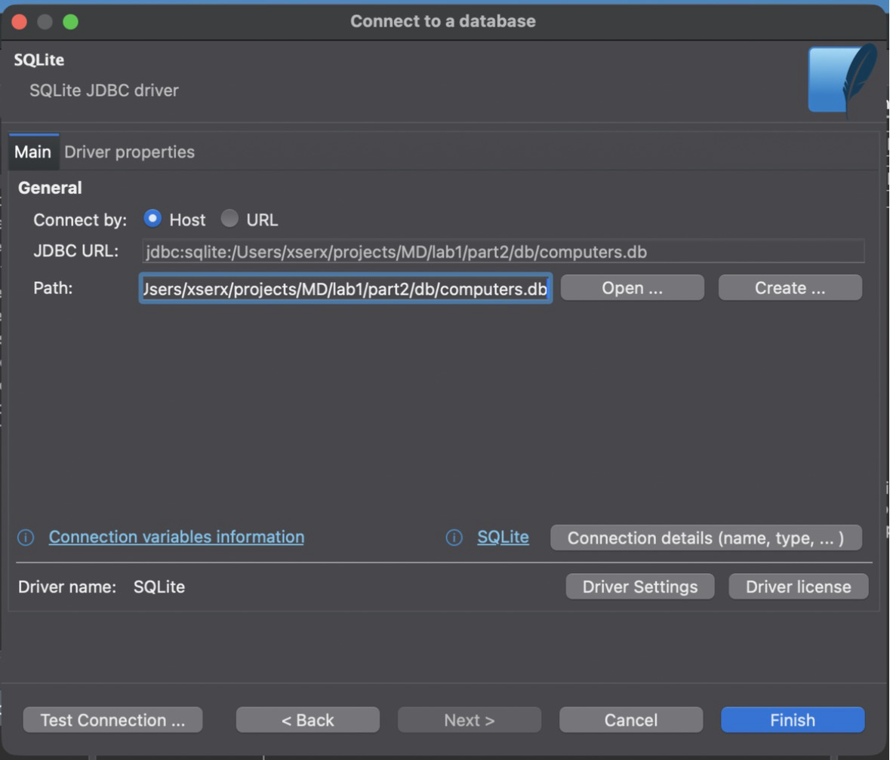
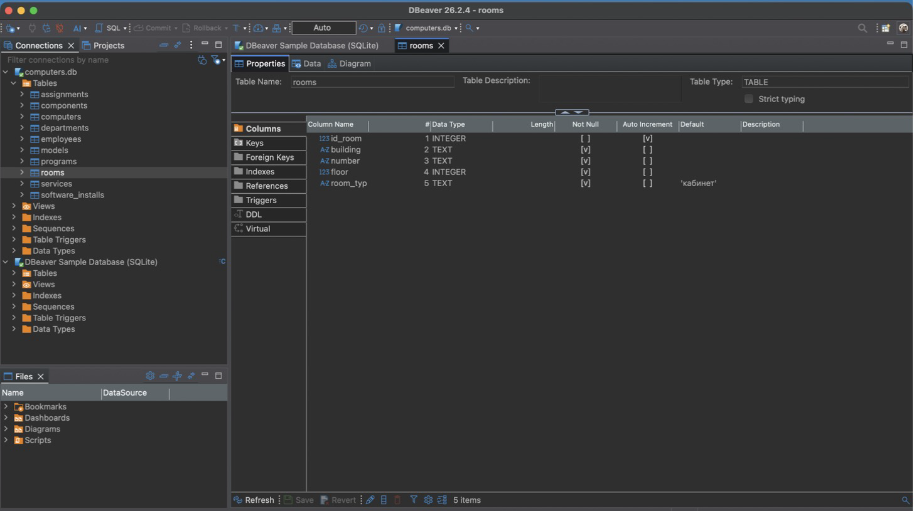
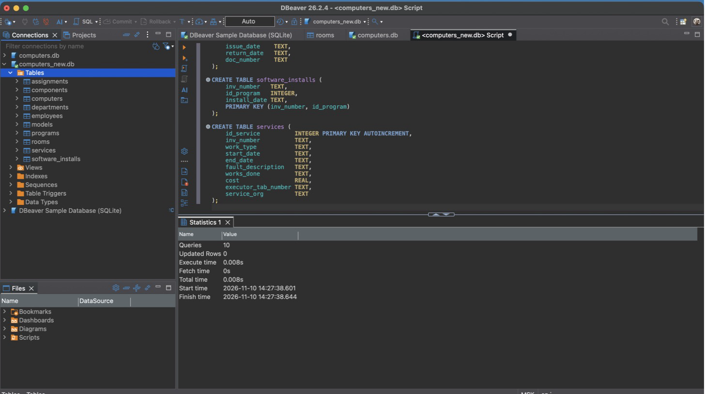
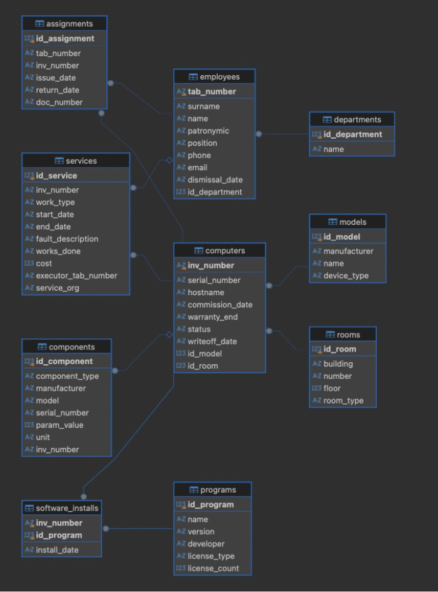
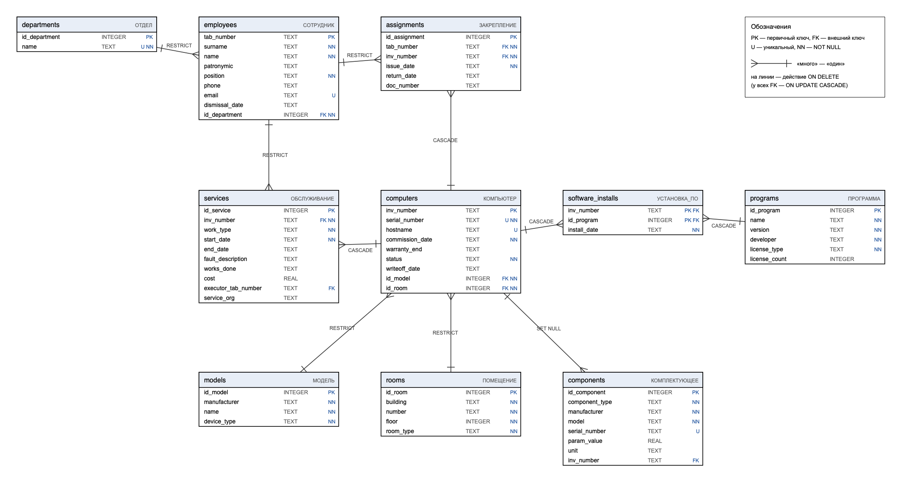

# Лабораторная работа № 1 (часть 2)

## «Создание базы данных в DBeaver и обеспечение целостности таблиц»

**Дисциплина:** Модели данных
**Тема:** АС учёта компьютеров, используемых фирмой

---

## 1. Цель работы

Создать базу данных SQLite для предметной области «Учёт компьютеров, используемых фирмой» в среде DBeaver: часть таблиц — через визуальный конструктор, часть — через SQL-редактор. Обеспечить целостность данных ограничениями NOT NULL, UNIQUE, CHECK, DEFAULT, FOREIGN KEY с каскадными операциями и проверить работу ограничений на тестовых данных.

## 2. Состав работы

| Файл | Назначение |
| --- | --- |
| `db/computers.db` | база данных SQLite |
| `sql/01_tables_gui.sql` | DDL таблиц, созданных в визуальном конструкторе DBeaver |
| `sql/02_tables_sql.sql` | таблицы, созданные в SQL-редакторе DBeaver |
| `sql/03_constraints.sql` | добавление ограничений целостности |
| `sql/04_seed.sql` | тестовые данные |
| `sql/05_constraint_tests.sql` | проверка ограничений на некорректных данных |
| `schema_export.sql` | экспортированный SQL-скрипт структуры базы |
| `backup/computers_2026-11-09.db` | резервная копия базы |
| `scripts/build_db.py` | сборка базы из скриптов 01–04, экспорт структуры, резервная копия |
| `scripts/check_constraints.py` | автоматический прогон проверок ограничений |
| `scripts/validate_rules.py` | проверка межтабличных бизнес-правил |

## 3. Создание базы данных в DBeaver

1. «База данных → Новое соединение» → тип **SQLite** → «Далее».
2. В поле «Путь» указан новый файл `computers.db`; так как файла нет, DBeaver создаёт пустую базу.
3. На вкладке «Свойства драйвера» задано `foreign_keys = true`. Без этого SQLite не проверяет внешние ключи: проверка включается для каждого соединения отдельно (`PRAGMA foreign_keys = ON`).
4. «Тест соединения» → «Готово». Соединение появилось в Database Navigator.



*Рисунок 1 — Создание соединения с новой базой SQLite в DBeaver*

## 4. Переход от инфологической модели к таблицам

Каждая сущность инфологической модели из части 1 стала таблицей, атрибут — столбцом, идентификатор — первичным ключом. Связи 1:М реализованы внешним ключом в таблице на стороне «М». Ассоциативные сущности (связи М:М) стали отдельными таблицами с двумя внешними ключами.

| Сущность | Таблица | Первичный ключ | Внешние ключи |
| --- | --- | --- | --- |
| ОТДЕЛ | `departments` | `id_department` | — |
| ПОМЕЩЕНИЕ | `rooms` | `id_room` | — |
| МОДЕЛЬ | `models` | `id_model` | — |
| СОТРУДНИК | `employees` | `tab_number` | `id_department` → departments |
| КОМПЬЮТЕР | `computers` | `inv_number` | `id_model` → models, `id_room` → rooms |
| КОМПЛЕКТУЮЩЕЕ | `components` | `id_component` | `inv_number` → computers |
| ПРОГРАММА | `programs` | `id_program` | — |
| ЗАКРЕПЛЕНИЕ (М:М) | `assignments` | `id_assignment` | `tab_number` → employees, `inv_number` → computers |
| УСТАНОВКА_ПО (М:М) | `software_installs` | (`inv_number`, `id_program`) | `inv_number` → computers, `id_program` → programs |
| ОБСЛУЖИВАНИЕ | `services` | `id_service` | `inv_number` → computers, `executor_tab_number` → employees |

Домены отображены на классы хранения SQLite так:

| Домен из части 1 | Тип SQLite | Как обеспечивается домен |
| --- | --- | --- |
| Д_КОД | INTEGER | PRIMARY KEY AUTOINCREMENT |
| Д_ИНВ_НОМЕР, Д_ТАБ_НОМЕР | TEXT | CHECK с шаблоном GLOB |
| Д_ДАТА | TEXT (ISO 8601, «ГГГГ-ММ-ДД») | CHECK (`x IS date(x)`) |
| Д_ДЕНЬГИ, Д_ЗНАЧЕНИЕ | REAL | CHECK (`x >= 0`, `x > 0`) |
| Д_ЭТАЖ, Д_КОЛИЧЕСТВО | INTEGER | CHECK с диапазоном |
| перечислимые (Д_СОСТОЯНИЕ и др.) | TEXT | CHECK (`x IN (...)`) |
| строковые (Д_НАЗВАНИЕ и др.) | TEXT | NOT NULL, CHECK (`length(trim(x)) > 0`) |

## 5. Создание таблиц

### 5.1. Через визуальный конструктор

Таблицы-справочники `departments`, `rooms`, `models` созданы через «Таблицы → Создать новую таблицу». В конструкторе на вкладке «Колонки» добавлены столбцы и выбраны типы, у ключевого столбца отмечены «Primary key» и «Auto increment». При сохранении DBeaver показывает сгенерированный DDL и выполняет его.



*Рисунок 2 — Таблица rooms в визуальном конструкторе DBeaver*

DDL, сгенерированный конструктором (`sql/01_tables_gui.sql`):

```sql
CREATE TABLE departments (
    id_department INTEGER PRIMARY KEY AUTOINCREMENT,
    name          TEXT
);

CREATE TABLE rooms (
    id_room   INTEGER PRIMARY KEY AUTOINCREMENT,
    building  TEXT,
    number    TEXT,
    floor     INTEGER,
    room_type TEXT
);

CREATE TABLE models (
    id_model     INTEGER PRIMARY KEY AUTOINCREMENT,
    manufacturer TEXT,
    name         TEXT,
    device_type  TEXT
);
```

### 5.2. Через SQL-редактор

Остальные семь таблиц созданы скриптом `sql/02_tables_sql.sql`: «Редактор SQL → Новый SQL-скрипт», затем «Выполнить скрипт» (Alt+X). Фрагмент скрипта:

```sql
CREATE TABLE computers (
    inv_number      TEXT PRIMARY KEY,
    serial_number   TEXT,
    hostname        TEXT,
    commission_date TEXT,
    warranty_end    TEXT,
    status          TEXT,
    writeoff_date   TEXT,
    id_model        INTEGER,
    id_room         INTEGER
);

CREATE TABLE software_installs (
    inv_number   TEXT,
    id_program   INTEGER,
    install_date TEXT,
    PRIMARY KEY (inv_number, id_program)
);
```



*Рисунок 3 — Выполнение скрипта создания таблиц в SQL-редакторе DBeaver*

### 5.3. Сравнение подходов

| Критерий | Визуальный конструктор | SQL-редактор |
| --- | --- | --- |
| Порог входа | не нужно знать синтаксис CREATE TABLE | нужно знать SQL |
| Скорость для многих таблиц | медленно: каждый столбец добавляется вручную | быстро: весь скрипт выполняется за раз |
| Воспроизводимость | действие не сохраняется; DDL можно лишь скопировать после | скрипт хранится в файле и повторяется на любой базе |
| Сложные ограничения (CHECK с выражениями, составные ключи) | неудобно: часть настроек спрятана в отдельных вкладках | пишутся явно рядом со столбцами |
| Контроль ошибок | ошибки типов видны сразу, имена не опечатаешь в ссылках | ошибка видна только при выполнении |
| Контроль версий | нет | скрипты лежат в Git вместе с отчётом |

Для разовой правки справочника удобен конструктор. Для проектирования всей схемы удобнее SQL-скрипт: его можно перечитать, повторить и сравнить с предыдущей версией.

### 5.4. Проверка, что все таблицы созданы

```sql
SELECT name FROM sqlite_master WHERE type = 'table' AND name NOT LIKE 'sqlite_%' ORDER BY name;
```

Результат — 10 таблиц: `assignments`, `components`, `computers`, `departments`, `employees`, `models`, `programs`, `rooms`, `services`, `software_installs`.

## 6. Экспорт структуры и резервное копирование

**SQL-скрипт структуры** получен через «ПКМ по базе → Сгенерировать SQL → DDL» и сохранён в `schema_export.sql`. Тот же файл формирует `scripts/build_db.py` по таблице `sqlite_master`. Полный текст итоговой структуры приведён в приложении А.

**Резервная копия.** База SQLite — один файл, поэтому резервная копия — это его копия. Соединение в DBeaver отключено («Отключиться»), файл `db/computers.db` скопирован в `backup/computers_2026-11-09.db`. Копия открывается в DBeaver как отдельное соединение и содержит те же данные.

## 7. ER-диаграмма DBeaver и сравнение с инфологической моделью

ER-диаграмма построена через «ПКМ по базе → Просмотр диаграммы» (рисунок 4). Та же физическая схема, сгенерированная по структуре базы, приведена на рисунке 5.



*Рисунок 4 — ER-диаграмма базы данных в DBeaver*



*Рисунок 5 — Физическая схема базы данных (таблицы, ключи, внешние ключи и действия ON DELETE)*

| Признак | Инфологическая модель (нотация Чена, часть 1) | ER-диаграмма DBeaver |
| --- | --- | --- |
| Уровень | концептуальный, не зависит от СУБД | физический, конкретная база SQLite |
| Связь | ромб с именем-глаголом, тип 1:М / М:М | линия между таблицами по внешнему ключу, без имени |
| Связь М:М | ассоциативная сущность (прямоугольник с ромбом) | обычная таблица с двумя внешними ключами |
| Атрибуты | овалы, без типов | столбцы с типами, отметками PK и FK |
| Внешние ключи | не показываются: связь задана ромбом | показаны столбцами (`id_model`, `inv_number` и т.д.) |
| Обязательность участия | двойная / одинарная линия | косвенно: NOT NULL у столбца внешнего ключа |
| Ограничения, домены | описаны текстом (БО, ОЦ, домены) | не видны; видны только ключи |

Состав сущностей и связей совпадает: 10 таблиц соответствуют 10 сущностям, 10 внешних ключей соответствуют 6 связям 1:М и двум связям М:М (по два ключа у каждой ассоциативной таблицы). Расхождений между моделями нет. Изменились только технические детали: появились суррогатные ключи `id_*` у справочников и внешние ключи как столбцы.

## 8. Ограничения целостности

SQLite не поддерживает `ALTER TABLE ... ADD CONSTRAINT`. Поэтому ограничения добавлены пересозданием таблиц (`sql/03_constraints.sql`): новая таблица с ограничениями → перенос данных → удаление старой → переименование. Так же поступает DBeaver, когда ограничение меняют в конструкторе. Всё выполняется в одной транзакции при выключенной проверке внешних ключей, после неё — `PRAGMA foreign_key_check`.

```sql
PRAGMA foreign_keys = OFF;
BEGIN TRANSACTION;

CREATE TABLE departments_new (
    id_department INTEGER PRIMARY KEY AUTOINCREMENT,
    name          TEXT    NOT NULL UNIQUE CHECK (length(trim(name)) > 0)
);
INSERT INTO departments_new (id_department, name)
SELECT id_department, name FROM departments;
DROP TABLE departments;
ALTER TABLE departments_new RENAME TO departments;

COMMIT;
PRAGMA foreign_keys = ON;
PRAGMA foreign_key_check;
```

### 8.1. Связанные таблицы и внешние ключи

| Дочерняя таблица.столбец | Родительская таблица | ON UPDATE | ON DELETE | Обоснование ON DELETE |
| --- | --- | --- | --- | --- |
| employees.id_department | departments | CASCADE | RESTRICT | нельзя удалить отдел, в котором работают сотрудники |
| computers.id_model | models | CASCADE | RESTRICT | нельзя удалить модель, если есть компьютеры этой модели |
| computers.id_room | rooms | CASCADE | RESTRICT | нельзя удалить помещение, в котором стоят компьютеры |
| components.inv_number | computers | CASCADE | SET NULL | комплектующее удалённого компьютера остаётся на складе |
| assignments.tab_number | employees | CASCADE | RESTRICT | история закреплений сотрудника должна сохраняться |
| assignments.inv_number | computers | CASCADE | CASCADE | при удалении ошибочно внесённого компьютера удаляется его история |
| software_installs.inv_number | computers | CASCADE | CASCADE | установки ПО не имеют смысла без компьютера |
| software_installs.id_program | programs | CASCADE | CASCADE | при удалении программы из каталога удаляются её установки |
| services.inv_number | computers | CASCADE | CASCADE | обслуживание не имеет смысла без компьютера |
| services.executor_tab_number | employees | CASCADE | RESTRICT | SET NULL нарушил бы БО7 (не останется исполнителя) |

ON UPDATE CASCADE задан для всех ключей: смена значения ключа (например, перенумерация инвентарных номеров) автоматически распространяется на все ссылки. ON DELETE CASCADE выбран только для записей, зависимых от компьютера и программы. Удалять сотрудников и справочники каскадно было бы опасно: так терялась бы история.

### 8.2. NOT NULL, UNIQUE, DEFAULT, CHECK

| Вид | Где применено | Что реализует |
| --- | --- | --- |
| NOT NULL | ключи, имена и названия, обязательные даты, внешние ключи обязательных связей | обязательные атрибуты и связи (ОЦ2) |
| NOT NULL у текстового PK | `employees.tab_number`, `computers.inv_number` | в SQLite PRIMARY KEY не целочисленного типа допускает NULL — исторический дефект |
| UNIQUE | `computers.serial_number`, `computers.hostname`, `employees.email`, `departments.name`, `components.serial_number` | ОЦ1 |
| UNIQUE составной | `rooms (building, number)`, `models (manufacturer, name)`, `programs (name, version)` | ОЦ1 |
| Частичный уникальный индекс | `assignments (inv_number) WHERE return_date IS NULL` | БО1: не более одного действующего закрепления |
| Частичный уникальный индекс | `services (inv_number) WHERE end_date IS NULL` | не более одного незавершённого обслуживания (БО4) |
| DEFAULT | `computers.status = 'в резерве'`, `rooms.room_type = 'кабинет'`, `models.device_type`, `programs.license_type = 'бесплатная'`, `services.work_type = 'ремонт'`, даты = `date('now')` | значения, которые чаще всего вводятся при создании записи |
| CHECK на домен | перечисления (`status IN (...)`), формат (`inv_number GLOB 'ПК-[0-9]...'`), диапазоны (`floor BETWEEN -3 AND 50`), даты (`x IS date(x)`) | домены из раздела 6.2 части 1 |
| CHECK межстолбцовый | `return_date >= issue_date`, `end_date >= start_date`, `warranty_end >= commission_date` | ОЦ3 |
| CHECK на бизнес-правило | `(status = 'списан') = (writeoff_date IS NOT NULL)` | БО5 |
| CHECK на бизнес-правило | `(executor_tab_number IS NULL) <> (service_org IS NULL)` | БО7 |
| CHECK на бизнес-правило | `(license_type = 'бесплатная') = (license_count IS NULL)` | БО9 |

Индексы по столбцам внешних ключей (`ix_*`) созданы для ускорения соединений и проверок при каскадных операциях.

### 8.3. Правила, которые не выражаются ограничениями таблицы

CHECK в SQLite видит только одну строку своей таблицы. Поэтому правила, сравнивающие данные разных таблиц, ограничениями не задаются:

- БО2 — закрепить можно только за неуволенным сотрудником;
- БО3 — согласованность состояния компьютера с закреплением и типом помещения;
- БО6 — закрепления уволенного сотрудника завершены;
- БО8 — число установок не превышает число лицензий.

Их соблюдение в тестовых данных проверяет `scripts/validate_rules.py`. В приложении (ЛР3) эти правила проверяются перед сохранением.

## 9. Тестовые данные

Данные (`sql/04_seed.sql`, генерируются `scripts/seed.py`) согласованы со сценариями и бизнес-правилами части 1:

| Таблица | Строк | Особенности |
| --- | --- | --- |
| departments | 7 | «Отдел логистики» без сотрудников |
| rooms | 11 | 2 склада, серверная, пустой кабинет 115 |
| models | 11 | модель Huawei без компьютеров |
| employees | 17 | 2 уволенных, у части нет телефона, e-mail или отчества |
| computers | 30 | в эксплуатации 19, в резерве 4, в ремонте 3, списано 4 |
| components | 122 | 10 на складе |
| programs | 14 | AutoCAD куплен, но не установлен |
| assignments | 27 | 17 действующих, 10 завершённых |
| software_installs | 120 | Photoshop занимает обе лицензии |
| services | 22 | 3 незавершённых |

Результат `scripts/validate_rules.py` — все 11 проверок пройдены:

```
БО1  не более одного действующего закрепления у компьютера          ok
БО2  действующие закрепления только за неуволенными сотрудниками    ok
БО3  «в резерве» — без закрепления и на складе                      ok
БО3  «в эксплуатации» — есть закрепление или стоит в серверной      ok
БО4  «в ремонте» ⇔ есть незавершённое обслуживание                  ok
БО5  у списанного нет действующего закрепления                      ok
БО6  закрепления уволенного завершены не позже даты увольнения      ok
БО8  установок платной программы не больше, чем лицензий            ok
ОЦ3  закрепление в пределах срока эксплуатации компьютера           ok
ОЦ3  обслуживание в пределах срока эксплуатации компьютера          ok
ОЦ5  периоды закреплений одного компьютера не пересекаются          ok
```

## 10. Проверка работы ограничений

Проверки собраны в `sql/05_constraint_tests.sql`. Скрипт выполняется в DBeaver целиком: весь он обёрнут в `BEGIN … ROLLBACK`, поэтому база не меняется. В SQLite ошибка ограничения отменяет только одну инструкцию, транзакция продолжается. Каждая проверка предваряется строкой `SELECT 'Tnn | ...'` с её описанием. Тот же набор автоматически прогоняет `scripts/check_constraints.py` (каждая проверка — в точке сохранения с откатом). Его результат:

| № | Ограничение | Проверка | Ожидалось | Результат SQLite |
| --- | --- | --- | --- | --- |
| T01 | NOT NULL | Сотрудник без фамилии | ошибка | ✔ NOT NULL constraint failed: employees.surname |
| T02 | NOT NULL | Компьютер без серийного номера | ошибка | ✔ NOT NULL constraint failed: computers.serial_number |
| T03 | NOT NULL | Текстовый первичный ключ равен NULL | ошибка | ✔ NOT NULL constraint failed: computers.inv_number |
| T04 | UNIQUE | Повтор серийного номера компьютера | ошибка | ✔ UNIQUE constraint failed: computers.serial_number |
| T05 | UNIQUE | Повтор пары «здание + номер» помещения | ошибка | ✔ UNIQUE constraint failed: rooms.building, rooms.number |
| T06 | UNIQUE | Повтор e-mail сотрудника | ошибка | ✔ UNIQUE constraint failed: employees.email |
| T07 | UNIQUE (частичный индекс) | Второе действующее закрепление компьютера (БО1) | ошибка | ✔ UNIQUE constraint failed: assignments.inv_number |
| T08 | PRIMARY KEY (составной) | Повторная установка программы на компьютер | ошибка | ✔ UNIQUE constraint failed: software_installs.inv_number, software_installs.id_program |
| T09 | DEFAULT | Помещение без типа получает «кабинет» | успех | ✔ выполнено; room_type=кабинет |
| T10 | DEFAULT | Новый компьютер: состояние и дата ввода по умолчанию | успех | ✔ выполнено; status=в резерве, today=1 |
| T11 | CHECK | Недопустимое состояние компьютера | ошибка | ✔ CHECK constraint failed: status IN ('в эксплуатации', 'в резерве', 'в ремонте', 'списан') |
| T12 | CHECK | Инвентарный номер не по формату «ПК-NNNNN» | ошибка | ✔ CHECK constraint failed: inv_number GLOB 'ПК-[0-9][0-9][0-9][0-9][0-9]' |
| T13 | CHECK | Этаж вне диапазона −3…50 | ошибка | ✔ CHECK constraint failed: floor BETWEEN -3 AND 50 |
| T14 | CHECK | Дата возврата раньше даты выдачи | ошибка | ✔ CHECK constraint failed: return_date IS NULL OR (return_date IS date(return_date) AND return_date >= issue_date) |
| T15 | CHECK | «Списан» без даты списания (БО5) | ошибка | ✔ CHECK constraint failed: (status = 'списан') = (writeoff_date IS NOT NULL) |
| T16 | CHECK | У обслуживания два исполнителя сразу (БО7) | ошибка | ✔ CHECK constraint failed: (executor_tab_number IS NULL) <> (service_org IS NULL) |
| T17 | CHECK | Платная программа без количества лицензий (БО9) | ошибка | ✔ CHECK constraint failed: (license_type = 'бесплатная') = (license_count IS NULL) |
| T18 | CHECK | Отрицательная стоимость обслуживания | ошибка | ✔ CHECK constraint failed: cost IS NULL OR cost >= 0 |
| T19 | CHECK | Дата в неверном формате | ошибка | ✔ CHECK constraint failed: warranty_end IS NULL OR (warranty_end IS date(warranty_end) AND warranty_end >= commission_date) |
| T20 | FOREIGN KEY | Сотрудник в несуществующем отделе | ошибка | ✔ FOREIGN KEY constraint failed |
| T21 | FOREIGN KEY, ON DELETE RESTRICT | Удаление отдела, в котором есть сотрудники | ошибка | ✔ FOREIGN KEY constraint failed |
| T22 | FOREIGN KEY, ON DELETE RESTRICT | Удаление сотрудника с историей закреплений | ошибка | ✔ FOREIGN KEY constraint failed |
| T23 | FOREIGN KEY, ON DELETE RESTRICT | Удаление модели без компьютеров | успех | ✔ выполнено; models_left=10 |
| T24 | ON UPDATE CASCADE | Смена инвентарного номера ПК-00007 → ПК-09999 | успех | ✔ выполнено; assignments=2, installs=6, services=1, components=4, old_refs=0 |
| T25 | ON UPDATE CASCADE | Смена кода ИТ-отдела 4 → 40 | успех | ✔ выполнено; moved=3, left_old=0 |
| T26 | ON DELETE CASCADE / SET NULL | Удаление компьютера ПК-00012 | успех | ✔ выполнено; assignments=0, services=0, installs=0, on_stock=13 |
| T27 | ON DELETE CASCADE | Удаление программы Adobe Photoshop | успех | ✔ выполнено; photoshop_installs=0 |

**Анализ ошибок.**

1. **NOT NULL** (T01–T03): SQLite называет таблицу и столбец, где не хватает значения. T03 показывает, зачем текстовому первичному ключу явное NOT NULL: без него строка с пустым ключом была бы вставлена.
2. **UNIQUE** (T04–T08): в сообщении перечислены столбцы ограничения. Для частичного индекса (T07) повтор допускается среди завершённых закреплений, но не среди действующих — так реализовано правило БО1.
3. **CHECK** (T11–T19): SQLite выводит текст нарушенного условия. По нему сразу видно, какое бизнес-правило не выполнено. Для понятных сообщений ограничениям можно давать имена (`CONSTRAINT ck_status CHECK (...)`).
4. **FOREIGN KEY** (T20–T22): сообщение не говорит, какой ключ нарушен. Причину приходится искать по смыслу операции или запросом `PRAGMA foreign_key_check`. Удаление при RESTRICT запрещено, пока на запись есть ссылки. Если ссылок нет, удаление разрешено (T23).
5. **Каскады** (T24–T27): при смене инвентарного номера обновились все 13 ссылок в четырёх таблицах, старых ссылок не осталось. При удалении компьютера каскадно удалены его закрепления, обслуживания и установки ПО, а 3 комплектующих переведены на склад (SET NULL: было 10, стало 13).

## 11. Выводы

1. База данных SQLite создана в DBeaver. 3 справочника созданы визуальным конструктором, 7 таблиц — SQL-скриптом. Для проектирования схемы SQL-скрипт удобнее: он воспроизводим и хранится в системе контроля версий.
2. Инфологическая модель из части 1 перенесена в базу без расхождений: 10 сущностей → 10 таблиц, связи М:М → ассоциативные таблицы с двумя внешними ключами.
3. Целостность обеспечена ограничениями всех требуемых видов: 10 внешних ключей с осмысленными действиями ON DELETE и ON UPDATE CASCADE, NOT NULL, UNIQUE (в том числе составные и частичные), DEFAULT и CHECK. Бизнес-правила БО1, БО5, БО7, БО9 реализованы на уровне базы.
4. Все 27 проверок дали ожидаемый результат: некорректные данные отклонены с понятной причиной, каскадные операции обновили и удалили связанные записи.
5. Межтабличные правила (БО2, БО3, БО6, БО8) обычными ограничениями не выражаются. Они проверены скриптом и будут контролироваться приложением.

---

## Приложение А. Итоговая структура базы данных (schema_export.sql)

```sql
CREATE TABLE "departments" (
    id_department INTEGER PRIMARY KEY AUTOINCREMENT,
    name          TEXT    NOT NULL UNIQUE CHECK (length(trim(name)) > 0)
);

CREATE TABLE "rooms" (
    id_room   INTEGER PRIMARY KEY AUTOINCREMENT,
    building  TEXT    NOT NULL CHECK (length(trim(building)) > 0),
    number    TEXT    NOT NULL CHECK (length(trim(number)) > 0),
    floor     INTEGER NOT NULL CHECK (floor BETWEEN -3 AND 50),
    room_type TEXT    NOT NULL DEFAULT 'кабинет'
                      CHECK (room_type IN ('кабинет', 'серверная', 'склад')),
    UNIQUE (building, number)
);

CREATE TABLE "models" (
    id_model     INTEGER PRIMARY KEY AUTOINCREMENT,
    manufacturer TEXT    NOT NULL CHECK (length(trim(manufacturer)) > 0),
    name         TEXT    NOT NULL CHECK (length(trim(name)) > 0),
    device_type  TEXT    NOT NULL DEFAULT 'настольный ПК'
                         CHECK (device_type IN ('настольный ПК', 'моноблок', 'ноутбук', 'сервер')),
    UNIQUE (manufacturer, name)
);

CREATE TABLE "employees" (
    tab_number     TEXT    NOT NULL PRIMARY KEY
                           CHECK (length(tab_number) = 6 AND tab_number NOT GLOB '*[^0-9]*'),
    surname        TEXT    NOT NULL CHECK (length(trim(surname)) > 0),
    name           TEXT    NOT NULL CHECK (length(trim(name)) > 0),
    patronymic     TEXT,
    position       TEXT    NOT NULL CHECK (length(trim(position)) > 0),
    phone          TEXT    CHECK (phone IS NULL OR phone NOT GLOB '*[^0-9+() -]*'),
    email          TEXT    UNIQUE CHECK (email IS NULL OR email LIKE '_%@_%._%'),
    dismissal_date TEXT    CHECK (dismissal_date IS NULL OR dismissal_date IS date(dismissal_date)),
    id_department  INTEGER NOT NULL
                           REFERENCES departments (id_department)
                           ON UPDATE CASCADE ON DELETE RESTRICT
);

CREATE TABLE "computers" (
    inv_number      TEXT    NOT NULL PRIMARY KEY
                            CHECK (inv_number GLOB 'ПК-[0-9][0-9][0-9][0-9][0-9]'),
    serial_number   TEXT    NOT NULL UNIQUE CHECK (length(trim(serial_number)) > 0),
    hostname        TEXT    UNIQUE
                            CHECK (hostname IS NULL OR (length(hostname) BETWEEN 1 AND 15
                                   AND hostname NOT GLOB '*[^A-Za-z0-9-]*')),
    commission_date TEXT    NOT NULL DEFAULT (date('now'))
                            CHECK (commission_date IS date(commission_date)),
    warranty_end    TEXT    CHECK (warranty_end IS NULL OR (warranty_end IS date(warranty_end)
                                   AND warranty_end >= commission_date)),
    status          TEXT    NOT NULL DEFAULT 'в резерве'
                            CHECK (status IN ('в эксплуатации', 'в резерве', 'в ремонте', 'списан')),
    writeoff_date   TEXT    CHECK (writeoff_date IS NULL OR (writeoff_date IS date(writeoff_date)
                                   AND writeoff_date >= commission_date)),
    id_model        INTEGER NOT NULL
                            REFERENCES models (id_model) ON UPDATE CASCADE ON DELETE RESTRICT,
    id_room         INTEGER NOT NULL
                            REFERENCES rooms (id_room) ON UPDATE CASCADE ON DELETE RESTRICT,

    CHECK ((status = 'списан') = (writeoff_date IS NOT NULL))
);

CREATE TABLE "components" (
    id_component   INTEGER PRIMARY KEY AUTOINCREMENT,
    component_type TEXT    NOT NULL
                           CHECK (component_type IN ('процессор', 'оперативная память', 'накопитель',
                                                     'видеокарта', 'материнская плата', 'блок питания')),
    manufacturer   TEXT    NOT NULL,
    model          TEXT    NOT NULL,
    serial_number  TEXT    UNIQUE,
    param_value    REAL    CHECK (param_value IS NULL OR param_value > 0),
    unit           TEXT    CHECK (unit IS NULL OR unit IN ('ГБ', 'ТБ', 'ГГц', 'Вт')),

    inv_number     TEXT    REFERENCES computers (inv_number)
                           ON UPDATE CASCADE ON DELETE SET NULL,

    CHECK ((param_value IS NULL) = (unit IS NULL))
);

CREATE TABLE "programs" (
    id_program    INTEGER PRIMARY KEY AUTOINCREMENT,
    name          TEXT    NOT NULL CHECK (length(trim(name)) > 0),
    version       TEXT    NOT NULL,
    developer     TEXT    NOT NULL,
    license_type  TEXT    NOT NULL DEFAULT 'бесплатная'
                          CHECK (license_type IN ('бесплатная', 'коммерческая', 'подписка')),
    license_count INTEGER CHECK (license_count IS NULL OR license_count > 0),
    UNIQUE (name, version),

    CHECK ((license_type = 'бесплатная') = (license_count IS NULL))
);

CREATE TABLE "assignments" (
    id_assignment INTEGER PRIMARY KEY AUTOINCREMENT,
    tab_number    TEXT    NOT NULL
                          REFERENCES employees (tab_number) ON UPDATE CASCADE ON DELETE RESTRICT,
    inv_number    TEXT    NOT NULL
                          REFERENCES computers (inv_number) ON UPDATE CASCADE ON DELETE CASCADE,
    issue_date    TEXT    NOT NULL DEFAULT (date('now')) CHECK (issue_date IS date(issue_date)),
    return_date   TEXT    CHECK (return_date IS NULL OR (return_date IS date(return_date)
                                 AND return_date >= issue_date)),
    doc_number    TEXT
);

CREATE TABLE "software_installs" (
    inv_number   TEXT    NOT NULL
                         REFERENCES computers (inv_number) ON UPDATE CASCADE ON DELETE CASCADE,
    id_program   INTEGER NOT NULL
                         REFERENCES programs (id_program) ON UPDATE CASCADE ON DELETE CASCADE,
    install_date TEXT    NOT NULL DEFAULT (date('now')) CHECK (install_date IS date(install_date)),

    PRIMARY KEY (inv_number, id_program)
);

CREATE TABLE "services" (
    id_service          INTEGER PRIMARY KEY AUTOINCREMENT,
    inv_number          TEXT    NOT NULL
                                REFERENCES computers (inv_number) ON UPDATE CASCADE ON DELETE CASCADE,
    work_type           TEXT    NOT NULL DEFAULT 'ремонт'
                                CHECK (work_type IN ('ремонт', 'модернизация', 'профилактика', 'диагностика')),
    start_date          TEXT    NOT NULL DEFAULT (date('now')) CHECK (start_date IS date(start_date)),
    end_date            TEXT    CHECK (end_date IS NULL OR (end_date IS date(end_date)
                                       AND end_date >= start_date)),
    fault_description   TEXT,
    works_done          TEXT,
    cost                REAL    CHECK (cost IS NULL OR cost >= 0),
    executor_tab_number TEXT    REFERENCES employees (tab_number) ON UPDATE CASCADE ON DELETE RESTRICT,
    service_org         TEXT    CHECK (service_org IS NULL OR length(trim(service_org)) > 0),

    CHECK ((executor_tab_number IS NULL) <> (service_org IS NULL))
);

CREATE INDEX ix_assignments_computer ON assignments (inv_number);

CREATE INDEX ix_assignments_employee ON assignments (tab_number);

CREATE INDEX ix_components_computer ON components (inv_number);

CREATE INDEX ix_computers_model ON computers (id_model);

CREATE INDEX ix_computers_room ON computers (id_room);

CREATE INDEX ix_employees_department ON employees (id_department);

CREATE INDEX ix_installs_program ON software_installs (id_program);

CREATE INDEX ix_services_computer ON services (inv_number);

CREATE INDEX ix_services_executor ON services (executor_tab_number);

CREATE UNIQUE INDEX ux_assignments_active ON assignments (inv_number) WHERE return_date IS NULL;

CREATE UNIQUE INDEX ux_services_open ON services (inv_number) WHERE end_date IS NULL;
```

## Приложение Б. Ответы на контрольные вопросы

1. **Назначение DBeaver.** Универсальный клиент баз данных: соединения, навигация по объектам, редактирование данных, SQL-редактор, ER-диаграммы, импорт и экспорт. Поддерживает SQLite, PostgreSQL, MySQL, Oracle, SQL Server и другие СУБД через JDBC-драйверы.
2. **Особенность SQLite.** Встраиваемая СУБД без сервера: библиотека работает внутри приложения, база — один файл. Нет пользователей и сетевого доступа; одновременно пишет только один процесс.
3. **Создание базы в DBeaver.** Новое соединение → SQLite → путь к несуществующему файлу → DBeaver создаёт пустую базу.
4. **База SQLite с точки зрения хранения.** Один кроссплатформенный файл со всеми таблицами, индексами и схемой.
5. **Таблица.** Именованный набор строк одинаковой структуры. Состоит из столбцов (имя, тип, ограничения), строк-записей, первичного ключа и ограничений.
6. **Классы хранения SQLite.** NULL, INTEGER, REAL, TEXT, BLOB.
7. **Особенность типов в SQLite.** Динамическая типизация: тип хранится вместе со значением, у столбца есть только «предпочтительный» тип (type affinity). В столбец INTEGER можно записать строку, если не запрещено ограничением или режимом STRICT.
8. **CREATE TABLE.** Создаёт таблицу: `CREATE TABLE имя (столбец тип [ограничения], ..., [ограничения таблицы]);`.
9. **PRIMARY KEY.** Столбец или набор столбцов, однозначно идентифицирующий строку: уникален и используется для ссылок из других таблиц.
10. **AUTOINCREMENT.** Ключ INTEGER PRIMARY KEY получает следующее значение автоматически. AUTOINCREMENT дополнительно гарантирует, что значения удалённых строк не будут выданы повторно. Применяется для суррогатных ключей.
11. **Способы создания таблиц в DBeaver.** Визуальный конструктор (без SQL, DDL генерируется) и SQL-редактор (DDL пишется вручную). Сравнение — в разделе 5.3.
12. **SQL-скрипт.** Файл с последовательностью SQL-команд. Используется для воспроизводимого создания и изменения схемы, заполнения данными, переноса базы.
13. **Целостность данных.** Корректность и непротиворечивость хранимых данных. Нужна, чтобы в базе не появлялись ошибочные значения, «висячие» ссылки и нарушения правил предметной области.
14. **Ограничения (constraints).** Правила, которые СУБД проверяет автоматически при INSERT, UPDATE и DELETE (внешние ключи — также при изменении родительской таблицы).
15. **Способы задать ограничения в SQLite.** В CREATE TABLE (у столбца или для таблицы); пересозданием таблицы, так как ALTER TABLE ADD CONSTRAINT не поддерживается; уникальными (частичными) индексами; триггерами; через конструктор DBeaver.
16. **NOT NULL.** Запрещает пустое значение. Нужен для обязательных атрибутов, ключей и внешних ключей обязательных связей.
17. **UNIQUE и PRIMARY KEY.** UNIQUE запрещает повторы, но допускает несколько NULL и может быть у нескольких столбцов таблицы. Первичный ключ один на таблицу и служит для ссылок.
18. **Составной UNIQUE.** Уникальность сочетания значений, например `UNIQUE (building, number)`: номера кабинетов повторяются в разных зданиях, но не в одном.
19. **DEFAULT.** Значение, подставляемое при отсутствии явного: начальное состояние (`'в резерве'`), текущая дата, частое значение.
20. **CHECK.** Логическое условие для значения строки: диапазоны, перечисления, формат, сравнение столбцов одной строки (БО5, БО7, БО9 в этой работе).
21. **FOREIGN KEY.** Столбец, значения которого должны существовать в первичном ключе другой таблицы. Обеспечивает ссылочную целостность.
22. **Требования внешних ключей.** Значение внешнего ключа — либо NULL, либо существующий ключ родителя. «Висячая» ссылка — значение, указывающее на несуществующую запись.
23. **Каскадные операции.** Автоматические действия с дочерними строками при изменении родителя. ON DELETE CASCADE удаляет дочерние строки, ON UPDATE CASCADE переписывает в них новое значение ключа.
24. **Действия, нарушающие ограничения.** Вставка NULL, повтора или значения вне домена; ссылка на несуществующую запись; удаление родителя при RESTRICT. Ошибки: `NOT NULL constraint failed`, `UNIQUE constraint failed`, `CHECK constraint failed`, `FOREIGN KEY constraint failed`.
25. **Почему целостность — на уровне базы.** Базой пользуются разные приложения и скрипты (DBeaver, импорт, Python). Ограничения в базе действуют для всех, а проверки в одном приложении легко обойти или забыть.
