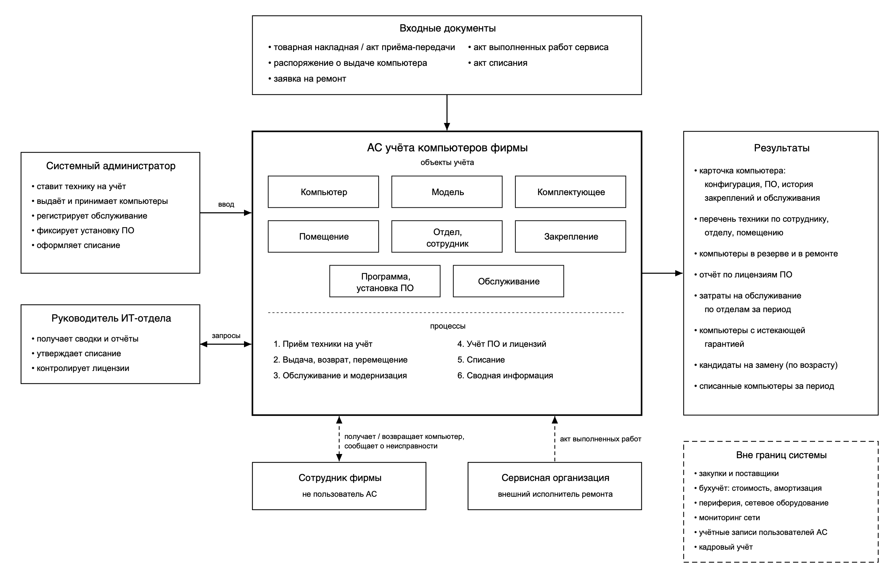
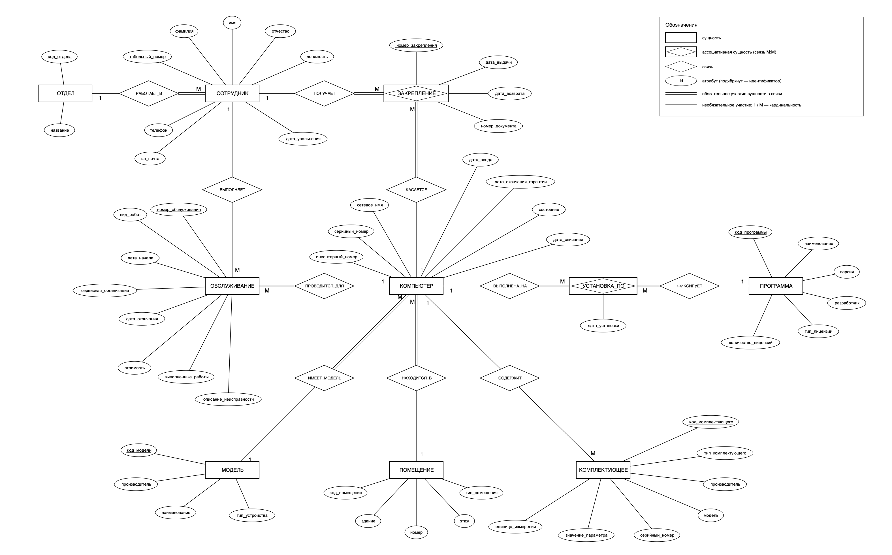

# Лабораторная работа № 1 (часть 1)

## «Исследование предметной области с использованием ИИ и построение инфологической модели»

**Дисциплина:** Модели данных
**Тема:** АС учёта компьютеров, используемых фирмой

---

## 1. Название и назначение системы

**Название:** Автоматизированная система учёта компьютеров, используемых фирмой (далее — АС, система).

**Назначение.** Система предназначена для ведения единого учёта компьютерной техники фирмы (настольных ПК, моноблоков, ноутбуков и серверов) на всём её жизненном цикле: от постановки на учёт до списания. Система хранит сведения о каждом компьютере, его модели и комплектующих, о помещении, в котором он находится, о сотруднике, за которым он закреплён (с историей закреплений), об установленном программном обеспечении и о проведённом обслуживании и ремонтах. Это позволяет в любой момент ответить на вопросы «где находится компьютер и кто за него отвечает», «какая у него конфигурация», «хватает ли лицензий на ПО» и «сколько фирма тратит на обслуживание техники».

### 1.1. Границы системы

| Входит в систему | Не входит в систему |
| --- | --- |
| Учёт компьютеров (ПК, моноблоки, ноутбуки, серверы) и их моделей | Периферия и оргтехника (мониторы, принтеры, МФУ), сетевое оборудование |
| Учёт комплектующих, установленных в компьютеры или лежащих на складе | Закупка техники, поставщики, договоры поставки |
| Закрепление компьютеров за сотрудниками и история закреплений | Бухгалтерский учёт: стоимость, амортизация, налоги |
| Текущее размещение компьютеров по помещениям | Мониторинг сети и удалённое администрирование |
| Учёт установленного ПО и количества лицензий | Учётные записи и права доступа пользователей самой АС |
| Учёт обслуживания, ремонтов и модернизации | Кадровый учёт (приём, отпуска, зарплата) — из него берутся только справочные данные о сотрудниках |
| Списание компьютеров | История замен комплектующих (хранится только текущее состояние) |

---

## 2. Словарь ключевых терминов

| Термин | Определение | Синонимы | Отличие от близких понятий |
| --- | --- | --- | --- |
| **Компьютер** | Единица вычислительной техники фирмы (настольный ПК, моноблок, ноутбук или сервер), учитываемая под собственным инвентарным номером | ПК, рабочая станция, единица техники | Не путать с **моделью**: модель — это тип изделия («Lenovo ThinkCentre M70q»), а компьютер — конкретный экземпляр с серийным номером |
| **Инвентарный номер** | Уникальный номер, присваиваемый компьютеру фирмой при постановке на учёт | Инв. №, учётный номер | Присваивается фирмой; **серийный номер** присваивает производитель |
| **Модель** | Тип компьютера, задаваемый производителем, наименованием и типом устройства | Модель устройства | Одной модели соответствует много компьютеров |
| **Комплектующее (компонент)** | Отдельно учитываемая составная часть компьютера: процессор, модуль памяти, накопитель, видеокарта, материнская плата, блок питания | Деталь, комплектующая | Может находиться вне компьютера (на складе), поэтому является сущностью, а не атрибутом компьютера |
| **Сотрудник** | Работник фирмы, за которым может быть закреплён компьютер или который выполняет обслуживание | Работник, пользователь ПК | Не является пользователем АС; пользователи АС — роли (п. 3.1) |
| **Отдел** | Структурное подразделение фирмы, в котором работает сотрудник | Подразделение | — |
| **Помещение** | Место размещения компьютера: кабинет, серверная или склад | Кабинет, место размещения | Склад — тоже помещение (тип «склад»), отдельной сущности «Склад» нет |
| **Закрепление** | Факт передачи компьютера сотруднику в пользование и под ответственность на период с даты выдачи по дату возврата | Выдача, передача в пользование | Закрепление — за **сотрудником**; размещение — в **помещении**. Это разные связи: ноутбук может быть закреплён за сотрудником и находиться на складе |
| **Действующее закрепление** | Закрепление, у которого не заполнена дата возврата | Текущее закрепление | Завершённое закрепление остаётся в истории |
| **Программа (ПО)** | Конкретная версия программного продукта, которая может устанавливаться на компьютеры | Программное обеспечение, софт | Программа с другой версией — другая программа |
| **Установка ПО** | Факт наличия программы на конкретном компьютере | Инсталляция | Удалённая программа удаляется из учёта установок |
| **Лицензия** | Право использования программы на одном компьютере; учитывается только их количество | — | Отдельной сущности нет, количество лицензий — атрибут программы |
| **Обслуживание** | Работы над конкретным компьютером: ремонт, модернизация, профилактика, диагностика | Ремонт, сервисная работа | Ремонт — один из видов обслуживания |
| **Состояние компьютера** | Текущий статус: «в эксплуатации», «в резерве», «в ремонте», «списан» | Статус | «В резерве» — исправен, но не закреплён ни за кем |
| **Списание** | Окончательный вывод компьютера из эксплуатации с фиксацией даты списания | Вывод из эксплуатации | Списанный компьютер остаётся в базе для истории |

---

## 3. Роли, пользовательские сценарии и бизнес-процессы

### 3.1. Роли

1. **Системный администратор** — основной пользователь системы: ставит технику на учёт, выдаёт и принимает компьютеры, регистрирует обслуживание, установку ПО и списание.
2. **Руководитель ИТ-отдела** — получает сводную информацию (распределение техники, лицензии, затраты, гарантии) и утверждает списание.

Сотрудники фирмы не работают с системой: они — участники процессов и объекты учёта (за ними закрепляются компьютеры).

### 3.2. Пользовательские сценарии

**С1. Постановка нового компьютера на учёт** (системный администратор).
Фирма получила компьютер по накладной. Администратор находит его модель в справочнике (или добавляет новую), вводит серийный номер, присваивает инвентарный номер, указывает дату ввода в эксплуатацию и дату окончания гарантии. Затем регистрирует основные комплектующие (процессор, память, накопитель). Компьютер размещается на складе в состоянии «в резерве».

**С2. Выдача компьютера сотруднику и возврат** (системный администратор).
По распоряжению руководителя администратор выбирает компьютер в резерве и сотрудника и оформляет закрепление с датой выдачи и номером документа. Компьютер переводится в состояние «в эксплуатации», его помещение меняется на кабинет сотрудника. При возврате (увольнение, замена техники) администратор указывает дату возврата: закрепление завершается, компьютер возвращается на склад в состояние «в резерве».

**С3. Регистрация обслуживания и ремонта** (системный администратор).
Сотрудник сообщает о неисправности. Администратор открывает запись обслуживания: дата начала, вид работ, описание неисправности, исполнитель (сам администратор или внешняя сервисная организация). Компьютер переходит в состояние «в ремонте». После окончания работ администратор указывает дату окончания, выполненные работы и стоимость. Если менялись комплектующие (модернизация), он переносит компонент на компьютер или снимает его. Компьютер возвращается в прежнее состояние.

**С4. Учёт установленного ПО и контроль лицензий** (системный администратор, руководитель ИТ-отдела).
После установки программы администратор фиксирует её на компьютере с датой установки. Руководитель ИТ-отдела смотрит, на каких компьютерах стоит коммерческая программа и сколько лицензий осталось свободными.

**С5. Списание компьютера** (руководитель ИТ-отдела, системный администратор).
Для устаревшего или неремонтопригодного компьютера руководитель утверждает списание. Администратор завершает действующее закрепление (если есть), снимает пригодные комплектующие на склад, переводит компьютер в состояние «списан» и указывает дату списания.

**С6. Получение сводной информации** (руководитель ИТ-отдела).
Руководитель получает: перечень компьютеров по отделам и сотрудникам, компьютеры с гарантией, истекающей в ближайшие 30 дней, затраты на обслуживание по отделам за период, компьютеры старше заданного возраста (кандидаты на замену).

### 3.3. Участники, объекты, события и документы

| Категория | Состав |
| --- | --- |
| Участники | Системный администратор, руководитель ИТ-отдела, сотрудник фирмы, внешняя сервисная организация |
| Объекты | Компьютер, модель, комплектующее, программа, помещение, отдел |
| События | Поступление компьютера, выдача, возврат, перемещение, начало и окончание обслуживания, установка и удаление ПО, установка и снятие комплектующего, списание |
| Входные документы | Товарная накладная / акт приёма-передачи (при поступлении), распоряжение о выдаче, заявка на ремонт, акт выполненных работ сервисной организации, акт списания |
| Результаты | Карточка компьютера (конфигурация, ПО, история закреплений и обслуживания), перечень техники по сотруднику / отделу / помещению, отчёт по лицензиям, отчёт о затратах на обслуживание, список компьютеров с истекающей гарантией |

### 3.4. Основные бизнес-процессы

1. **Приём техники на учёт** (С1): накладная → регистрация модели и компьютера → регистрация комплектующих → размещение на складе.
2. **Движение техники** (С2): распоряжение → закрепление за сотрудником и перемещение в кабинет → возврат на склад.
3. **Обслуживание** (С3): заявка → запись обслуживания → работы (в т. ч. замена комплектующих) → закрытие записи.
4. **Управление ПО** (С4): установка или удаление программы → фиксация установки → контроль числа лицензий.
5. **Вывод из эксплуатации** (С5): решение о списании → закрытие закрепления → снятие комплектующих → списание.
6. **Аналитика** (С6): выборки и сводки по накопленным данным.

---

## 4. Описание предметной области

### 4.1. Словесное описание

Фирма состоит из **отделов**. Каждый отдел имеет уникальный код и уникальное название. В отделах работают **сотрудники**. Каждый сотрудник работает ровно в одном отделе, в отделе может работать сколько угодно сотрудников (в том числе ни одного). Сотрудник характеризуется табельным номером (уникален), фамилией, именем, отчеством (может отсутствовать), должностью, рабочим телефоном и адресом электронной почты. Для уволенного сотрудника указывается дата увольнения.

Фирма использует **компьютеры**. Каждый компьютер имеет уникальный инвентарный номер, серийный номер производителя (уникален), сетевое имя (уникально, если задано), дату ввода в эксплуатацию, дату окончания гарантии (если гарантия есть) и состояние: «в эксплуатации», «в резерве», «в ремонте» или «списан». Для списанного компьютера указывается дата списания.

Каждый компьютер относится ровно к одной **модели**. Модель описывается производителем, наименованием и типом устройства (настольный ПК, моноблок, ноутбук, сервер). Сочетание производителя и наименования модели уникально. К одной модели может относиться много компьютеров.

Каждый компьютер в каждый момент находится ровно в одном **помещении**. Помещение характеризуется зданием, номером (уникален в пределах здания), этажом и типом: кабинет, серверная или склад. В помещении может находиться много компьютеров.

Компьютер передаётся сотрудникам в пользование. Каждый факт передачи оформляется **закреплением** с датой выдачи, номером документа-основания и датой возврата (пока компьютер не возвращён, дата возврата не заполнена). У компьютера может быть много закреплений за время эксплуатации, но действующее — не более одного. За сотрудником одновременно может быть закреплено несколько компьютеров (например, ПК и ноутбук).

В компьютерах установлены **комплектующие**. Комплектующее характеризуется типом (процессор, оперативная память, накопитель, видеокарта, материнская плата, блок питания), производителем, моделью, серийным номером (если есть) и основным параметром: числовым значением и единицей измерения (например, 16 ГБ, 3,6 ГГц, 550 Вт). Комплектующее в каждый момент установлено не более чем в одном компьютере или лежит на складе (не установлено).

На компьютеры устанавливаются **программы**. Программа описывается наименованием, версией (сочетание уникально), разработчиком, типом лицензии (бесплатная, коммерческая, подписка) и количеством приобретённых лицензий (для платных программ). Факт наличия программы на компьютере фиксируется **установкой ПО** с датой установки. Одна программа может быть установлена на многих компьютерах, на компьютере — много программ, но одна и та же программа на одном компьютере учитывается один раз.

Над компьютером проводится **обслуживание**: ремонт, модернизация, профилактика или диагностика. Запись об обслуживании содержит дату начала, дату окончания (пока работы не закончены, не заполнена), описание неисправности, перечень выполненных работ и стоимость. Обслуживание выполняет либо сотрудник фирмы, либо внешняя сервисная организация (указывается её название).

### 4.2. Функциональная модель запросов

| № | Запрос пользователя | Роль | Сценарий | Используемые сущности |
| --- | --- | --- | --- | --- |
| З1 | Найти компьютер по инвентарному или серийному номеру и показать его карточку | Администратор | С1–С5 | Компьютер, Модель, Помещение, Закрепление, Сотрудник |
| З2 | Перечень компьютеров в резерве (доступных для выдачи) | Администратор | С2 | Компьютер, Модель, Помещение |
| З3 | Какие компьютеры закреплены за сотрудником / отделом сейчас | Администратор, руководитель | С2, С6 | Сотрудник, Отдел, Закрепление, Компьютер |
| З4 | История закреплений компьютера | Администратор | С2, С5 | Компьютер, Закрепление, Сотрудник |
| З5 | Какие компьютеры находятся в помещении | Администратор | С2 | Помещение, Компьютер |
| З6 | Конфигурация компьютера (список комплектующих) | Администратор | С1, С3 | Компьютер, Комплектующее |
| З7 | Комплектующие на складе (не установленные) указанного типа | Администратор | С3, С5 | Комплектующее |
| З8 | Компьютеры, находящиеся в ремонте, и незавершённые обслуживания | Администратор, руководитель | С3 | Обслуживание, Компьютер |
| З9 | Затраты на обслуживание за период по отделам | Руководитель | С6 | Обслуживание, Компьютер, Закрепление, Сотрудник, Отдел |
| З10 | На каких компьютерах установлена программа и сколько лицензий свободно | Руководитель | С4 | Программа, Установка ПО, Компьютер |
| З11 | Компьютеры с гарантией, истекающей в ближайшие N дней | Руководитель | С6 | Компьютер, Модель |
| З12 | Компьютеры старше N лет (по дате ввода в эксплуатацию) | Руководитель | С5, С6 | Компьютер, Модель |
| З13 | Перечень списанных компьютеров за период | Руководитель | С5 | Компьютер, Модель |

### 4.3. Ограничения предметной области

**Бизнес-ограничения**

| № | Ограничение | Сценарий |
| --- | --- | --- |
| БО1 | У компьютера в любой момент не более одного действующего закрепления (с незаполненной датой возврата) | С2 |
| БО2 | Закрепить можно только компьютер в состоянии «в резерве» и только за неуволенным сотрудником (дата увольнения не заполнена) | С2 |
| БО3 | Компьютер находится в состоянии «в эксплуатации» тогда и только тогда, когда у него есть действующее закрепление или он размещён в серверной | С2 |
| БО4 | У компьютера в состоянии «в ремонте» есть ровно одна незавершённая запись обслуживания; у компьютера в другом состоянии незавершённых обслуживаний нет | С3 |
| БО5 | Состояние «списан» ⇔ заполнена дата списания. У списанного компьютера нет действующего закрепления, установленных комплектующих и незавершённых обслуживаний | С5 |
| БО6 | Перед увольнением сотрудника все его действующие закрепления должны быть завершены (дата возврата ≤ дата увольнения) | С2 |
| БО7 | Каждое обслуживание выполняет ровно один исполнитель: либо сотрудник фирмы, либо внешняя сервисная организация. Указан ровно один из двух | С3 |
| БО8 | Число установок программы с типом лицензии «коммерческая» или «подписка» не превышает количества её лицензий | С4 |
| БО9 | Для программы с типом лицензии «коммерческая» или «подписка» количество лицензий обязательно; для бесплатной — не заполняется | С4 |
| БО10 | Комплектующее установлено не более чем в одном компьютере | С1, С3 |

**Ограничения целостности**

| № | Ограничение |
| --- | --- |
| ОЦ1 | Уникальны: инвентарный номер компьютера, серийный номер компьютера, сетевое имя (если задано), табельный номер, e-mail сотрудника (если задан), код и название отдела, код программы, пара «наименование + версия» программы, код модели, пара «производитель + наименование» модели, пара «здание + номер» помещения |
| ОЦ2 | Обязательные связи: каждый сотрудник работает в отделе; каждый компьютер относится к модели и находится в помещении; каждое закрепление относится к одному компьютеру и одному сотруднику; каждая установка ПО — к одному компьютеру и одной программе; каждое обслуживание — к одному компьютеру |
| ОЦ3 | Даты: дата возврата ≥ даты выдачи; дата окончания обслуживания ≥ даты начала; дата списания ≥ даты ввода в эксплуатацию; дата выдачи и дата начала обслуживания ≥ даты ввода в эксплуатацию и ≤ даты списания (если она есть) |
| ОЦ4 | Пара (компьютер, программа) в установках ПО уникальна |
| ОЦ5 | Периоды закреплений одного компьютера не пересекаются |
| ОЦ6 | Доменные ограничения: стоимость обслуживания ≥ 0; количество лицензий — целое > 0; значение параметра комплектующего > 0; значения перечислимых атрибутов — только из своих доменов (раздел 6.2) |

### 4.4. Рисунок предметной области

*Рисунок 1 — Предметная область: участники, документы, объекты учёта и результаты*

---

## 5. Диалог с ИИ: три итерации и журнал решений

Диалог вёлся с ассистентом Claude. Ниже приведены запросы, краткое содержание ответов и решения по каждому предложению.

### 5.1. Итерация 1 — сценарии, границы и словарь

**Запрос:**

> Я исследую предметную область «Учёт компьютеров, используемых фирмой». Система предназначена для учёта компьютерной техники фирмы: где она находится, кто за неё отвечает, в каком она состоянии, что на ней установлено и как она обслуживается. Предложи 3–5 основных пользовательских сценариев для 1–2 главных ролей. Сценарии должны описывать реальные действия пользователей в системе. Предложи также границы системы и основные термины.

**Краткое содержание ответа ИИ.** Роли: «Администратор», «Сотрудник», «Бухгалтер». Сценарии: (1) закупка компьютера у поставщика и постановка на учёт; (2) выдача компьютера сотруднику; (3) перемещение компьютера между кабинетами; (4) подача сотрудником заявки на ремонт через личный кабинет; (5) учёт установленного ПО; (6) списание и расчёт остаточной стоимости; (7) учёт принтеров и мониторов; (8) регистрация и вход пользователей. Термины: «компьютер», «оборудование», «техника», «ПК», «устройство» — без определений.

**Журнал решений итерации 1**

| Предложение ИИ | Решение | Обоснование |
| --- | --- | --- |
| Роль «Администратор» | Изменено → «Системный администратор» | Уточнено, чтобы не путать с администратором БД |
| Роль «Сотрудник» как пользователь системы | Отклонено | Сотрудник не работает с АС, он участник процесса и объект связи «закрепление» |
| Роль «Бухгалтер» | Отклонено, вместо неё «Руководитель ИТ-отдела» | Бухучёт вне границ системы; сводки и списание нужны руководителю ИТ |
| Сц. 1 «Закупка у поставщика» | Изменено → С1 «Постановка на учёт» | Закупка вне границ. Учёт начинается с поступления по накладной |
| Сц. 2 «Выдача» и сц. 3 «Перемещение» | Объединены → С2 | Перемещение в кабинет — часть выдачи и возврата; два независимых сценария дублировали бы друг друга |
| Сц. 4 «Заявка через личный кабинет» | Изменено → С3 | «Личный кабинет» — элемент интерфейса. Важен сам факт обслуживания, а не способ подачи заявки |
| Сц. 5 «Учёт ПО» | Принято, дополнено контролем лицензий → С4 | — |
| Сц. 6 «Списание и расчёт остаточной стоимости» | Изменено → С5 (без стоимости) | Остаточная стоимость — бухгалтерский, вычисляемый показатель, вне границ |
| Сц. 7 «Учёт принтеров и мониторов» | Отклонено | Периферия исключена из границ системы |
| Сц. 8 «Регистрация и вход пользователей» | Отклонено | Функция безопасности и интерфейса, не предметная область |
| — (не было у ИИ) | Добавлено С6 «Сводная информация» | Без него нет сценария для второй роли |
| Термины-синонимы «компьютер / оборудование / техника / устройство» | Изменено: один термин «компьютер» с определением | Дублирование терминов; «оборудование» шире границ системы |

### 5.2. Итерация 2 — кандидаты в сущности и атрибуты

**Запрос:**

> На основе утверждённых сценариев: [С1–С6 из п. 3.2] предложи кандидатов в сущности, их атомарные атрибуты, связи, кардинальность и бизнес-ограничения. Не добавляй функции интерфейса. Для каждого решения укажи, каким сценарием оно подтверждается.

**Краткое содержание ответа ИИ.** Предложены сущности:
*Пользователь* (логин, пароль, роль);
*Отдел* (название, ФИО руководителя, количество сотрудников);
*Сотрудник* (ФИО, должность, отдел, телефон);
*Компьютер* (инвентарный номер, серийный номер, производитель, модель, тип, характеристики, местоположение, ответственный, статус, дата покупки, цена, гарантия, возраст);
*Комплектующие* (название, характеристики);
*ПО* (название, версия, лицензионный ключ);
*Лицензия* (ключ, срок действия);
*Ремонт* (компьютер, дата, описание, мастер, стоимость);
*Перемещение* (компьютер, откуда, куда, дата);
*Поставщик*, *Закупка*, *Гарантия*, *Отчёт*.

**Журнал решений итерации 2**

| Предложение ИИ | Решение | Обоснование |
| --- | --- | --- |
| Сущность «Пользователь» (логин, пароль, роль) | Отклонено | Учётные записи АС — не предметная область; ни один сценарий не работает с ними как с объектом учёта |
| Сущность «Отчёт» | Отклонено | Отчёт — результат запроса (вычисляется), а не хранимый объект |
| «Поставщик», «Закупка» | Отклонено | Вне границ системы (п. 1.1) |
| «Гарантия» как сущность | Изменено → атрибут «дата окончания гарантии» компьютера | У гарантии нет самостоятельного смысла и собственных экземпляров, она описывает одно свойство компьютера |
| «Лицензия» (ключ, срок) | Изменено → атрибуты программы «тип лицензии» и «количество лицензий» | Для С4 нужно только количество. Хранение ключей не требуется ни одним сценарием |
| Атрибут «лицензионный ключ» у ПО | Отклонено | Не используется в сценариях |
| Отдел: «ФИО руководителя» | Отклонено | Не используется в сценариях; кроме того, неатомарно и дублирует данные сотрудника |
| Отдел: «количество сотрудников» | Отклонено | Вычисляемое значение, получается подсчётом |
| Сотрудник: «ФИО» | Изменено → «фамилия», «имя», «отчество» | Неатомарный атрибут |
| Сотрудник: «отдел» (атрибут) | Изменено → связь «РАБОТАЕТ_В» с сущностью «Отдел» | Смешение атрибута и связи |
| Добавлено: табельный номер, e-mail, дата увольнения | Добавлено | Идентификатор сотрудника; дата увольнения нужна для БО2 и БО6 |
| Компьютер: «производитель», «модель», «тип» | Изменено → сущность «Модель» | Эти значения повторяются у всех компьютеров одной модели, а «тип» зависит от модели, а не от экземпляра |
| Компьютер: «характеристики» («i5 / 16 ГБ / 512 SSD») | Изменено → сущность «Комплектующее» | Неатомарный атрибут; к тому же комплектующие меняются при модернизации (С3) и хранятся на складе (С5) |
| Компьютер: «местоположение» (текст) | Изменено → сущность «Помещение» и связь «НАХОДИТСЯ_В» | Текстовые значения дублируются и пишутся по-разному; нужен запрос З5 |
| Компьютер: «ответственный» (атрибут) | Изменено → ассоциативная сущность «Закрепление» | Атрибут хранит только текущее значение, а для З4 нужна история; это связь М:М во времени |
| Компьютер: «цена», «дата покупки» | Отклонено | Бухгалтерские сведения вне границ |
| Компьютер: «возраст» | Отклонено | Вычисляется из даты ввода в эксплуатацию (З12) |
| Компьютер: «статус» | Принято с уточнением домена → «состояние» {в эксплуатации, в резерве, в ремонте, списан} | ИИ давал значения «рабочий», «сломан», «на складе», «выдан» — они пересекаются по смыслу |
| Добавлено: сетевое имя, дата ввода, дата списания | Добавлено | Нужны для С5, З1, З12, З13 |
| «Комплектующие» (название, характеристики) | Изменено → «Комплектующее»: тип, производитель, модель, серийный номер, значение параметра, единица измерения | Неатомарные и неоднозначные атрибуты |
| «Ремонт» | Изменено → «Обслуживание» с атрибутом «вид работ» | Модернизация и профилактика тоже нужны (С3); «Ремонт» — частный случай |
| Ремонт: «мастер» (текст) | Изменено → связь «ВЫПОЛНЯЕТ» с сотрудником + атрибут «сервисная организация» | Исполнитель может быть сотрудником фирмы; текстовое поле дублировало бы данные сотрудника |
| «Перемещение» (откуда, куда, дата) | Отклонено | Текущего помещения достаточно для З5; история перемещений не требуется сценариями (а «откуда» вычисляется из предыдущей записи) |

### 5.3. Итерация 3 — связи, кардинальность и ограничения

**Запрос:**

> Вот уточнённый список сущностей и атрибутов: [список после итерации 2]. Предложи связи между ними: имя связи (глагол), направление чтения, кардинальность и обязательность участия каждой стороны. Сформулируй проверяемые бизнес-ограничения. Укажи, каким сценарием подтверждается каждое решение.

**Краткое содержание ответа ИИ.** Связи:
Отдел 1:М Сотрудник;
Сотрудник 1:1 Компьютер («у сотрудника один компьютер»);
Компьютер М:М ПО (без промежуточной сущности);
Компьютер М:М Комплектующее с историей установок (дата установки / снятия);
Обслуживание М:1 Сотрудник, обязательная для обслуживания;
Компьютер М:1 Помещение, необязательная;
Модель 1:М Компьютер.

Ограничения: «данные должны быть корректными», «компьютер должен быть исправен», «у каждого сотрудника должен быть компьютер», «лицензий должно хватать», «дата должна быть правильной».

**Журнал решений итерации 3**

| Предложение ИИ | Решение | Обоснование |
| --- | --- | --- |
| Отдел 1:М Сотрудник | Принято, уточнено: обязательна для сотрудника, необязательна для отдела | Новый отдел может быть ещё без сотрудников |
| Сотрудник 1:1 Компьютер | Изменено → Сотрудник М:М Компьютер через «Закрепление» | За сотрудником может быть ПК и ноутбук; у компьютера с течением времени много сотрудников (З4) |
| «У каждого сотрудника должен быть компьютер» | Отклонено | Противоречит действительности: не всем сотрудникам выдаётся техника |
| Компьютер М:М ПО без промежуточной сущности | Изменено → ассоциативная сущность «Установка ПО» с атрибутом «дата установки» | У связи есть собственный атрибут, и нужен подсчёт установок для БО8 |
| Компьютер М:М Комплектующее с историей | Изменено → Компьютер 1:М Комплектующее, необязательная с обеих сторон | Ни один сценарий не требует истории установок; в каждый момент комплектующее стоит не более чем в одном компьютере (БО10) |
| Обслуживание М:1 Сотрудник, обязательная | Изменено → необязательная + ограничение БО7 | Ремонт может выполнять внешняя сервисная организация |
| Компьютер М:1 Помещение, необязательная | Изменено → обязательная для компьютера | Компьютер всегда где-то находится; склад тоже помещение |
| Модель 1:М Компьютер | Принято, обязательна для компьютера | — |
| Добавлено: Компьютер 1:М Обслуживание (обязательная для обслуживания) | Добавлено | ИИ пропустил связь, без неё нельзя выполнить С3 и З8 |
| «Данные должны быть корректными», «дата должна быть правильной» | Изменено → ОЦ3 (конкретные неравенства дат), ОЦ6 (домены) | Непроверяемые формулировки |
| «Компьютер должен быть исправен» | Отклонено, вместо него БО4 | Неисправные компьютеры как раз учитываются (состояние «в ремонте») |
| «Лицензий должно хватать» | Изменено → БО8 (число установок ≤ количества лицензий) | Переформулировано проверяемо |
| — (не было у ИИ) | Добавлены БО1, БО2, БО3, БО5, БО6, ОЦ5 | Выявлены при прогоне сценариев С2 и С5 по модели |

---

## 6. Спецификационный вариант инфологической модели

### 6.1. Перечень сущностей

| № | Сущность | Идентификатор | Назначение | Сценарии |
| --- | --- | --- | --- | --- |
| 1 | ОТДЕЛ | код_отдела | Подразделения фирмы | С6 |
| 2 | СОТРУДНИК | табельный_номер | Работники, за которыми закрепляют технику и которые её обслуживают | С2, С3, С6 |
| 3 | ПОМЕЩЕНИЕ | код_помещения | Места размещения компьютеров (кабинеты, серверные, склады) | С1, С2, С5 |
| 4 | МОДЕЛЬ | код_модели | Модели компьютеров | С1, С6 |
| 5 | КОМПЬЮТЕР | инвентарный_номер | Учитываемые компьютеры | С1–С6 |
| 6 | КОМПЛЕКТУЮЩЕЕ | код_комплектующего | Комплектующие компьютеров | С1, С3, С5 |
| 7 | ПРОГРАММА | код_программы | Программы (конкретные версии) | С4 |
| 8 | ЗАКРЕПЛЕНИЕ (ассоциативная) | номер_закрепления | Связь М:М «сотрудник — компьютер» во времени | С2, С5, С6 |
| 9 | УСТАНОВКА_ПО (ассоциативная) | инвентарный_номер + код_программы (составной, через связи) | Связь М:М «компьютер — программа» | С4 |
| 10 | ОБСЛУЖИВАНИЕ | номер_обслуживания | Ремонты, модернизация, профилактика, диагностика | С3, С6 |

### 6.2. Домены

| Домен | Описание допустимых значений |
| --- | --- |
| Д_КОД | Целое положительное число (суррогатный идентификатор) |
| Д_ИНВ_НОМЕР | Строка формата «ПК-NNNNN», где N — цифра |
| Д_СЕРИЙНЫЙ_НОМЕР | Строка из латинских букв, цифр и дефиса, 1–40 символов |
| Д_ТАБ_НОМЕР | Строка из 6 цифр |
| Д_ИМЯ_ЧЕЛОВЕКА | Строка из букв, пробела и дефиса, 1–50 символов |
| Д_НАЗВАНИЕ | Непустая строка до 100 символов |
| Д_ТЕКСТ | Строка до 1000 символов |
| Д_ДАТА | Календарная дата, не ранее 01.01.2000 |
| Д_ТЕЛЕФОН | Строка из цифр, «+», «-», пробелов, до 20 символов |
| Д_EMAIL | Строка формата «имя@домен» |
| Д_СЕТЕВОЕ_ИМЯ | Латинские буквы, цифры, дефис, 1–15 символов |
| Д_ЭТАЖ | Целое от −3 до 50 |
| Д_ДЕНЬГИ | Неотрицательное число с двумя знаками после запятой, рубли |
| Д_КОЛИЧЕСТВО | Целое > 0 |
| Д_ЗНАЧЕНИЕ | Положительное число с точностью до 0,01 |
| Д_СОСТОЯНИЕ | {в эксплуатации, в резерве, в ремонте, списан} |
| Д_ТИП_УСТРОЙСТВА | {настольный ПК, моноблок, ноутбук, сервер} |
| Д_ТИП_ПОМЕЩЕНИЯ | {кабинет, серверная, склад} |
| Д_ТИП_КОМПЛЕКТУЮЩЕГО | {процессор, оперативная память, накопитель, видеокарта, материнская плата, блок питания} |
| Д_ЕД_ИЗМ | {ГБ, ТБ, ГГц, Вт} |
| Д_ТИП_ЛИЦЕНЗИИ | {бесплатная, коммерческая, подписка} |
| Д_ВИД_РАБОТ | {ремонт, модернизация, профилактика, диагностика} |

### 6.3. Атрибуты сущностей

Обозначения: **ИД** — идентифицирующий атрибут, **У** — уникальный, **О** — обязательный, **Н** — необязательный.

**ОТДЕЛ**

| Атрибут | Домен | Свойства |
| --- | --- | --- |
| код_отдела | Д_КОД | ИД, О |
| название | Д_НАЗВАНИЕ | У, О |

**СОТРУДНИК**

| Атрибут | Домен | Свойства |
| --- | --- | --- |
| табельный_номер | Д_ТАБ_НОМЕР | ИД, О |
| фамилия | Д_ИМЯ_ЧЕЛОВЕКА | О |
| имя | Д_ИМЯ_ЧЕЛОВЕКА | О |
| отчество | Д_ИМЯ_ЧЕЛОВЕКА | Н |
| должность | Д_НАЗВАНИЕ | О |
| телефон | Д_ТЕЛЕФОН | Н |
| эл_почта | Д_EMAIL | У, Н |
| дата_увольнения | Д_ДАТА | Н |

**ПОМЕЩЕНИЕ**

| Атрибут | Домен | Свойства |
| --- | --- | --- |
| код_помещения | Д_КОД | ИД, О |
| здание | Д_НАЗВАНИЕ | О; (здание, номер) — У |
| номер | Д_НАЗВАНИЕ | О |
| этаж | Д_ЭТАЖ | О |
| тип_помещения | Д_ТИП_ПОМЕЩЕНИЯ | О |

**МОДЕЛЬ**

| Атрибут | Домен | Свойства |
| --- | --- | --- |
| код_модели | Д_КОД | ИД, О |
| производитель | Д_НАЗВАНИЕ | О; (производитель, наименование) — У |
| наименование | Д_НАЗВАНИЕ | О |
| тип_устройства | Д_ТИП_УСТРОЙСТВА | О |

**КОМПЬЮТЕР**

| Атрибут | Домен | Свойства |
| --- | --- | --- |
| инвентарный_номер | Д_ИНВ_НОМЕР | ИД, О |
| серийный_номер | Д_СЕРИЙНЫЙ_НОМЕР | У, О |
| сетевое_имя | Д_СЕТЕВОЕ_ИМЯ | У, Н |
| дата_ввода | Д_ДАТА | О |
| дата_окончания_гарантии | Д_ДАТА | Н |
| состояние | Д_СОСТОЯНИЕ | О |
| дата_списания | Д_ДАТА | Н (обязательна при состоянии «списан») |

**КОМПЛЕКТУЮЩЕЕ**

| Атрибут | Домен | Свойства |
| --- | --- | --- |
| код_комплектующего | Д_КОД | ИД, О |
| тип_комплектующего | Д_ТИП_КОМПЛЕКТУЮЩЕГО | О |
| производитель | Д_НАЗВАНИЕ | О |
| модель | Д_НАЗВАНИЕ | О |
| серийный_номер | Д_СЕРИЙНЫЙ_НОМЕР | Н |
| значение_параметра | Д_ЗНАЧЕНИЕ | Н |
| единица_измерения | Д_ЕД_ИЗМ | Н (обязательна, если задано значение) |

**ПРОГРАММА**

| Атрибут | Домен | Свойства |
| --- | --- | --- |
| код_программы | Д_КОД | ИД, О |
| наименование | Д_НАЗВАНИЕ | О; (наименование, версия) — У |
| версия | Д_НАЗВАНИЕ | О |
| разработчик | Д_НАЗВАНИЕ | О |
| тип_лицензии | Д_ТИП_ЛИЦЕНЗИИ | О |
| количество_лицензий | Д_КОЛИЧЕСТВО | Н (см. БО9) |

**ЗАКРЕПЛЕНИЕ**

| Атрибут | Домен | Свойства |
| --- | --- | --- |
| номер_закрепления | Д_КОД | ИД, О |
| дата_выдачи | Д_ДАТА | О |
| дата_возврата | Д_ДАТА | Н |
| номер_документа | Д_НАЗВАНИЕ | Н |

**УСТАНОВКА_ПО**

| Атрибут | Домен | Свойства |
| --- | --- | --- |
| (инвентарный_номер, код_программы) | — | ИД, наследуется по связям ВЫПОЛНЕНА_НА и ФИКСИРУЕТ |
| дата_установки | Д_ДАТА | О |

**ОБСЛУЖИВАНИЕ**

| Атрибут | Домен | Свойства |
| --- | --- | --- |
| номер_обслуживания | Д_КОД | ИД, О |
| вид_работ | Д_ВИД_РАБОТ | О |
| дата_начала | Д_ДАТА | О |
| дата_окончания | Д_ДАТА | Н |
| описание_неисправности | Д_ТЕКСТ | Н |
| выполненные_работы | Д_ТЕКСТ | Н |
| стоимость | Д_ДЕНЬГИ | Н |
| сервисная_организация | Д_НАЗВАНИЕ | Н (см. БО7) |

### 6.4. Связи

| № | Связь | Сущности | Чтение | Кардинальность | Обязательность |
| --- | --- | --- | --- | --- | --- |
| R1 | РАБОТАЕТ_В | СОТРУДНИК — ОТДЕЛ | Сотрудник работает в отделе | М : 1 | Сотрудник — обязательно; отдел — необязательно |
| R2 | ПОЛУЧАЕТ | СОТРУДНИК — ЗАКРЕПЛЕНИЕ | Сотрудник получает компьютер по закреплению | 1 : М | Закрепление — обязательно; сотрудник — необязательно |
| R3 | КАСАЕТСЯ | ЗАКРЕПЛЕНИЕ — КОМПЬЮТЕР | Закрепление касается компьютера | М : 1 | Закрепление — обязательно; компьютер — необязательно |
| R4 | ВЫПОЛНЯЕТ | СОТРУДНИК — ОБСЛУЖИВАНИЕ | Сотрудник выполняет обслуживание | 1 : М | Обе стороны необязательны (БО7) |
| R5 | ПРОВОДИТСЯ_ДЛЯ | ОБСЛУЖИВАНИЕ — КОМПЬЮТЕР | Обслуживание проводится для компьютера | М : 1 | Обслуживание — обязательно; компьютер — необязательно |
| R6 | ВЫПОЛНЕНА_НА | УСТАНОВКА_ПО — КОМПЬЮТЕР | Установка ПО выполнена на компьютере | М : 1 | Установка — обязательно; компьютер — необязательно |
| R7 | ФИКСИРУЕТ | УСТАНОВКА_ПО — ПРОГРАММА | Установка ПО фиксирует программу | М : 1 | Установка — обязательно; программа — необязательно |
| R8 | ИМЕЕТ_МОДЕЛЬ | КОМПЬЮТЕР — МОДЕЛЬ | Компьютер имеет модель | М : 1 | Компьютер — обязательно; модель — необязательно |
| R9 | НАХОДИТСЯ_В | КОМПЬЮТЕР — ПОМЕЩЕНИЕ | Компьютер находится в помещении | М : 1 | Компьютер — обязательно; помещение — необязательно |
| R10 | СОДЕРЖИТ | КОМПЬЮТЕР — КОМПЛЕКТУЮЩЕЕ | Компьютер содержит комплектующее | 1 : М | Обе стороны необязательны |

Связи R2 + R3 реализуют М:М «СОТРУДНИК — КОМПЬЮТЕР» через ассоциативную сущность ЗАКРЕПЛЕНИЕ, связи R6 + R7 — М:М «КОМПЬЮТЕР — ПРОГРАММА» через УСТАНОВКУ_ПО.

### 6.5. Связи между атрибутами (функциональные зависимости)

| Сущность | Зависимости |
| --- | --- |
| ОТДЕЛ | код_отдела → название; название → код_отдела |
| СОТРУДНИК | табельный_номер → фамилия, имя, отчество, должность, телефон, эл_почта, дата_увольнения, (отдел); эл_почта → табельный_номер |
| ПОМЕЩЕНИЕ | код_помещения → здание, номер, этаж, тип_помещения; (здание, номер) → код_помещения |
| МОДЕЛЬ | код_модели → производитель, наименование, тип_устройства; (производитель, наименование) → код_модели |
| КОМПЬЮТЕР | инвентарный_номер → серийный_номер, сетевое_имя, дата_ввода, дата_окончания_гарантии, состояние, дата_списания, (модель), (помещение); серийный_номер → инвентарный_номер; сетевое_имя → инвентарный_номер |
| КОМПЛЕКТУЮЩЕЕ | код_комплектующего → тип_комплектующего, производитель, модель, серийный_номер, значение_параметра, единица_измерения, (компьютер) |
| ПРОГРАММА | код_программы → наименование, версия, разработчик, тип_лицензии, количество_лицензий; (наименование, версия) → код_программы |
| ЗАКРЕПЛЕНИЕ | номер_закрепления → дата_выдачи, дата_возврата, номер_документа, (сотрудник), (компьютер) |
| УСТАНОВКА_ПО | (инвентарный_номер, код_программы) → дата_установки |
| ОБСЛУЖИВАНИЕ | номер_обслуживания → вид_работ, дата_начала, дата_окончания, описание_неисправности, выполненные_работы, стоимость, сервисная_организация, (компьютер), (сотрудник-исполнитель) |

Межатрибутные условия: «состояние = списан ⇔ дата_списания заполнена» (БО5); «тип_лицензии ∈ {коммерческая, подписка} ⇔ количество_лицензий заполнено» (БО9); «значение_параметра заполнено ⇔ единица_измерения заполнена».

Транзитивных зависимостей неключевых атрибутов друг от друга нет: тип устройства вынесен в МОДЕЛЬ, данные о месте — в ПОМЕЩЕНИЕ.

---

## 7. Инфологическая модель (нотация Чена)

*Рисунок 2 — Инфологическая модель АС учёта компьютеров в нотации Чена*

Обозначения: прямоугольник — сущность; прямоугольник с ромбом внутри — ассоциативная сущность; ромб — связь; овал — атрибут; подчёркнутый атрибут — идентификатор; «1» / «М» у линии — кардинальность; двойная линия — обязательное участие сущности в связи, одинарная — необязательное.

---

## 8. Проверка модели на пользовательских сценариях

**С1. Постановка нового компьютера на учёт**

| Шаг сценария | Сущности, атрибуты, связи |
| --- | --- |
| Найти или добавить модель | МОДЕЛЬ (производитель, наименование уникальны — ОЦ1) |
| Создать компьютер с инв. и серийным номером, датами | КОМПЬЮТЕР; R8 ИМЕЕТ_МОДЕЛЬ (обязательна) |
| Разместить на складе в состоянии «в резерве» | R9 НАХОДИТСЯ_В → ПОМЕЩЕНИЕ (тип «склад»); КОМПЬЮТЕР.состояние |
| Зарегистрировать комплектующие | КОМПЛЕКТУЮЩЕЕ; R10 СОДЕРЖИТ |

Результат: все данные С1 имеют место в модели, обязательные связи R8 и R9 выполнены. Сценарий выполняется.

**С2. Выдача компьютера сотруднику и возврат**

| Шаг сценария | Сущности, атрибуты, связи |
| --- | --- |
| Найти компьютеры в резерве (З2) | КОМПЬЮТЕР.состояние = «в резерве» |
| Проверить, что сотрудник не уволен | СОТРУДНИК.дата_увольнения (БО2) |
| Оформить закрепление | ЗАКРЕПЛЕНИЕ (дата_выдачи, номер_документа); R2 ПОЛУЧАЕТ; R3 КАСАЕТСЯ; проверка БО1, ОЦ5 |
| Перевести в «в эксплуатации» и переместить в кабинет | КОМПЬЮТЕР.состояние; R9 → ПОМЕЩЕНИЕ (тип «кабинет») |
| Возврат | ЗАКРЕПЛЕНИЕ.дата_возврата (ОЦ3); состояние «в резерве»; R9 → склад |
| Какие компьютеры у сотрудника / отдела (З3) | ОТДЕЛ —R1— СОТРУДНИК —R2— ЗАКРЕПЛЕНИЕ (дата_возврата пуста) —R3— КОМПЬЮТЕР |

Результат: история закреплений сохраняется (З4), текущее размещение отделено от ответственности. Сценарий выполняется.

**С3. Регистрация обслуживания и ремонта**

| Шаг сценария | Сущности, атрибуты, связи |
| --- | --- |
| Открыть запись обслуживания | ОБСЛУЖИВАНИЕ (дата_начала, вид_работ, описание_неисправности); R5 ПРОВОДИТСЯ_ДЛЯ |
| Указать исполнителя | R4 ВЫПОЛНЯЕТ → СОТРУДНИК **или** ОБСЛУЖИВАНИЕ.сервисная_организация (БО7) |
| Перевести компьютер в «в ремонте» | КОМПЬЮТЕР.состояние (БО4) |
| Заменить комплектующее | R10 СОДЕРЖИТ: старое комплектующее отвязывается (на склад), новое привязывается (БО10) |
| Закрыть обслуживание | ОБСЛУЖИВАНИЕ.дата_окончания, выполненные_работы, стоимость |
| Затраты по отделам (З9) | ОБСЛУЖИВАНИЕ —R5— КОМПЬЮТЕР —R3— ЗАКРЕПЛЕНИЕ —R2— СОТРУДНИК —R1— ОТДЕЛ |

Результат: сценарий выполняется. При проверке была найдена и добавлена связь R5, которую ИИ пропустил.

**С4. Учёт ПО и контроль лицензий**

| Шаг сценария | Сущности, атрибуты, связи |
| --- | --- |
| Зафиксировать установку программы | УСТАНОВКА_ПО (дата_установки); R6 ВЫПОЛНЕНА_НА; R7 ФИКСИРУЕТ; ОЦ4 |
| Проверить лимит лицензий | Подсчёт УСТАНОВОК_ПО по программе ≤ ПРОГРАММА.количество_лицензий (БО8) |
| Где установлена программа, сколько свободно (З10) | ПРОГРАММА —R7— УСТАНОВКА_ПО —R6— КОМПЬЮТЕР; свободно = количество_лицензий − число установок (вычисляется, не хранится) |

Результат: сценарий выполняется.

**С5. Списание компьютера**

| Шаг сценария | Сущности, атрибуты, связи |
| --- | --- |
| Завершить действующее закрепление | ЗАКРЕПЛЕНИЕ.дата_возврата |
| Снять комплектующие на склад | R10 СОДЕРЖИТ — отвязать |
| Перевести в «списан» с датой | КОМПЬЮТЕР.состояние, дата_списания (БО5, ОЦ3) |
| Перечень списанных за период (З13) | КОМПЬЮТЕР.дата_списания |

Результат: сценарий выполняется. История закреплений и обслуживания сохраняется, потому что компьютер не удаляется.

**С6. Сводная информация**

Запросы З3, З9, З11, З12 выполняются по существующим атрибутам и связям: дата_окончания_гарантии, дата_ввода, стоимость и цепочки связей R1–R3, R5. Вычисляемые величины (возраст, сумма затрат, число компьютеров в отделе) получаются запросами и в модели не хранятся.

**Итог проверки:** каждая из 10 сущностей участвует хотя бы в одном сценарии, каждый сценарий С1–С6 полностью обеспечен сущностями и связями модели.

---

## 9. Вывод

Проверенная модель заметно отличается от первого ответа ИИ.

1. **Границы.** ИИ включил закупки, поставщиков, бухгалтерскую стоимость, периферию и учётные записи пользователей. Всё это исключено, потому что не участвует в выбранных сценариях.
2. **Лишние сущности.** Удалены «Пользователь», «Отчёт», «Поставщик», «Закупка», «Перемещение». «Гарантия» и «Лицензия» понижены до атрибутов: у них нет самостоятельного смысла в рамках системы.
3. **Недостающие сущности.** ИИ хранил модель, местоположение, характеристики и ответственного как атрибуты компьютера. В проверенной модели это отдельные сущности МОДЕЛЬ, ПОМЕЩЕНИЕ, КОМПЛЕКТУЮЩЕЕ и ассоциативная сущность ЗАКРЕПЛЕНИЕ: это устраняет дублирование и даёт историю закреплений.
4. **Атомарность и вычисляемые значения.** «ФИО» и «характеристики» разложены на атомарные атрибуты. «Возраст», «количество сотрудников» и «остаточная стоимость» удалены как вычисляемые.
5. **Связи.** Исправлены ошибочные кардинальности (1:1 «сотрудник — компьютер» → М:М через закрепление) и обязательности (исполнитель обслуживания, размещение компьютера). Связь М:М с ПО раскрыта через УСТАНОВКУ_ПО. Пропущенная связь «обслуживание — компьютер» добавлена.
6. **Ограничения.** Расплывчатые формулировки («данные должны быть корректными», «лицензий должно хватать») заменены проверяемыми правилами БО1–БО10 и ОЦ1–ОЦ6. Несколько правил (БО1, БО3, БО5, БО6) удалось найти только при прогоне сценариев по модели.

Ответ ИИ полезен как быстрый черновик и источник вопросов к предметной области. Но готовой моделью его считать нельзя: примерно половина предложенных элементов была отклонена или изменена при сверке со сценариями.

---

## Приложение. Краткие ответы на контрольные вопросы

1. **Почему ответ ИИ нельзя использовать как готовую модель?** ИИ не знает реальных границ и правил конкретной фирмы. Он добавляет типовые, но ненужные элементы, путает атрибуты и сущности, даёт непроверяемые ограничения (см. журнал в разделе 5).
2. **Что задать до диалога с ИИ?** Назначение системы, роли, известные процессы, границы (что входит и что не входит), требования к форме ответа (атомарность, без интерфейса, ссылка на сценарий).
3. **Зачем начинать со сценариев?** Сценарии определяют, какие данные реально используются, и служат критерием проверки: элемент, не нужный ни одному сценарию, удаляется.
4. **Сущность, атрибут и элемент интерфейса.** Сущность — класс объектов с собственными экземплярами и атрибутами. Атрибут — одно свойство сущности. Элемент интерфейса (кнопка, личный кабинет, форма, отчёт) — способ работы с данными, а не данные.
5. **Как проверить, что сущность нужна?** Она участвует хотя бы в одном сценарии или запросе, имеет идентификатор и собственные атрибуты, и её нельзя заменить атрибутом другой сущности.
6. **Зачем атомарность?** Чтобы искать, сортировать и проверять по отдельным свойствам и не дублировать данные (например, поиск по фамилии в «ФИО» или по объёму памяти в «характеристиках» невозможен).
7. **Как определить кардинальность и обязательность?** Задать два вопроса с обеих сторон связи: «со сколькими Б может быть связан один А?» и «может ли А существовать без Б?», — и ответить по сценариям и правилам предметной области.
8. **Какие ограничения проверяемы?** Формулируемые через конкретные атрибуты и условия: уникальность, диапазон, сравнение дат, число связанных экземпляров (например, «дата возврата ≥ даты выдачи»).
9. **Как сценарии помогают найти пропуски?** При пошаговом прогоне сценария каждый шаг должен опираться на атрибут или связь. Шаг без опоры указывает на пропуск (так найдена связь R5 и правила БО1, БО5).
10. **Какие решения ИИ фиксировать как отклонённые или исправленные?** Элементы вне границ, элементы интерфейса, вычисляемые значения, неатомарные атрибуты, ошибочные кардинальность и обязательность, непроверяемые ограничения.
11. **Инфологическая модель и даталогическая схема.** Инфологическая модель не зависит от СУБД и описывает сущности, атрибуты, домены, связи и ограничения на языке предметной области. Даталогическая схема описывает таблицы, типы данных, первичные и внешние ключи конкретной СУБД.
