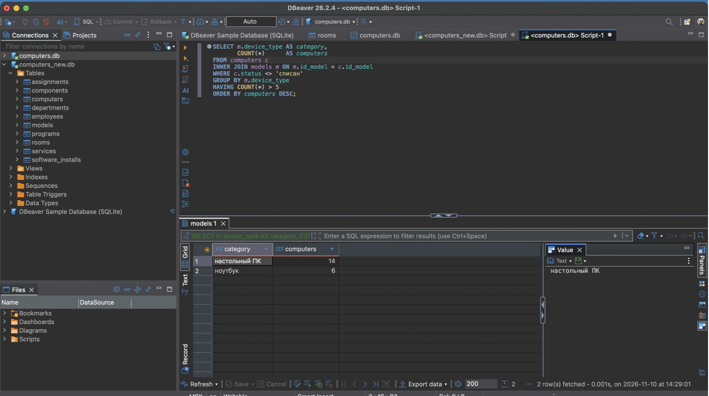

# Лабораторная работа № 2 (часть 1)

## «SELECT-запросы с сортировкой и ограничениями»

**Дисциплина:** Модели данных
**Тема:** АС учёта компьютеров, используемых фирмой

---

## 1. Цель работы

Сформировать знания и умения по языку SQL для выборки данных с сортировкой, фильтрацией, группировкой, соединением таблиц и подзапросами в СУБД SQLite с помощью среды DBeaver.

## 2. Исходные данные

Запросы выполняются над базой `lab1/part2/db/computers.db`, созданной в ЛР1 (часть 2). В ней 10 таблиц: отделы, сотрудники, помещения, модели, компьютеры, комплектующие, программы, закрепления, установки ПО и обслуживания.

Каждый запрос сохранён в отдельный файл в папке `queries/`. В DBeaver файл открывается через «Файл → Открыть файл» и выполняется кнопкой «Выполнить SQL-запрос» (Ctrl+Enter). Результат выводится на вкладке результатов под редактором (рисунок 1).



*Рисунок 1 — Выполнение запроса варианта 18 в DBeaver*

Таблицы результатов ниже получены скриптом `run_queries.py`: он выполняет те же файлы через модуль `sqlite3` в режиме только для чтения. Для длинных результатов показаны первые 12 строк.

## 3. Общие задания и варианта 18

| № | Конструкция | Файл |
| --- | --- | --- |
| 1 | SELECT * | `01_select_all.sql` |
| 2 | выбор отдельных столбцов | `02_select_columns.sql` |
| 3 | ORDER BY | `03_order_by.sql` |
| 4 | LIMIT и OFFSET | `04_limit_offset.sql` |
| 5 | WHERE, операторы сравнения, BETWEEN | `05_where_between.sql` |
| 6 | IN с подзапросом | `06_in_subquery.sql` |
| 7 | LIKE | `07_like.sql` |
| 8 | IS NULL | `08_is_null.sql` |
| 9 | COUNT, SUM, AVG, MIN, MAX | `09_aggregates.sql` |
| 10 | GROUP BY и HAVING | `10_group_having.sql` |
| 11 | INNER JOIN и LEFT JOIN | `11_join.sql` |
| 12 | DISTINCT | `12_distinct.sql` |
| 13 | EXISTS | `13_exists.sql` |
| 14 | CASE | `14_case.sql` |
| 15 | вариант 18, задание 1 | `15_var18_join_categories.sql` |
| 16 | вариант 18, задание 2 | `16_var18_categories_over_n.sql` |

## 4. Запросы и результаты

Запросы выполнены 09.11.2026 над базой `lab1/part2/db/computers.db`.

### Запрос 01. Все записи таблицы

**Задание.** Выбрать все записи из таблицы компьютеров.

Файл: `queries/01_select_all.sql`

```sql
SELECT *
FROM computers;
```

| inv_number | serial_number | hostname | commission_date | warranty_end | status | writeoff_date | id_model | id_room |
| --- | --- | --- | --- | --- | --- | --- | --- | --- |
| ПК-00001 | DE-HX99GR38 | NULL | 2019-02-11 | 2022-02-11 | списан | 2024-12-20 | 3 | 8 |
| ПК-00002 | DE-5SAFHVG5 | BUH-02 | 2019-02-11 | 2022-02-11 | в эксплуатации | NULL | 3 | 1 |
| ПК-00003 | LE-A8XP2TZZ | BUH-01 | 2022-03-01 | 2025-03-01 | в эксплуатации | NULL | 1 | 1 |
| ПК-00004 | LE-19EYFVV6 | BUH-03 | 2025-01-15 | 2028-01-15 | в резерве | NULL | 1 | 8 |
| ПК-00005 | HP-KWB0064F | SALES-01 | 2020-09-10 | 2023-09-10 | в эксплуатации | NULL | 2 | 3 |
| ПК-00006 | HP-28H4982T | SALES-02 | 2020-09-10 | 2023-09-10 | в ремонте | NULL | 2 | 3 |
| ПК-00007 | HP-379BRJDG | SALES-03 | 2020-09-10 | 2023-09-10 | в эксплуатации | NULL | 2 | 3 |
| ПК-00008 | LE-47K7RH67 | SALES-04 | 2023-04-03 | 2026-04-03 | в эксплуатации | NULL | 1 | 9 |
| ПК-00009 | AS-T2W9724N | SALES-NB1 | 2024-02-01 | 2027-02-01 | в эксплуатации | NULL | 8 | 9 |
| ПК-00010 | AS-VUACK680 | SALES-NB2 | 2024-02-01 | 2027-02-01 | в эксплуатации | NULL | 8 | 9 |
| ПК-00011 | AP-NT86984C | MKT-01 | 2024-06-10 | 2025-06-10 | в эксплуатации | NULL | 4 | 4 |
| ПК-00012 | HP-VX6G59T5 | MKT-02 | 2022-11-21 | 2025-11-21 | в эксплуатации | NULL | 5 | 4 |

Показаны первые 12 из 30 строк.

### Запрос 02. Отдельные столбцы

**Задание.** Выбрать ФИО, должность и телефон сотрудников.

Файл: `queries/02_select_columns.sql`

```sql
SELECT surname, name, patronymic, position, phone
FROM employees;
```

| surname | name | patronymic | position | phone |
| --- | --- | --- | --- | --- |
| Иванова | Мария | Сергеевна | Главный бухгалтер | +7 (495) 123-45-01 |
| Петрова | Анна | Викторовна | Бухгалтер | +7 (495) 123-45-02 |
| Сидоров | Алексей | Игоревич | Бухгалтер | NULL |
| Кузнецов | Дмитрий | Андреевич | Руководитель отдела продаж | +7 (495) 123-45-11 |
| Смирнова | Екатерина | Олеговна | Менеджер по продажам | +7 (495) 123-45-12 |
| Волков | Артём | Павлович | Менеджер по продажам | +7 (495) 123-45-13 |
| Морозова | Ольга | Николаевна | Менеджер по продажам | +7 (495) 123-45-14 |
| Тимофеев | Роман | NULL | Стажёр | NULL |
| Новиков | Илья | Романович | Маркетолог | +7 (495) 123-45-21 |
| Фёдорова | Дарья | Александровна | Дизайнер | +7 (495) 123-45-22 |
| Соколов | Максим | Владимирович | Руководитель ИТ-отдела | +7 (495) 123-45-31 |
| Лебедев | Кирилл | Евгеньевич | Системный администратор | +7 (495) 123-45-32 |

Показаны первые 12 из 17 строк.

### Запрос 03. Сортировка

**Задание.** Компьютеры от новых к старым; при одинаковой дате — по инвентарному номеру.

Файл: `queries/03_order_by.sql`

```sql
SELECT inv_number, commission_date, status
FROM computers
ORDER BY commission_date DESC, inv_number;
```

| inv_number | commission_date | status |
| --- | --- | --- |
| ПК-00026 | 2026-10-20 | в резерве |
| ПК-00027 | 2026-10-20 | в резерве |
| ПК-00030 | 2026-04-06 | в эксплуатации |
| ПК-00021 | 2025-03-03 | в эксплуатации |
| ПК-00004 | 2025-01-15 | в резерве |
| ПК-00011 | 2024-06-10 | в эксплуатации |
| ПК-00009 | 2024-02-01 | в эксплуатации |
| ПК-00010 | 2024-02-01 | в эксплуатации |
| ПК-00029 | 2024-02-01 | списан |
| ПК-00013 | 2023-09-04 | в эксплуатации |
| ПК-00028 | 2023-09-04 | в ремонте |
| ПК-00008 | 2023-04-03 | в эксплуатации |

Показаны первые 12 из 30 строк.

### Запрос 04. LIMIT и OFFSET

**Задание.** Вторая «страница» (записи 6–10) обслуживаний по убыванию стоимости.

Файл: `queries/04_limit_offset.sql`

```sql
SELECT id_service, inv_number, work_type, start_date, cost
FROM services
WHERE cost IS NOT NULL
ORDER BY cost DESC, id_service
LIMIT 5 OFFSET 5;
```

| id_service | inv_number | work_type | start_date | cost |
| --- | --- | --- | --- | --- |
| 14 | ПК-00014 | ремонт | 2026-02-09 | 6700 |
| 13 | ПК-00002 | ремонт | 2026-01-19 | 4200 |
| 1 | ПК-00001 | ремонт | 2021-03-10 | 3500 |
| 4 | ПК-00024 | диагностика | 2023-06-20 | 2000 |
| 19 | ПК-00008 | ремонт | 2026-08-17 | 1800 |

Строк в результате: 5.

### Запрос 05. WHERE и BETWEEN

**Задание.** Действующие компьютеры, введённые в эксплуатацию в 2023–2024 годах.

Файл: `queries/05_where_between.sql`

```sql
SELECT inv_number, commission_date, warranty_end, status
FROM computers
WHERE commission_date BETWEEN '2023-01-01' AND '2024-12-31'
  AND status <> 'списан'
ORDER BY commission_date;
```

| inv_number | commission_date | warranty_end | status |
| --- | --- | --- | --- |
| ПК-00014 | 2023-01-16 | 2026-01-16 | в эксплуатации |
| ПК-00023 | 2023-01-16 | 2026-01-16 | в резерве |
| ПК-00008 | 2023-04-03 | 2026-04-03 | в эксплуатации |
| ПК-00013 | 2023-09-04 | 2024-09-04 | в эксплуатации |
| ПК-00028 | 2023-09-04 | 2024-09-04 | в ремонте |
| ПК-00009 | 2024-02-01 | 2027-02-01 | в эксплуатации |
| ПК-00010 | 2024-02-01 | 2027-02-01 | в эксплуатации |
| ПК-00011 | 2024-06-10 | 2025-06-10 | в эксплуатации |

Строк в результате: 8.

### Запрос 06. IN с подзапросом

**Задание.** Компьютеры, модель которых относится к типу «ноутбук».

Файл: `queries/06_in_subquery.sql`

```sql
SELECT inv_number, hostname, status
FROM computers
WHERE id_model IN (SELECT id_model FROM models WHERE device_type = 'ноутбук')
ORDER BY inv_number;
```

| inv_number | hostname | status |
| --- | --- | --- |
| ПК-00009 | SALES-NB1 | в эксплуатации |
| ПК-00010 | SALES-NB2 | в эксплуатации |
| ПК-00013 | MKT-NB1 | в эксплуатации |
| ПК-00014 | IT-NB1 | в эксплуатации |
| ПК-00023 | LAW-NB1 | в резерве |
| ПК-00028 | MKT-NB2 | в ремонте |
| ПК-00029 | NULL | списан |

Строк в результате: 7.

### Запрос 07. LIKE

**Задание.** Сотрудники, фамилия которых начинается на «К».

Файл: `queries/07_like.sql`

```sql
SELECT tab_number, surname, name, position
FROM employees
WHERE surname LIKE 'К%'
ORDER BY surname;
```

| tab_number | surname | name | position |
| --- | --- | --- | --- |
| 400403 | Козлов | Никита | Инженер техподдержки |
| 200201 | Кузнецов | Дмитрий | Руководитель отдела продаж |

Строк в результате: 2.

### Запрос 08. IS NULL

**Задание.** Сотрудники, у которых не указан e-mail или телефон.

Файл: `queries/08_is_null.sql`

```sql
SELECT tab_number, surname, name, phone, email
FROM employees
WHERE email IS NULL OR phone IS NULL
ORDER BY surname;
```

| tab_number | surname | name | phone | email |
| --- | --- | --- | --- | --- |
| 500502 | Егорова | Наталья | NULL | n.egorova@firma.ru |
| 200204 | Морозова | Ольга | +7 (495) 123-45-14 | NULL |
| 100103 | Сидоров | Алексей | NULL | NULL |
| 200205 | Тимофеев | Роман | NULL | r.timofeev@firma.ru |

Строк в результате: 4.

### Запрос 09. Агрегатные функции

**Задание.** Количество, сумма, средняя, минимальная и максимальная стоимость завершённых обслуживаний.

Файл: `queries/09_aggregates.sql`

```sql
SELECT COUNT(*)            AS services_total,
       COUNT(cost)         AS with_cost,
       SUM(cost)           AS cost_sum,
       ROUND(AVG(cost), 2) AS cost_avg,
       MIN(cost)           AS cost_min,
       MAX(cost)           AS cost_max
FROM services
WHERE end_date IS NOT NULL;
```

| services_total | with_cost | cost_sum | cost_avg | cost_min | cost_max |
| --- | --- | --- | --- | --- | --- |
| 19 | 19 | 139900 | 7363.16 | 0 | 64000 |

Строк в результате: 1.

### Запрос 10. GROUP BY и HAVING

**Задание.** Виды работ, выполнявшиеся больше трёх раз, с суммой затрат.

Файл: `queries/10_group_having.sql`

```sql
SELECT work_type,
       COUNT(*)  AS services,
       SUM(cost) AS cost_sum
FROM services
GROUP BY work_type
HAVING COUNT(*) > 3
ORDER BY services DESC;
```

| work_type | services | cost_sum |
| --- | --- | --- |
| ремонт | 9 | 57400 |
| профилактика | 5 | 15000 |
| диагностика | 5 | 3500 |

Строк в результате: 3.

### Запрос 11. INNER JOIN и LEFT JOIN

**Задание.** Действующие компьютеры с моделью, помещением и сотрудником, за которым компьютер закреплён сейчас.

Файл: `queries/11_join.sql`

```sql
SELECT c.inv_number,
       m.manufacturer || ' ' || m.name AS model,
       r.building || ', ' || r.number  AS room,
       e.surname || ' ' || e.name       AS employee,
       c.status
FROM computers c
INNER JOIN models m ON m.id_model = c.id_model
INNER JOIN rooms r ON r.id_room = c.id_room
LEFT JOIN assignments a ON a.inv_number = c.inv_number AND a.return_date IS NULL
LEFT JOIN employees e ON e.tab_number = a.tab_number
WHERE c.status <> 'списан'
ORDER BY c.inv_number;
```

| inv_number | model | room | employee | status |
| --- | --- | --- | --- | --- |
| ПК-00002 | Dell OptiPlex 7090 | Главный корпус, 101 | Петрова Анна | в эксплуатации |
| ПК-00003 | Lenovo ThinkCentre M70q Gen 3 | Главный корпус, 101 | Иванова Мария | в эксплуатации |
| ПК-00004 | Lenovo ThinkCentre M70q Gen 3 | Главный корпус, 001 | NULL | в резерве |
| ПК-00005 | HP ProDesk 400 G7 | Главный корпус, 201 | Кузнецов Дмитрий | в эксплуатации |
| ПК-00006 | HP ProDesk 400 G7 | Главный корпус, 201 | Смирнова Екатерина | в ремонте |
| ПК-00007 | HP ProDesk 400 G7 | Главный корпус, 201 | Волков Артём | в эксплуатации |
| ПК-00008 | Lenovo ThinkCentre M70q Gen 3 | Корпус Б, 110 | Морозова Ольга | в эксплуатации |
| ПК-00009 | ASUS ExpertBook B1 B1500 | Корпус Б, 110 | Кузнецов Дмитрий | в эксплуатации |
| ПК-00010 | ASUS ExpertBook B1 B1500 | Корпус Б, 110 | Тимофеев Роман | в эксплуатации |
| ПК-00011 | Apple iMac 24 M3 | Главный корпус, 202 | Фёдорова Дарья | в эксплуатации |
| ПК-00012 | HP ProOne 440 G9 | Главный корпус, 202 | Новиков Илья | в эксплуатации |
| ПК-00013 | Apple MacBook Air 13 M2 | Главный корпус, 202 | Новиков Илья | в эксплуатации |

Показаны первые 12 из 26 строк.

### Запрос 12. DISTINCT

**Задание.** Уникальные сочетания «тип комплектующего — производитель».

Файл: `queries/12_distinct.sql`

```sql
SELECT DISTINCT component_type, manufacturer
FROM components
ORDER BY component_type, manufacturer;
```

| component_type | manufacturer |
| --- | --- |
| блок питания | Chieftec |
| блок питания | Dell |
| блок питания | HP |
| блок питания | HPE |
| видеокарта | NVIDIA |
| материнская плата | ASUS |
| накопитель | Apple |
| накопитель | Dell |
| накопитель | HPE |
| накопитель | Intel |
| накопитель | Kingston |
| накопитель | Kioxia |

Показаны первые 12 из 23 строк.

### Запрос 13. EXISTS

**Задание.** Программы, которые не установлены ни на одном компьютере.

Файл: `queries/13_exists.sql`

```sql
SELECT p.name, p.version, p.license_type, p.license_count
FROM programs p
WHERE NOT EXISTS (SELECT 1 FROM software_installs i WHERE i.id_program = p.id_program)
ORDER BY p.name;
```

| name | version | license_type | license_count |
| --- | --- | --- | --- |
| AutoCAD LT | 2024 | коммерческая | 1 |

Строк в результате: 1.

### Запрос 14. CASE

**Задание.** Состояние гарантии каждого действующего компьютера.

Файл: `queries/14_case.sql`

```sql
SELECT inv_number,
       warranty_end,
       CASE
           WHEN warranty_end IS NULL THEN 'без гарантии'
           WHEN warranty_end < date('now') THEN 'истекла'
           WHEN warranty_end <= date('now', '+180 days') THEN 'истекает в течение полугода'
           ELSE 'действует'
       END AS warranty_state
FROM computers
WHERE status <> 'списан'
ORDER BY warranty_end IS NULL, warranty_end DESC;
```

| inv_number | warranty_end | warranty_state |
| --- | --- | --- |
| ПК-00026 | 2029-10-20 | действует |
| ПК-00027 | 2029-10-20 | действует |
| ПК-00030 | 2029-04-06 | действует |
| ПК-00021 | 2028-03-03 | действует |
| ПК-00004 | 2028-01-15 | действует |
| ПК-00009 | 2027-02-01 | истекает в течение полугода |
| ПК-00010 | 2027-02-01 | истекает в течение полугода |
| ПК-00017 | 2026-10-04 | истекла |
| ПК-00008 | 2026-04-03 | истекла |
| ПК-00014 | 2026-01-16 | истекла |
| ПК-00023 | 2026-01-16 | истекла |
| ПК-00012 | 2025-11-21 | истекла |
| ПК-00016 | 2025-08-08 | истекла |
| ПК-00011 | 2025-06-10 | истекла |
| ПК-00003 | 2025-03-01 | истекла |
| ПК-00018 | 2024-12-02 | истекла |
| ПК-00019 | 2024-12-02 | истекла |
| ПК-00013 | 2024-09-04 | истекла |
| ПК-00028 | 2024-09-04 | истекла |
| ПК-00015 | 2024-05-17 | истекла |
| ПК-00022 | 2024-05-17 | истекла |
| ПК-00005 | 2023-09-10 | истекла |
| ПК-00006 | 2023-09-10 | истекла |
| ПК-00007 | 2023-09-10 | истекла |
| ПК-00002 | 2022-02-11 | истекла |
| ПК-00020 | NULL | без гарантии |

Строк в результате: 26.

### Запрос 15. Вариант 18, задание 1

**Задание.** Получить список объектов и их категорий, используя соединение таблиц: компьютеры и их тип устройства (категория задаётся моделью).

Файл: `queries/15_var18_join_categories.sql`

```sql
SELECT c.inv_number,
       m.device_type                   AS category,
       m.manufacturer || ' ' || m.name AS model,
       c.status
FROM computers c
INNER JOIN models m ON m.id_model = c.id_model
ORDER BY m.device_type, c.inv_number;
```

| inv_number | category | model | status |
| --- | --- | --- | --- |
| ПК-00011 | моноблок | Apple iMac 24 M3 | в эксплуатации |
| ПК-00012 | моноблок | HP ProOne 440 G9 | в эксплуатации |
| ПК-00021 | моноблок | HP ProOne 440 G9 | в эксплуатации |
| ПК-00001 | настольный ПК | Dell OptiPlex 7090 | списан |
| ПК-00002 | настольный ПК | Dell OptiPlex 7090 | в эксплуатации |
| ПК-00003 | настольный ПК | Lenovo ThinkCentre M70q Gen 3 | в эксплуатации |
| ПК-00004 | настольный ПК | Lenovo ThinkCentre M70q Gen 3 | в резерве |
| ПК-00005 | настольный ПК | HP ProDesk 400 G7 | в эксплуатации |
| ПК-00006 | настольный ПК | HP ProDesk 400 G7 | в ремонте |
| ПК-00007 | настольный ПК | HP ProDesk 400 G7 | в эксплуатации |
| ПК-00008 | настольный ПК | Lenovo ThinkCentre M70q Gen 3 | в эксплуатации |
| ПК-00015 | настольный ПК | Dell OptiPlex 7090 | в эксплуатации |

Показаны первые 12 из 30 строк.

### Запрос 16. Вариант 18, задание 2

**Задание.** Найти категории, в которых количество объектов превышает заданное значение: типы устройств, в которых больше 5 несписанных компьютеров.

Файл: `queries/16_var18_categories_over_n.sql`

```sql
SELECT m.device_type AS category,
       COUNT(*)      AS computers
FROM computers c
INNER JOIN models m ON m.id_model = c.id_model
WHERE c.status <> 'списан'
GROUP BY m.device_type
HAVING COUNT(*) > 5
ORDER BY computers DESC;
```

| category | computers |
| --- | --- |
| настольный ПК | 14 |
| ноутбук | 6 |

Строк в результате: 2.

## 5. Пояснения к запросам

1. **ORDER BY** (запрос 3) сортирует по двум полям: при равной дате ввода порядок задаёт инвентарный номер, поэтому результат детерминирован.
2. **LIMIT / OFFSET** (запрос 4) имеет смысл только вместе с ORDER BY. Без сортировки SQLite не гарантирует порядок строк, и «вторая страница» может меняться от запуска к запуску.
3. **BETWEEN по датам** (запрос 5) работает, потому что даты хранятся как текст в формате ISO 8601 («ГГГГ-ММ-ДД»): лексикографический порядок таких строк совпадает с хронологическим. Это обеспечивает ограничение CHECK из ЛР1.
4. **LIKE** (запрос 7) в SQLite без учёта регистра сравнивает только латиницу. Для кириллицы `LIKE 'к%'` и `LIKE 'К%'` дают разные результаты.
5. **IS NULL** (запрос 8): условие `email = NULL` всегда даёт NULL, а не истину, поэтому отсутствие значения проверяется только через IS NULL.
6. **Агрегатные функции** (запрос 9) пропускают NULL: `COUNT(*)` считает строки, `COUNT(cost)` — только заполненные значения. AVG делит сумму на число заполненных значений.
7. **WHERE и HAVING** (запрос 10): WHERE отбирает строки до группировки, HAVING — группы после неё. Поэтому условие на `COUNT(*)` можно записать только в HAVING.
8. **LEFT JOIN** (запрос 11) сохраняет компьютеры без действующего закрепления (серверы и резерв) — у них в столбце сотрудника NULL. Условие `a.return_date IS NULL` записано в ON, а не в WHERE: в WHERE оно отбросило бы компьютеры, у которых есть только завершённые закрепления.
9. **NOT EXISTS** (запрос 13) нашёл программу, купленную, но не установленную (AutoCAD LT). Подзапрос коррелированный: он ссылается на `p.id_program` внешнего запроса.
10. **CASE** (запрос 14) выводит одно из четырёх состояний гарантии. Пороговые даты считаются от `date('now')`, поэтому результат зависит от даты запуска (здесь — 09.11.2026).

## 6. Вариант 18

**Задание 1.** «Получить список объектов и их категорий, используя соединение таблиц». Объект — компьютер, категория — тип устройства, который хранится в справочнике моделей. Таблицы соединены по внешнему ключу `computers.id_model → models.id_model` (INNER JOIN): у каждого компьютера модель обязательна (NOT NULL), поэтому ни одна строка не теряется. Результат — все 30 компьютеров, сгруппированные по категориям.

**Задание 2.** «Найти категории, в которых количество объектов превышает заданное значение». Заданное значение — 5. Компьютеры соединены с моделями, списанные исключены в WHERE, затем строки сгруппированы по типу устройства, и HAVING оставляет группы, где больше 5 компьютеров. Результат — настольные ПК (14) и ноутбуки (6). Моноблоки (3) и серверы (3) отсеяны условием HAVING.

## 7. Выводы

1. Составлены и выполнены 14 запросов по общим заданиям и 2 запроса варианта 18. Они охватывают сортировку, ограничение выборки, фильтрацию (сравнения, BETWEEN, IN, LIKE, IS NULL), агрегатные функции с группировкой и HAVING, соединения INNER и LEFT JOIN, DISTINCT, EXISTS и CASE.
2. Все результаты соответствуют тестовым данным из ЛР1. Например, NOT EXISTS нашёл единственную неустановленную программу, LEFT JOIN показал 7 несписанных компьютеров без закрепления: 3 сервера и 4 компьютера в резерве.
3. Ограничения базы из ЛР1 упрощают запросы. Даты в едином формате позволяют сравнивать их как строки. NOT NULL у внешнего ключа гарантирует, что INNER JOIN не теряет строки. Частичный уникальный индекс гарантирует, что LEFT JOIN с действующим закреплением не размножает строки.

---

## Приложение. Ответы на контрольные вопросы

1. **SQL и SELECT.** SQL — декларативный язык работы с реляционными базами данных. SELECT выбирает данные из одной или нескольких таблиц и возвращает результат в виде таблицы.
2. **Синтаксис SELECT.** `SELECT [DISTINCT] поля FROM таблицы [WHERE условие] [GROUP BY поля] [HAVING условие] [ORDER BY поля] [LIMIT n OFFSET m]`. Порядок выполнения: FROM/JOIN → WHERE → GROUP BY → HAVING → SELECT → ORDER BY → LIMIT.
3. **SELECT * и список столбцов.** `*` возвращает все столбцы в порядке таблицы — удобно для просмотра, но результат меняется при изменении структуры и передаёт лишние данные. Явный список фиксирует состав и порядок столбцов.
4. **DISTINCT.** Убирает повторяющиеся строки результата. Нужен для получения уникальных значений или сочетаний (запрос 12).
5. **WHERE.** Задаёт условие отбора строк. Операторы сравнения: `=`, `<>`, `<`, `>`, `<=`, `>=`; логические: AND, OR, NOT.
6. **BETWEEN, IN, LIKE, IS NULL.** BETWEEN — диапазон включительно (запрос 5). IN — принадлежность списку или результату подзапроса (запрос 6). LIKE — шаблон с `%` и `_` (запрос 7). IS NULL — отсутствие значения (запрос 8).
7. **Агрегатные функции.** COUNT — количество, SUM — сумма, AVG — среднее, MIN и MAX — наименьшее и наибольшее значение. Вычисляются по группе строк, NULL пропускают.
8. **GROUP BY.** Объединяет строки с одинаковыми значениями полей в группы для агрегатов. В SELECT допустимы поля группировки и агрегаты. Другие столбцы SQLite формально разрешает, но берёт значение из произвольной строки группы, поэтому так писать не следует.
9. **WHERE и HAVING.** WHERE фильтрует строки до группировки и не может использовать агрегаты. HAVING фильтрует группы после группировки и работает с агрегатами (запросы 10 и 16).
10. **Сортировка.** ORDER BY поле [ASC|DESC], по умолчанию ASC. По нескольким полям — через запятую: следующее поле упорядочивает строки с равными значениями предыдущего (запрос 3).
11. **LIMIT и OFFSET.** LIMIT n — не более n строк, OFFSET m — пропустить первые m. Применяются для постраничного вывода и «первых N» (запрос 4).
12. **JOIN.** Соединение строк двух таблиц по условию. INNER JOIN возвращает только пары с совпадением. LEFT JOIN — все строки левой таблицы, а при отсутствии пары подставляет NULL (запрос 11).
13. **Подзапросы, EXISTS и IN.** Подзапрос — SELECT внутри другого запроса. EXISTS проверяет, что подзапрос вернул хотя бы одну строку, и обычно коррелирован с внешним запросом (запрос 13). IN сравнивает значение с набором значений подзапроса. Если в подзапросе встречается NULL, `NOT IN` не вернёт ни одной строки, а NOT EXISTS работает корректно.
14. **CASE.** Условное выражение: возвращает значение первой ветви WHEN, условие которой истинно, иначе ELSE. Используется для классификации и вычисляемых полей (запрос 14).
