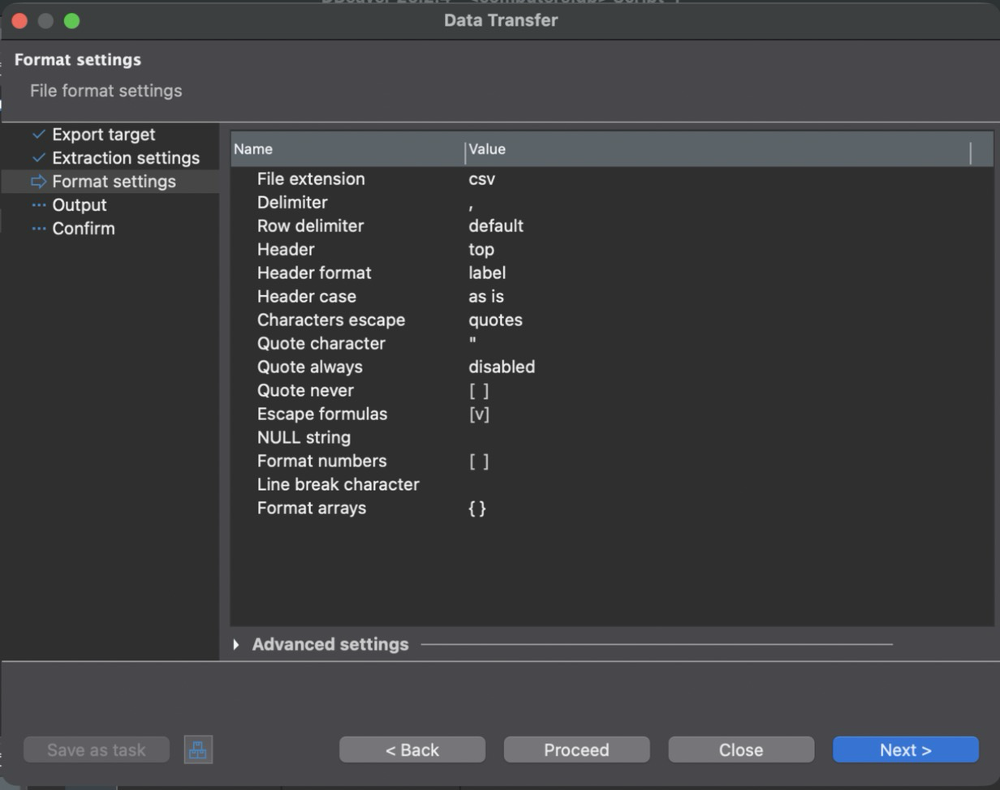
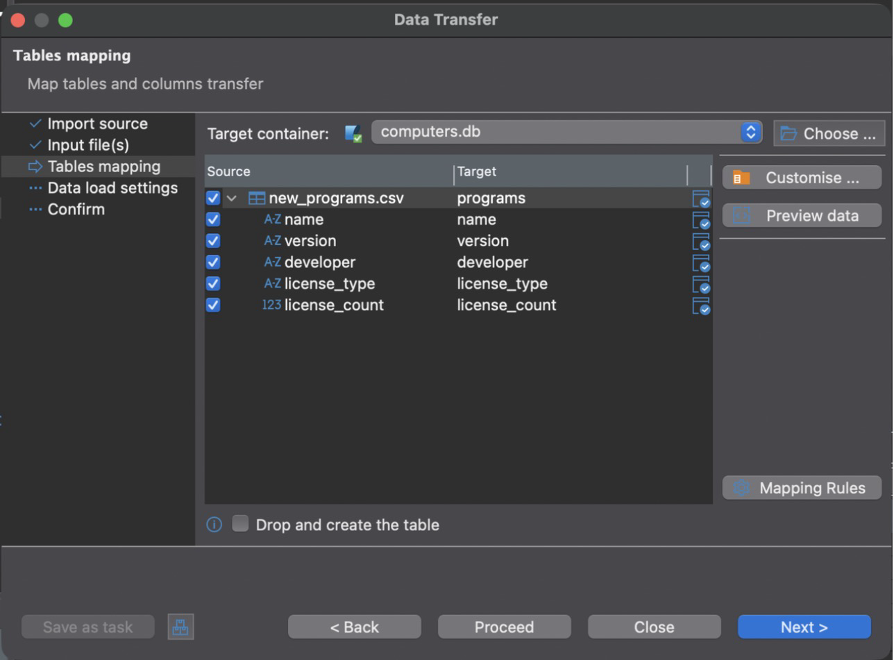
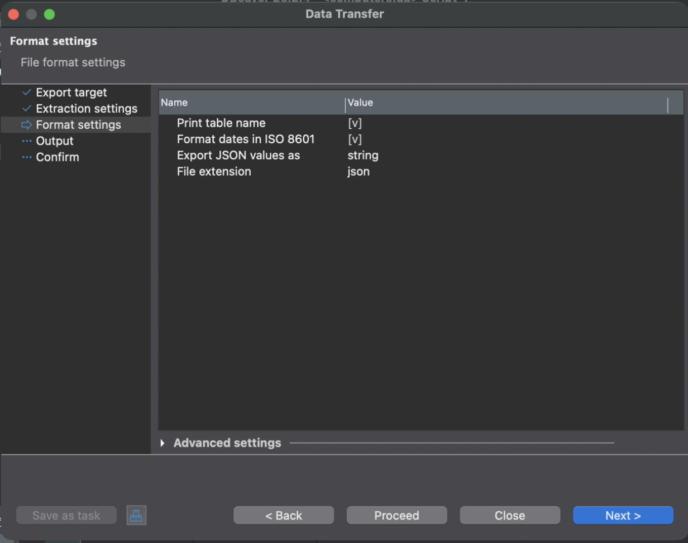
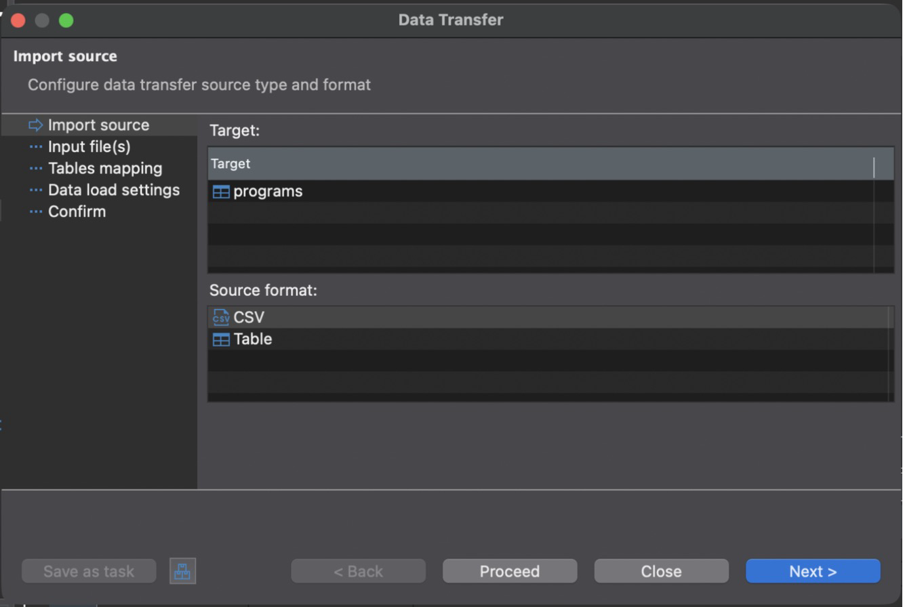

# Лабораторная работа № 2 (часть 2)

## «Импорт и экспорт данных (SQLite + DBeaver + Python)»

**Дисциплина:** Модели данных
**Тема:** АС учёта компьютеров, используемых фирмой

---

## 1. Цель работы

Освоить импорт и экспорт данных SQLite в форматы CSV и JSON двумя способами: через графический интерфейс DBeaver и Python-скриптами. Реализовать миграцию структуры базы и автоматическое резервное копирование с восстановлением.

## 2. Исходные данные и состав работы

Работа выполняется над готовой базой предметной области из ЛР1: копия `lab1/part2/db/computers.db` лежит в `lab2/part2/db/computers.db`. В базе 10 заполненных таблиц: 7 отделов, 17 сотрудников, 30 компьютеров, 122 комплектующих, 120 установок ПО и т.д.

| Файл | Назначение |
| --- | --- |
| `dbio.py` | общие функции: подключение, чтение и запись CSV и JSON, вставка в транзакции, проверка типов |
| `export_csv.py`, `export_json.py` | экспорт таблиц (всех или указанных) |
| `import_csv.py`, `import_json.py` | импорт файла в таблицу |
| `verify_roundtrip.py` | проверка: экспорт → импорт в пустую копию схемы → построчное сравнение |
| `migrations/001_buildings.sql`, `migrations/002_mac_address.sql` | миграции структуры |
| `migrate.py` | применение миграций с учётом версии схемы |
| `backup.py`, `restore.py` | резервное копирование с датой и временем и восстановление |
| `check_backup_restore.py` | проверка восстановления после «аварии» |
| `data/` | входные файлы для импорта |
| `export/csv`, `export/json` | результаты экспорта |
| `backups/` | резервные копии |

Скрипты используют только стандартную библиотеку Python (`sqlite3`, `csv`, `json`, `argparse`) и работают на Python 3.9+. Каждый скрипт принимает `--db` и `--help`.

## 3. Экспорт данных в CSV

### 3.1. Экспорт через DBeaver

ПКМ по таблице `computers` → «Export Data» → в списке форматов (CSV, DbUnit, HTML, JSON, Markdown, SQL, Source code, TXT, XML) выбран **CSV** → шаг «Format settings» (рисунок 1): разделитель `,`, строка заголовков сверху (Header: top), экранирование кавычками, пустая строка для NULL → шаг «Output»: каталог `export/dbeaver`, кодировка UTF-8 → «Proceed». В мастере можно отметить несколько таблиц сразу, тогда каждая попадает в свой файл.



*Рисунок 1 — Мастер экспорта данных DBeaver, настройки формата CSV*

### 3.2. Проверка CSV-файла

Начало файла `computers.csv`:

```
inv_number,serial_number,hostname,commission_date,warranty_end,status,writeoff_date,id_model,id_room
ПК-00001,DE-HX99GR38,,2019-02-11,2022-02-11,списан,2024-12-20,3,8
ПК-00002,DE-5SAFHVG5,BUH-02,2019-02-11,2022-02-11,в эксплуатации,,3,1
ПК-00003,LE-A8XP2TZZ,BUH-01,2022-03-01,2025-03-01,в эксплуатации,,1,1
```

- **Структура:** первая строка — 9 имён столбцов в порядке таблицы, далее одна строка на запись (30 строк данных).
- **Разделитель:** запятая. Значения с запятой или кавычкой автоматически заключаются в кавычки (модуль `csv`).
- **Кодировка:** UTF-8, кириллица читается без искажений. Для открытия в Excel под Windows предусмотрен флаг `--bom` (UTF-8 с BOM).
- **NULL** выгружается как пустое поле (`hostname` у списанного ПК-00001). Типы столбцов, ключи и ограничения в CSV не сохраняются.

### 3.3. Экспорт Python-скриптом

```python
def export_csv(con, table, path, delimiter=",", bom=False):
    require_table(con, table)
    cur = con.execute(f'SELECT * FROM "{table}"')
    cols = [d[0] for d in cur.description]
    n = 0
    with open(path, "w", newline="", encoding="utf-8-sig" if bom else "utf-8") as f:
        w = csv.writer(f, delimiter=delimiter)
        w.writerow(cols)
        for row in cur:
            w.writerow(["" if v is None else v for v in row])
            n += 1
    return n
```

```
$ python3 export_csv.py
departments           7 строк → export/csv/departments.csv
rooms                11 строк → export/csv/rooms.csv
models               11 строк → export/csv/models.csv
employees            17 строк → export/csv/employees.csv
computers            30 строк → export/csv/computers.csv
components          122 строк → export/csv/components.csv
programs             14 строк → export/csv/programs.csv
assignments          27 строк → export/csv/assignments.csv
software_installs   120 строк → export/csv/software_installs.csv
services             22 строк → export/csv/services.csv
```

## 4. Импорт данных из CSV

### 4.1. Импорт через DBeaver

ПКМ по таблице `programs` → «Import Data» → источник **CSV** → шаг «Input file(s)»: файл `data/new_programs.csv`, настройки импортёра — кодировка utf-8, разделитель `,`, заголовок сверху (Header position: top) → шаг «Tables mapping» (рисунок 2): столбцы файла `name`, `version`, `developer`, `license_type`, `license_count` сопоставлены с одноимёнными столбцами таблицы. Столбца `id_program` в файле нет, его значение назначит AUTOINCREMENT → «Proceed». Чтобы не задвоить строки, загруженные скриптом в разделе 4.3, импорт мастером выполняется на копии базы.



*Рисунок 2 — Сопоставление столбцов при импорте CSV в DBeaver*

### 4.2. Проверка загруженных данных

```sql
SELECT COUNT(*) FROM programs;
SELECT * FROM programs WHERE name IN ('КОМПАС-3D', 'Notepad++');
```

Число записей выросло с 14 до 16. У «КОМПАС-3D» `license_count = 2` (INTEGER), у «Notepad++» `license_count IS NULL`: пустое поле CSV загружено как NULL и не нарушило CHECK из ЛР1 (БО9).

### 4.3. Импорт Python-скриптом

Скрипт читает файл, сверяет заголовок со столбцами таблицы и вставляет все строки **одной транзакцией**. Если хотя бы одна строка нарушает ограничение, отменяется весь импорт.

```python
def insert_rows(con, table, fields, rows, skip_existing=False):
    require_table(con, table)
    cols = columns(con, table)
    unknown = [f for f in fields if f not in cols]
    if unknown:
        raise ValueError(f"в таблице {table} нет столбцов: {', '.join(unknown)}")
    before = count(con, table)
    names = ", ".join(f'"{f}"' for f in fields)
    marks = ", ".join("?" for _ in fields)
    tail = " ON CONFLICT DO NOTHING" if skip_existing else ""
    sql = f'INSERT INTO "{table}" ({names}) VALUES ({marks}){tail}'
    with con:
        con.executemany(sql, [[row.get(f) for f in fields] for row in rows])
    return before, count(con, table)
```

```
$ python3 import_csv.py data/new_programs.csv --table programs
programs: в файле 2 строк, было 14, стало 16, добавлено 2

$ python3 import_csv.py data/bad_programs.csv --table programs
ошибка импорта, изменения отменены: UNIQUE constraint failed: programs.name, programs.version
```

Во втором файле первая строка («Paint.NET») корректна, а вторая повторяет существующую программу «7-Zip 24.08». Транзакция откатилась, «Paint.NET» тоже не добавлена: число записей осталось 16. Импорт не оставляет базу в частично загруженном состоянии.

Режима «заменить содержимое таблицы» намеренно нет. `DELETE FROM programs` каскадно удалил бы все установки ПО (ON DELETE CASCADE из ЛР1). Вместо него есть `--skip-existing` (`INSERT ... ON CONFLICT DO NOTHING`): строки, уже имеющиеся в таблице, пропускаются.

### 4.4. Соответствие структуры и типов

1. Заголовок файла сверяется со столбцами таблицы (`PRAGMA table_info`). Лишний столбец — ошибка до начала вставки. Отсутствующий получает DEFAULT или NULL.
2. В CSV все значения — строки. SQLite по объявленному типу столбца (type affinity) приводит `'2'` к INTEGER, а `'3.6'` — к REAL.
3. После импорта функция `type_mismatches` проверяет `typeof()` каждого столбца. Например, строка в столбце INTEGER будет показана как несоответствие. Для импортированных файлов несоответствий нет.

Итоговая проверка без потерь — `verify_roundtrip.py`: скрипт выгружает все таблицы в CSV и JSON во временную папку, загружает их в пустую копию схемы и сравнивает с исходными построчно. Ниже — запуск до миграции (раздел 7); после неё в проверку входит и новая таблица `buildings`.

```
$ python3 verify_roundtrip.py
CSV:
  departments           7 строк, совпадает
  rooms                11 строк, совпадает
  models               11 строк, совпадает
  employees            17 строк, совпадает
  computers            30 строк, совпадает
  components          122 строк, совпадает
  programs             14 строк, совпадает
  assignments          27 строк, совпадает
  software_installs   120 строк, совпадает
  services             22 строк, совпадает
JSON:
  ... (те же 10 таблиц), совпадает
итог: данные восстановлены без потерь
```

Таблицы загружаются в порядке «родитель → потомок» (`dbio.ORDER`): иначе внешние ключи отклонили бы ссылки на ещё не загруженные записи.

## 5. Экспорт данных в JSON

### 5.1. Экспорт через DBeaver

ПКМ по таблице → «Export Data» → формат **JSON** → шаг «Format settings» (рисунок 3): «Print table name» — массив записей оборачивается в объект с именем таблицы, «Format dates in ISO 8601» — даты в формате ГГГГ-ММ-ДД, расширение json → шаг «Output»: каталог, кодировка UTF-8 → «Proceed». В отличие от скрипта из раздела 5.3, который пишет просто массив, DBeaver при включённом «Print table name» записывает объект вида `{"computers": [...]}`.



*Рисунок 3 — Экспорт таблицы в JSON через DBeaver, настройки формата*

### 5.2. Структура JSON-файла

Файл `export/json/programs.json` — массив объектов, по одному на запись. Ключи совпадают с именами столбцов, числа остаются числами, NULL — `null`:

```json
[
  {
    "id_program": 1,
    "name": "Windows 11 Pro",
    "version": "23H2",
    "developer": "Microsoft",
    "license_type": "коммерческая",
    "license_count": 25
  },
  {
    "id_program": 2,
    "name": "Microsoft Office LTSC",
    "version": "2021",
    "developer": "Microsoft",
    "license_type": "коммерческая",
    "license_count": 20
  }
]
```

В отличие от CSV, JSON сохраняет различие между числом и строкой, а также между NULL и пустой строкой.

### 5.3. Экспорт Python-скриптом

```python
def export_json(con, table, path):
    require_table(con, table)
    cur = con.execute(f'SELECT * FROM "{table}"')
    cols = [d[0] for d in cur.description]
    rows = [dict(zip(cols, r)) for r in cur]
    with open(path, "w", encoding="utf-8") as f:
        json.dump(rows, f, ensure_ascii=False, indent=2)
    return len(rows)
```

`ensure_ascii=False` записывает кириллицу как есть, а не escape-последовательностями `Р...`.

## 6. Импорт данных из JSON

### 6.1. Импорт через DBeaver

В DBeaver Community 26.2 мастер импорта (ПКМ по таблице → «Import Data») предлагает только два источника: **CSV** и **Table**, то есть другую таблицу (рисунок 4). Источника JSON в бесплатной версии нет. Поэтому JSON-файл загружается скриптом `import_json.py` (раздел 6.2). Средствами DBeaver JSON можно загрузить только в обход: преобразовать его в CSV и импортировать мастером из раздела 4.1.



*Рисунок 4 — Источники данных в мастере импорта DBeaver Community: только CSV и Table*

### 6.2. Проверка и импорт Python-скриптом

Файл `data/new_components.json` описывает поставку: два модуля памяти на склад (`inv_number: null`) и SSD, установленный в новый компьютер ПК-00026. Скрипт проверяет, что файл — массив объектов, собирает объединение ключей и вставляет записи той же функцией `insert_rows`.

```
$ python3 import_json.py data/new_components.json --table components
components: в файле 3 строк, было 122, стало 125, добавлено 3

$ python3 import_json.py data/new_components.json --table components
ошибка импорта, изменения отменены: UNIQUE constraint failed: components.serial_number

$ python3 import_json.py data/new_components.json --table components --skip-existing
components: в файле 3 строк, было 125, стало 125, добавлено 0
```

Повторный импорт того же файла отклонён ограничением UNIQUE на серийный номер. С `--skip-existing` дубликаты пропущены без ошибки. Внешний ключ `inv_number → computers` проверен при вставке: ссылка на несуществующий компьютер была бы отклонена.

## 7. Миграция структуры базы данных

### 7.1. Анализ текущей структуры

В таблице `rooms` название здания хранится текстом в каждой строке (`building`). Для 11 помещений 8 раз повторяется «Главный корпус» и 3 раза — «Корпус Б». Это транзитивная зависимость, которая мешает добавить адрес здания: его пришлось бы дублировать в каждом помещении. Кроме того, для компьютеров понадобился MAC-адрес, которого в структуре нет.

### 7.2. Скрипты миграции

Миграции — пронумерованные SQL-файлы в `migrations/`. Номер применённой версии хранится в заголовке базы (`PRAGMA user_version`), поэтому каждая миграция применяется ровно один раз. `migrate.py` перед запуском делает резервную копию. Каждая миграция выполняется в транзакции при выключенных внешних ключах, затем запускается `PRAGMA foreign_key_check`. При любой ошибке транзакция откатывается и база восстанавливается из копии.

**Миграция 001 — перенос зданий в отдельную таблицу.** SQLite не умеет удалять столбец с ограничениями и менять его тип, поэтому таблица `rooms` пересоздаётся:

```sql
CREATE TABLE buildings (
    id_building INTEGER PRIMARY KEY AUTOINCREMENT,
    name        TEXT    NOT NULL UNIQUE CHECK (length(trim(name)) > 0),
    address     TEXT
);

INSERT INTO buildings (name)
SELECT DISTINCT building FROM rooms ORDER BY building;

CREATE TABLE rooms_new (
    id_room     INTEGER PRIMARY KEY AUTOINCREMENT,
    id_building INTEGER NOT NULL
                        REFERENCES buildings (id_building) ON UPDATE CASCADE ON DELETE RESTRICT,
    number      TEXT    NOT NULL CHECK (length(trim(number)) > 0),
    floor       INTEGER NOT NULL CHECK (floor BETWEEN -3 AND 50),
    room_type   TEXT    NOT NULL DEFAULT 'кабинет'
                        CHECK (room_type IN ('кабинет', 'серверная', 'склад')),
    UNIQUE (id_building, number)
);

INSERT INTO rooms_new (id_room, id_building, number, floor, room_type)
SELECT r.id_room, b.id_building, r.number, r.floor, r.room_type
FROM rooms r
JOIN buildings b ON b.name = r.building;

DROP TABLE rooms;
ALTER TABLE rooms_new RENAME TO rooms;
CREATE INDEX ix_rooms_building ON rooms (id_building);
```

Значения `id_room` сохранены, поэтому ссылки `computers.id_room` остаются верными без изменений.

**Миграция 002 — новый столбец с переносом данных.**

```sql
ALTER TABLE computers ADD COLUMN mac_address TEXT
    CHECK (mac_address IS NULL OR mac_address GLOB
           '[0-9A-F][0-9A-F]:[0-9A-F][0-9A-F]:[0-9A-F][0-9A-F]:[0-9A-F][0-9A-F]:[0-9A-F][0-9A-F]:[0-9A-F][0-9A-F]');

CREATE UNIQUE INDEX ux_computers_mac ON computers (mac_address);

UPDATE computers
SET mac_address = printf('00:1A:2B:00:%02X:%02X',
                         CAST(substr(inv_number, 4) AS INTEGER) / 256,
                         CAST(substr(inv_number, 4) AS INTEGER) % 256)
WHERE hostname IS NOT NULL;
```

`ALTER TABLE ADD COLUMN` в SQLite не позволяет объявить столбец UNIQUE. Уникальность задана отдельным уникальным индексом.

```
$ python3 migrate.py --list
  001_buildings.sql
  002_mac_address.sql
текущая версия: 0

$ python3 migrate.py
резервная копия перед миграцией: computers_2026-11-09_23-42-33.db
применена 001_buildings.sql
применена 002_mac_address.sql
версия схемы: 2

$ python3 migrate.py
база уже в версии 2, применять нечего
```

### 7.3. Проверка после миграции

```sql
SELECT b.name AS building, COUNT(DISTINCT r.id_room) AS rooms, COUNT(c.inv_number) AS computers
FROM buildings b
JOIN rooms r USING (id_building)
LEFT JOIN computers c USING (id_room)
GROUP BY b.id_building;
```

| building | rooms | computers |
| --- | --- | --- |
| Главный корпус | 8 | 25 |
| Корпус Б | 3 | 5 |

- Помещений по-прежнему 11, компьютеров без помещения — 0, все 30 компьютеров на месте.
- `PRAGMA foreign_key_check` — нарушений нет, `PRAGMA integrity_check` — `ok`.
- Проверка бизнес-правил из ЛР1 (`validate_rules.py`) на мигрированной базе — 0 нарушений.
- MAC-адрес заполнен у 24 компьютеров с сетевым именем, у 6 (списанные и новые) — NULL.

Данные сохранили корректность и доступны для дальнейшей работы. На этой версии схемы работает приложение из ЛР3.

## 8. Автоматическое резервное копирование

### 8.1. Скрипт резервного копирования

`backup.py` копирует базу методом `sqlite3.Connection.backup()`. В отличие от простого копирования файла, он даёт согласованную копию, даже если в этот момент базой пользуется другое соединение. После копирования выполняется `PRAGMA integrity_check`; повреждённая копия удаляется.

```python
def make_backup(db=dbio.DB, backup_dir=BACKUP_DIR, keep=10):
    db, backup_dir = Path(db), Path(backup_dir)
    if not db.exists():
        raise FileNotFoundError(f"нет файла базы данных: {db}")
    backup_dir.mkdir(parents=True, exist_ok=True)
    stamp = datetime.now().strftime("%Y-%m-%d_%H-%M-%S")
    dst = backup_dir / f"{db.stem}_{stamp}.db"
    n = 1
    while dst.exists():
        dst = backup_dir / f"{db.stem}_{stamp}_{n}.db"
        n += 1
    src_con, dst_con = sqlite3.connect(db), sqlite3.connect(dst)
    try:
        src_con.backup(dst_con)
        status = dst_con.execute("PRAGMA integrity_check").fetchone()[0]
    finally:
        src_con.close()
        dst_con.close()
    if status != "ok":
        dst.unlink()
        raise RuntimeError(f"копия повреждена: {status}")
    removed = rotate(backup_dir, db.stem, keep)
    return dst, removed
```

### 8.2. Каталог копий и имена

Копии сохраняются в `backups/` с датой и временем в имени: `computers_ГГГГ-ММ-ДД_ЧЧ-ММ-СС.db`. Такие имена сортируются хронологически. Параметр `--keep N` оставляет N последних копий, более старые удаляются.

```
$ python3 backup.py --keep 5
создана копия: backups/computers_2026-11-09_23-42-33_1.db

$ python3 restore.py --list
computers_2026-11-09_23-42-33.db
computers_2026-11-09_23-42-33_1.db
```

Первая копия создана `migrate.py` перед миграцией. Вторая — вручную в ту же секунду, поэтому к имени добавлен суффикс `_1`.

**Автоматический запуск.** Ежедневная копия в 20:00 через cron (macOS, Linux):

```
0 20 * * * cd /путь/к/MD/lab2/part2 && /usr/bin/python3 backup.py --keep 14
```

В Windows то же настраивается в «Планировщике заданий»: действие `python backup.py --keep 14`, рабочая папка — `lab2\part2`.

### 8.3. Проверка восстановления

`restore.py` проверяет целостность выбранной копии (по умолчанию последней), сохраняет текущий файл как `computers_before_restore.db` и переносит данные из копии методом `backup()`. `check_backup_restore.py` проверяет это на временной копии базы: создаёт резервную копию, имитирует аварию (удаление всех обслуживаний и установок ПО) и восстанавливает:

```
$ python3 check_backup_restore.py
1. создана копия: computers_2026-11-09_23-42-33.db
2. «авария»: services 22 → 0, software_installs 120 → 0
3. восстановлено: services 22, software_installs 120
4. integrity_check: ok | все таблицы совпадают с исходными: True
```

## 9. Сравнение способов: DBeaver и Python

| Критерий | DBeaver (GUI) | Python-скрипты |
| --- | --- | --- |
| Порог входа | низкий, мастер с подсказками | нужно программировать |
| Контроль процесса | визуальное сопоставление столбцов, предпросмотр | всё задаётся в коде, проверки пишутся явно |
| Повторяемость | каждый раз пройти мастер заново (можно сохранить задачу) | одна команда, легко поставить в расписание |
| Транзакционность | зависит от настроек мастера | весь файл — одна транзакция, откат при ошибке |
| Проверки | ошибки показываются по ходу | сверка заголовка, типов, построчное сравнение после импорта |
| Подходит для | разовых операций, просмотра данных | регулярных задач, миграций, резервного копирования |

## 10. Выводы

1. Данные всех 10 таблиц выгружены в CSV и JSON через DBeaver и Python-скриптами. Обратная загрузка в пустую копию схемы дала построчное совпадение для обоих форматов.
2. Импорт выполнен через DBeaver и скриптами, каждый файл — одной транзакцией. Ограничения из ЛР1 отклонили дубликаты, а ошибка в одной строке отменила весь файл. Частично загруженного состояния не возникает.
3. CSV не хранит типы, NULL и связи: типы восстанавливает type affinity SQLite, NULL кодируется пустым полем. JSON сохраняет типы и NULL, но тоже не содержит схемы и ограничений.
4. Две миграции изменили структуру без потери данных: здания вынесены в отдельную таблицу, у компьютеров появился MAC-адрес. Версия схемы хранится в `PRAGMA user_version`, перед миграцией создаётся копия, при ошибке база восстанавливается.
5. Реализовано резервное копирование с датой и временем в имени, ротацией и проверкой целостности. Восстановление из копии проверено на имитации аварии.

---

## Приложение. Ответы на контрольные вопросы

1. **Зачем экспорт.** Для обмена данными с другими программами (Excel, BI, веб-сервисы), переноса между базами, анализа вне СУБД и резервного сохранения содержимого таблиц.
2. **CSV и JSON.** CSV — плоская таблица: строка на запись, значения через разделитель, все значения — текст. JSON — массив объектов «ключ: значение» с типами (число, строка, `null`, логическое) и возможной вложенностью.
3. **Что теряется в CSV.** Типы столбцов, различие NULL и пустой строки, первичные и внешние ключи, ограничения NOT NULL, UNIQUE, CHECK, индексы и связи между таблицами.
4. **Возможности DBeaver.** Мастер экспорта таблиц и результатов запросов: CSV, JSON, XML, HTML, Markdown, SQL (INSERT), TXT и др., с настройкой разделителя, заголовков, формата NULL и кодировки. Мастер импорта в Community-версии — из CSV и из другой таблицы, с сопоставлением столбцов.
5. **GUI и Python.** GUI нагляден и не требует кода, но плохо подходит для повторяющихся задач. Скрипты воспроизводимы, автоматизируются и позволяют встроить проверки, но требуют программирования. Сравнение — в разделе 9.
6. **Библиотеки Python.** `sqlite3` (стандартная), `csv`, `json`; также `pandas` (`read_sql`, `to_csv`, `to_json`, `to_sql`) и `SQLAlchemy`.
7. **Экспорт в CSV на Python.** Подключиться `sqlite3.connect`, выполнить `SELECT * FROM таблица`, записать заголовок из `cursor.description` и строки через `csv.writer` (раздел 3.3).
8. **Импорт из CSV.** Прочитать файл `csv.DictReader`, сопоставить заголовок со столбцами таблицы, преобразовать пустые поля в NULL и вставить строки `executemany` с параметрами `?` в одной транзакции (раздел 4.3).
9. **Миграция.** Изменение структуры базы без потери данных: добавление столбцов, вынос данных в новую таблицу, исправление ошибок проектирования. В SQLite сложные изменения выполняются пересозданием таблицы: новая таблица → перенос данных → удаление старой → переименование (раздел 7).
10. **Резервное копирование.** Нужно, чтобы восстановить данные после ошибки пользователя, сбоя или неудачной миграции. Автоматизируется скриптом, который создаёт копии с датой в имени, проверяет их целостность и удаляет старые, и запуском по расписанию (cron, Планировщик заданий) — раздел 8.
