# Лабораторная работа № 3 (часть 1)

## «Дизайн форм и интерфейсов в Figma»

**Дисциплина:** Модели данных
**Тема:** АС учёта компьютеров, используемых фирмой

---

## 1. Цель работы

Спроектировать пользовательский интерфейс настольного приложения для работы с базой данных учёта компьютеров. Нужно создать wireframes, mockups и интерактивный прототип экранов просмотра, ввода и обработки данных, выполнения SQL-запросов, импорта и экспорта, а также подготовить дизайн-систему приложения.

## 2. Состав работы и формат результатов

| Файл | Содержание |
| --- | --- |
| `design/wireframes/*.svg` | 8 wireframes экранов (упрощённая схема без оформления) |
| `design/mockups/*.svg` | 8 mockups тех же экранов в итоговом оформлении |
| `design/design_system.svg` | лист дизайн-системы: палитра, шрифты, компоненты |
| `design/prototype/index.html` | интерактивный прототип: переходы между экранами по клику |
| `design/ui_kit.py` | библиотека компонентов (кнопка, поле, таблица, меню, модальное окно и т.д.) |
| `design/screens.py` | описание экранов; формирует все файлы выше |

Экраны собраны из общих компонентов (`ui_kit.py`) и выгружены как SVG-фреймы 1280×800. SVG импортируется в Figma как редактируемые векторные слои: «File → Import» или перетаскивание файлов на холст. Каждый файл становится отдельным фреймом, текст остаётся текстом. В Figma из повторяющихся элементов созданы компоненты, а на вкладке Prototype фреймы связаны переходами (раздел 11). Wireframe и mockup каждого экрана получены из одного описания в двух режимах оформления, поэтому расположение элементов в них совпадает. Таблицы на макетах заполнены реальными данными из базы ЛР2.

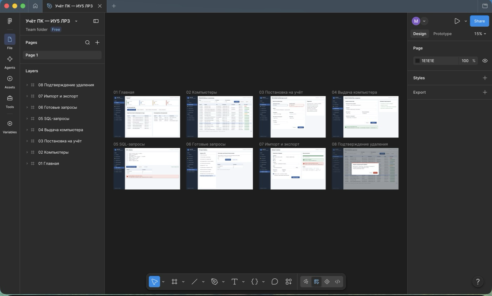

*Рисунок 1 — Фреймы экранов на холсте Figma*

## 3. Экраны приложения

Экраны определены по пользовательским сценариям из ЛР1 (часть 1) и по требованиям к приложению из ЛР3 (часть 2).

| № | Экран (фрейм) | Тип | Назначение | Сценарий ЛР1 |
| --- | --- | --- | --- | --- |
| 1 | `dashboard` — Главная | главный экран | сводка по состояниям, быстрые действия, истекающие гарантии, незавершённые обслуживания | С6 |
| 2 | `computers` — Просмотр данных | форма просмотра | таблица компьютеров с поиском, фильтрами и сортировкой | С1–С6 |
| 3 | `computer_form` — Постановка на учёт | форма ввода | ввод нового компьютера с проверкой полей | С1 |
| 4 | `assign_form` — Выдача компьютера | форма предметной области | закрепление компьютера за сотрудником с проверкой бизнес-правил | С2 |
| 5 | `sql` — SQL-запросы | служебный экран | ввод и выполнение произвольного SQL, вывод результата или ошибки | — |
| 6 | `queries` — Готовые запросы | служебный экран | выбор и запуск запросов ЛР2 с параметром | С4, С6 |
| 7 | `import_export` — Импорт и экспорт | служебный экран | выбор формата, таблицы и файла, статус и журнал операций | — |
| 8 | `delete_confirm` — Подтверждение удаления | модальное окно | подтверждение необратимого действия с последствиями каскада | С5 |

## 4. Wireframes

Wireframes показывают только структуру: серые блоки, рамки, подписи и расположение таблиц, полей, кнопок и навигации, без цвета и оформления. На этом этапе проверялось, что каждая функция приложения имеет место на экране и что экраны одного типа устроены одинаково: слева меню, сверху заголовок с «хлебными крошками», ниже панель инструментов и рабочая область.

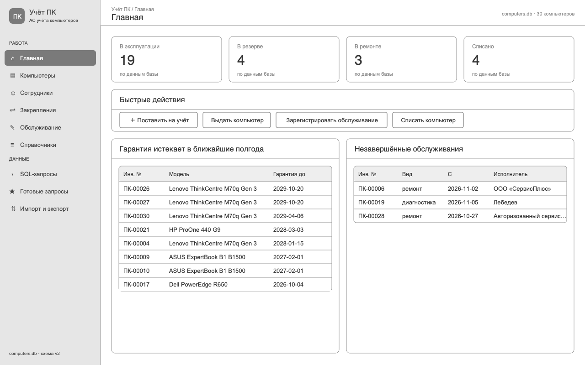

*Рисунок 2 — Wireframe: главный экран*

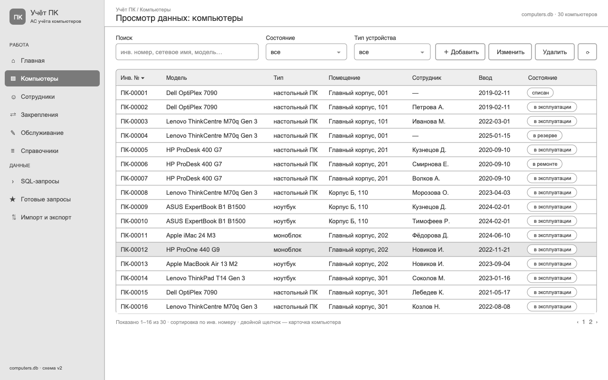

*Рисунок 3 — Wireframe: просмотр таблицы компьютеров*

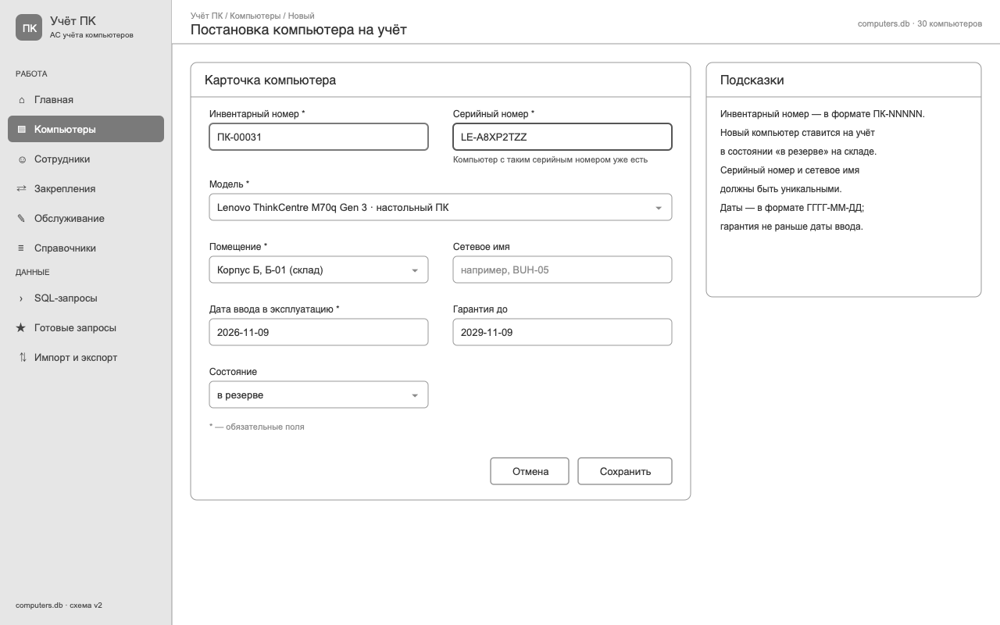

*Рисунок 4 — Wireframe: форма постановки компьютера на учёт*

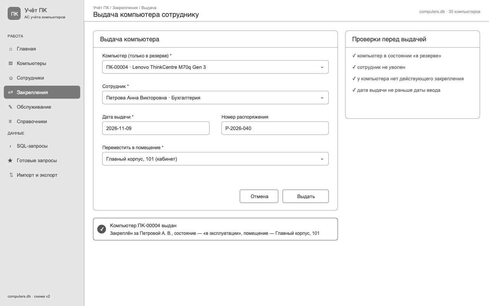

*Рисунок 5 — Wireframe: выдача компьютера сотруднику*

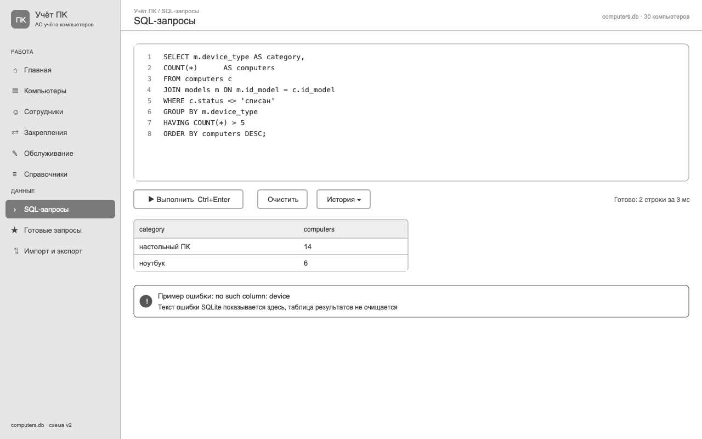

*Рисунок 6 — Wireframe: SQL-запросы*

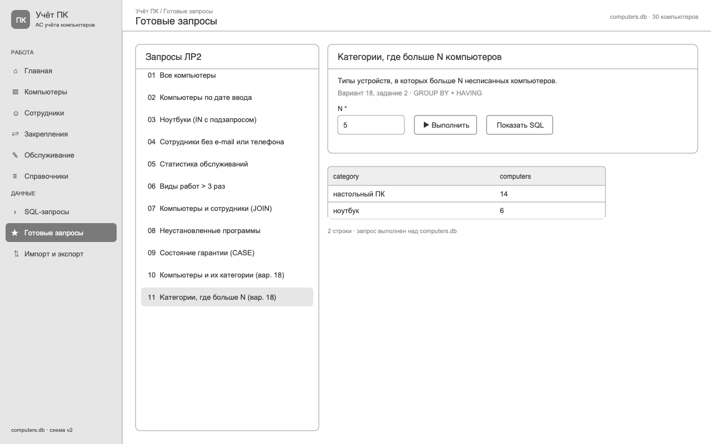

*Рисунок 7 — Wireframe: готовые запросы*

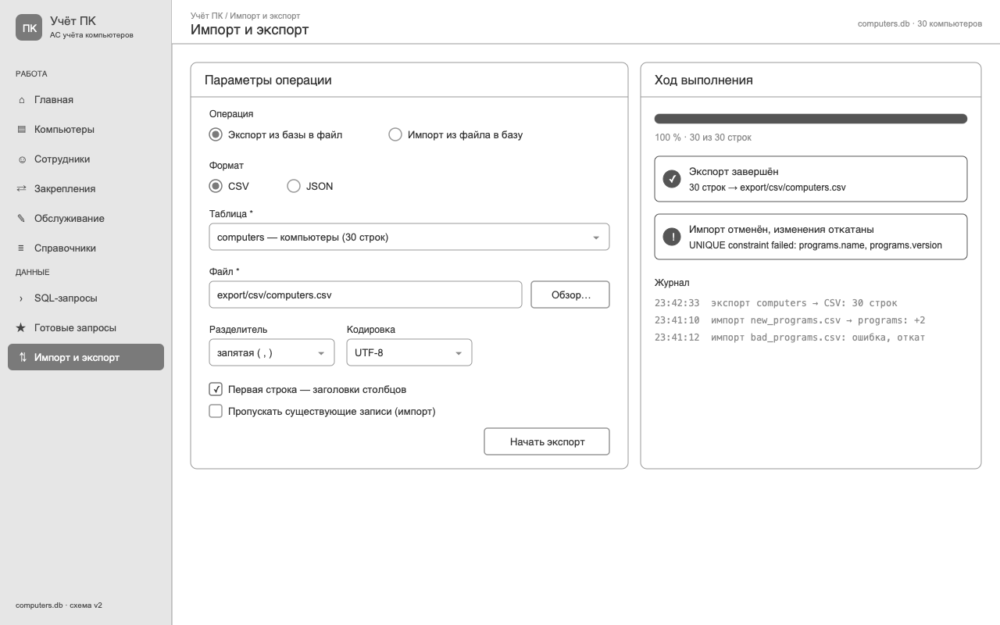

*Рисунок 8 — Wireframe: импорт и экспорт*

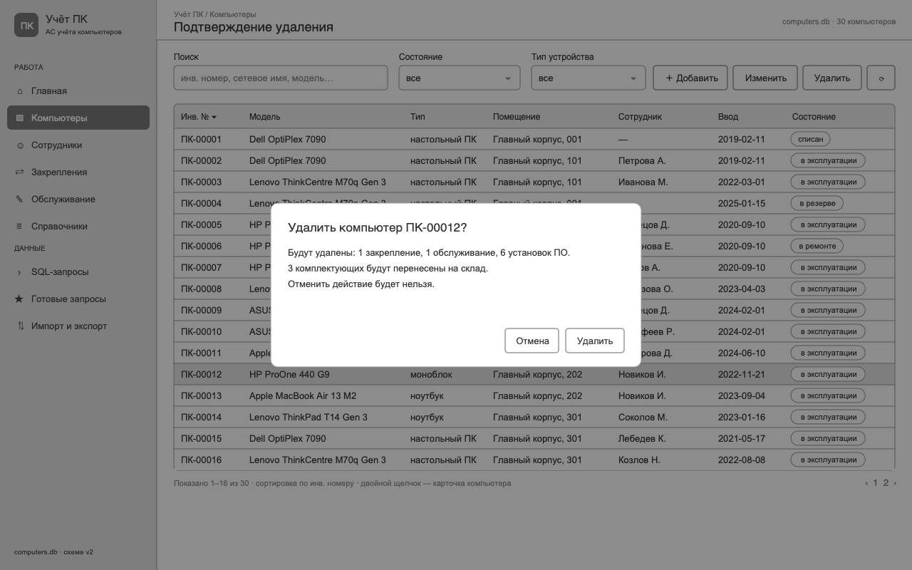

*Рисунок 9 — Wireframe: подтверждение удаления*

## 5. Главное меню и навигация

Меню — постоянная левая панель шириной 220 px, одинаковая на всех экранах. Пункты разделены на две группы:

- **Работа:** Главная, Компьютеры, Сотрудники, Закрепления, Обслуживание, Справочники (отделы, помещения, модели, программы);
- **Данные:** SQL-запросы, Готовые запросы, Импорт и экспорт.

Текущий пункт выделен основным цветом. В верхней панели показаны путь («Учёт ПК / Компьютеры / Новый»), название экрана и открытая база. Внизу меню указан файл базы и версия схемы. Формы ввода открываются из панели инструментов списка или из быстрых действий на главном экране и возвращают пользователя туда, откуда он пришёл.

| Откуда | Элемент | Куда |
| --- | --- | --- |
| любой экран | пункт меню | соответствующий раздел |
| Главная | «＋ Поставить на учёт» | Постановка на учёт |
| Главная | «Выдать компьютер» | Выдача компьютера |
| Компьютеры | «＋ Добавить» | Постановка на учёт |
| Компьютеры | «Удалить» | Подтверждение удаления |
| Постановка на учёт | «Сохранить» / «Отмена» | Компьютеры |
| Выдача компьютера | «Выдать» / «Отмена» | Главная |
| Подтверждение удаления | «Удалить» / «Отмена» | Компьютеры |
| Готовые запросы | «Показать SQL» | SQL-запросы |

## 6. Формы просмотра данных

Экран «Просмотр данных» (рисунки 3 и 11) — основной для работы с таблицами:

- **поиск** по инвентарному номеру, сетевому имени и модели — одно поле над таблицей;
- **фильтры** по состоянию и типу устройства — выпадающие списки рядом с поиском;
- **сортировка** — щелчок по заголовку столбца, направление показано стрелкой (▾ у «Инв. №»);
- **действия** над выбранной строкой: «Добавить», «Изменить», «Удалить», «Обновить»; двойной щелчок открывает карточку;
- **читаемость:** чередование фона строк, выделение выбранной строки, состояние компьютера — цветной меткой, длинные значения обрезаются многоточием, внизу строка состояния и постраничная навигация.

Для других таблиц (сотрудники, закрепления, обслуживание, справочники) используется тот же шаблон, меняются только столбцы и фильтры.

## 7. Формы для выполнения SQL-запросов

Экран «SQL-запросы» (рисунки 6 и 15):

- область ввода с моноширинным шрифтом и номерами строк;
- кнопки «▶ Выполнить» (Ctrl+Enter), «Очистить» и «История»;
- строка статуса: число строк и время выполнения;
- таблица результата под редактором;
- плашка ошибки с текстом сообщения SQLite. Результат предыдущего запроса при ошибке не стирается.

Экран «Готовые запросы» (рисунки 7 и 16) показывает список запросов ЛР2. Для выбранного запроса выводятся описание, поле параметра (N для варианта 18) и кнопки «Выполнить» и «Показать SQL».

## 8. Интерфейс импорта и экспорта

Экран «Импорт и экспорт» (рисунки 8 и 17) разделён на две панели:

- **параметры:** операция (экспорт или импорт), формат (CSV или JSON), таблица, файл с кнопкой «Обзор…», разделитель, кодировка, флажки «Первая строка — заголовки» и «Пропускать существующие записи»;
- **ход выполнения:** индикатор прогресса, плашка результата (успех — зелёная, ошибка с откатом — красная, с текстом причины) и журнал операций с временем.

## 9. Дизайн-система

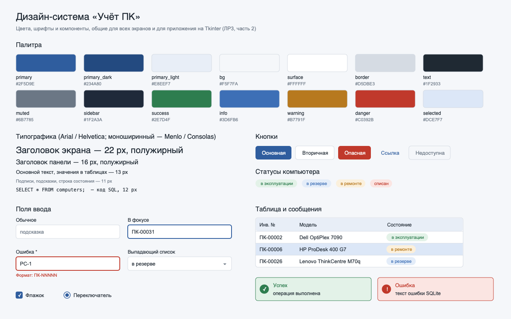

*Рисунок 10 — Лист дизайн-системы*

**Цветовая палитра.**

| Роль | Цвет | Применение |
| --- | --- | --- |
| primary | #2F5D9E | основные кнопки, активный пункт меню, фокус поля |
| primary_light | #E8EEF7 | заголовок таблицы |
| bg / surface | #F5F7FA / #FFFFFF | фон окна / фон панелей и полей |
| border | #D5DBE3 | рамки панелей, полей, линии таблиц |
| text / muted | #1F2933 / #6B7785 | основной текст / подписи и подсказки |
| sidebar | #1F2A3A | фон меню |
| success | #2E7D4F | «в эксплуатации», успешные операции |
| info | #3D6FB6 | «в резерве» |
| warning | #B7791F | «в ремонте» |
| danger | #C0392B | «списан», ошибки, удаление |

Цвета состояний совпадают с доменом «Состояние компьютера» из ЛР1. Цвет никогда не единственный носитель смысла: метка всегда содержит текст состояния.

**Шрифты:** Arial / Helvetica (есть во всех ОС и доступен в Tkinter): заголовок экрана — 22 px полужирный, заголовок панели — 16 px полужирный, основной текст и таблицы — 13 px, подписи и строка состояния — 11 px. Код SQL — Menlo / Consolas, 12 px.

**Компоненты** (в Figma — основные компоненты с вариантами):

- кнопка: основная, вторичная, опасная, ссылка; состояние «недоступна»;
- поле ввода: обычное, в фокусе, с ошибкой (красная рамка и текст под полем); выпадающий список; обязательные поля отмечены «*»;
- флажок, переключатель;
- таблица: заголовок, строки с чередованием, выбранная строка, метка состояния;
- плашки сообщений: успех, ошибка;
- модальное окно с затемнением фона;
- карточка показателя, панель с заголовком, боковое меню, верхняя панель.

**Единый стиль:** все экраны собраны из одних и тех же компонентов, используют одну сетку (отступ 24 px от меню, 16 px между панелями) и одинаковое расположение элементов.

## 10. Mockups

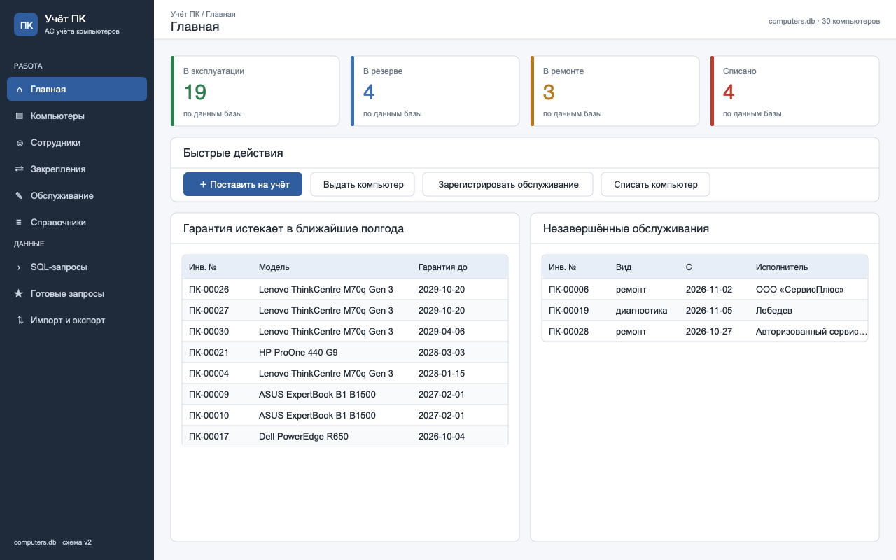

*Рисунок 11 — Mockup: главный экран*

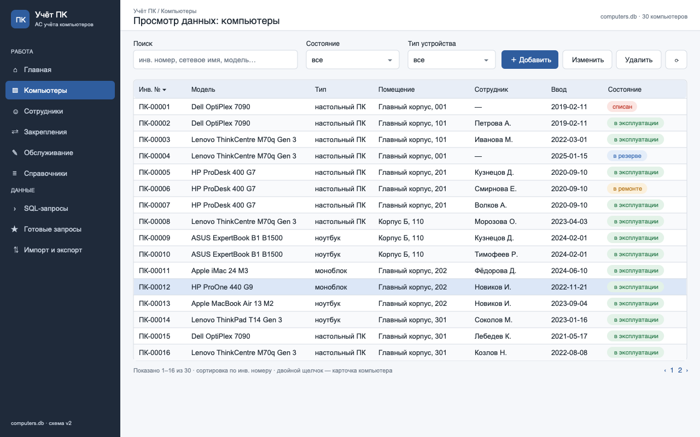

*Рисунок 12 — Mockup: просмотр таблицы компьютеров*

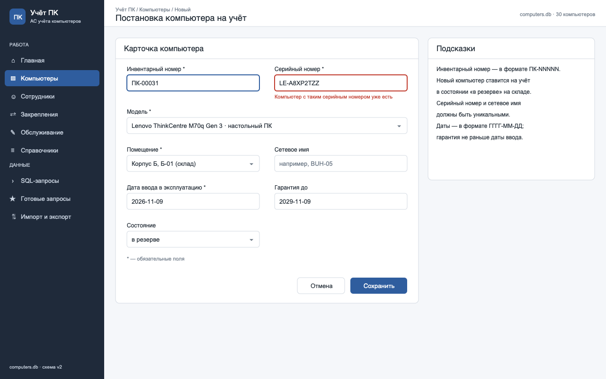

*Рисунок 13 — Mockup: форма постановки на учёт с ошибкой проверки*

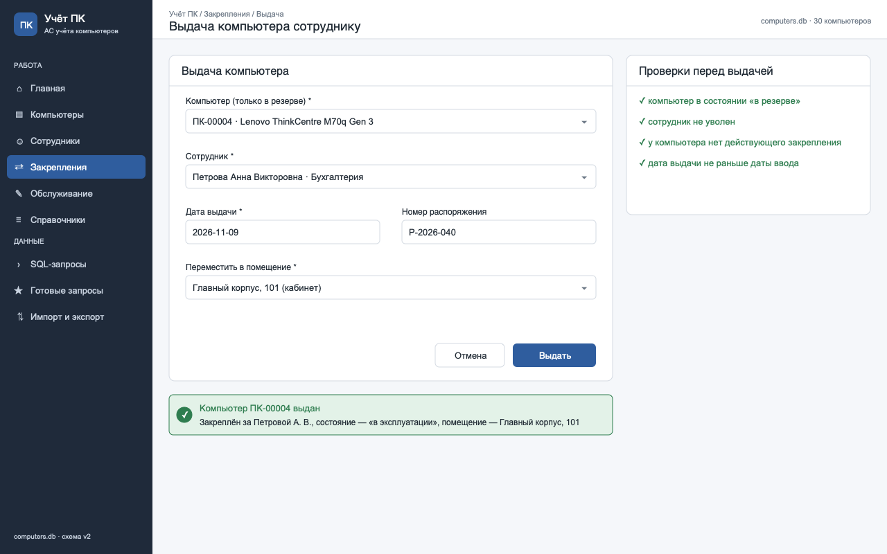

*Рисунок 14 — Mockup: выдача компьютера сотруднику*

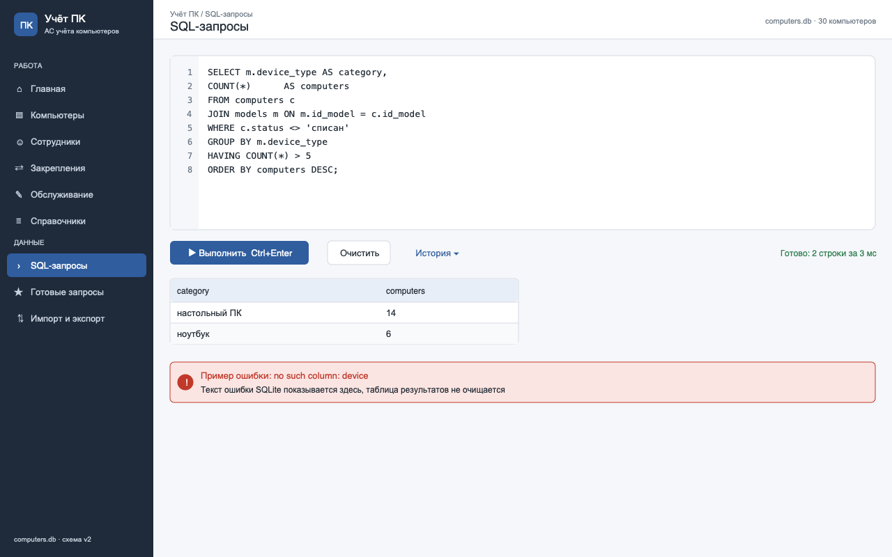

*Рисунок 15 — Mockup: SQL-запросы*

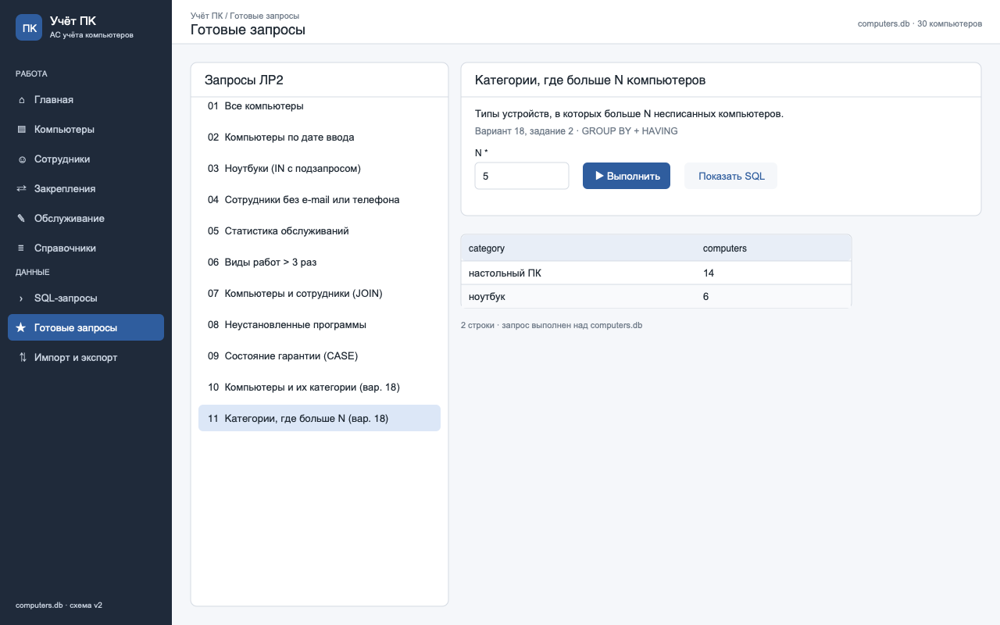

*Рисунок 16 — Mockup: готовые запросы*

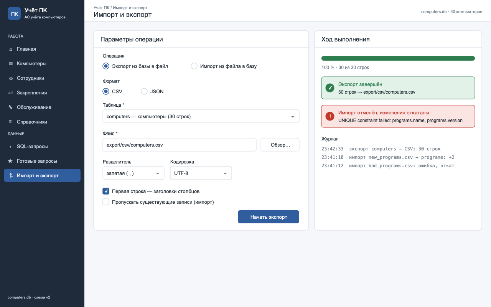

*Рисунок 17 — Mockup: импорт и экспорт*

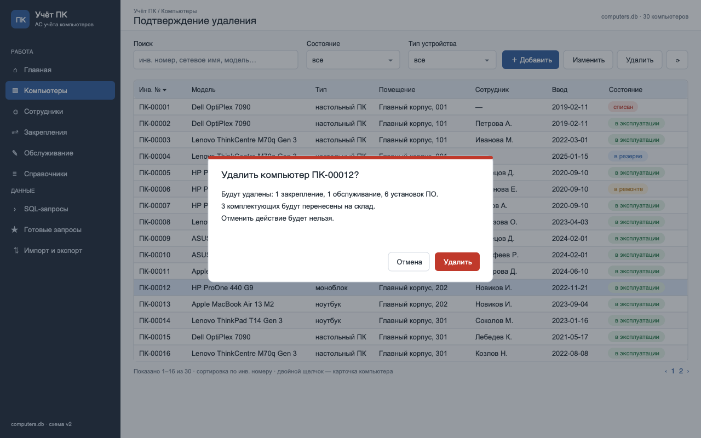

*Рисунок 18 — Mockup: подтверждение удаления*

На форме постановки на учёт показано состояние ошибки: введён серийный номер, который уже есть в базе (ограничение UNIQUE из ЛР1). На форме выдачи перечислены проверки бизнес-правил БО1–БО3 и показано сообщение об успехе. В диалоге удаления перечислены последствия каскадных операций (ON DELETE CASCADE и SET NULL из ЛР1).

## 11. Интерактивный прототип

В Figma на вкладке Prototype кнопки и пункты меню связаны с фреймами переходами «On click → Navigate to» (переходы — по таблице раздела 5). Стартовый фрейм — «Главная». Для модального окна задан переход «Open overlay».

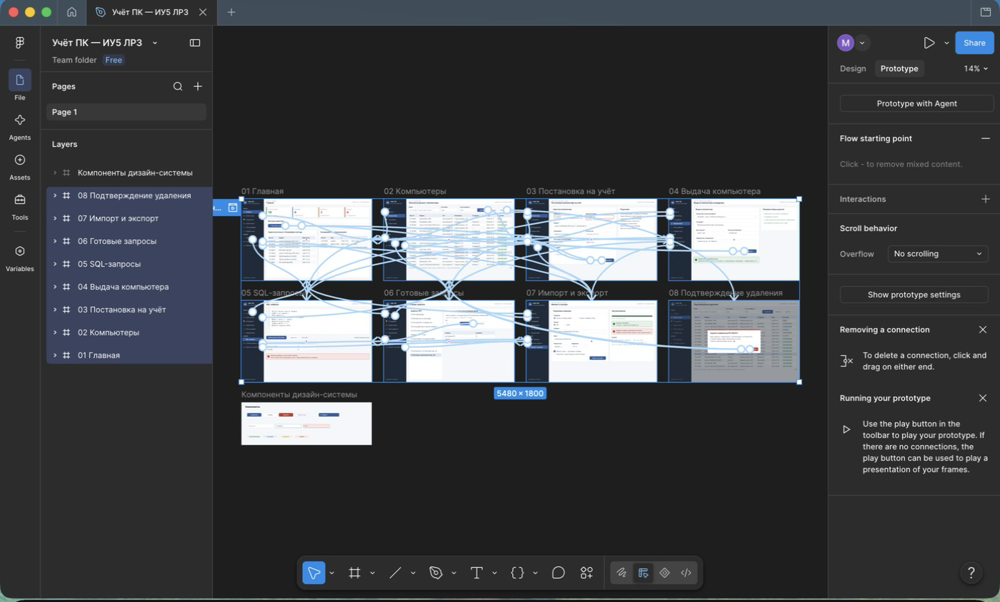

*Рисунок 19 — Связи прототипа в Figma*

Те же переходы реализованы в `design/prototype/index.html` — самостоятельном файле, который открывается в любом браузере без Figma. Кнопка «Показать кликабельные области» подсвечивает активные элементы, кнопка «Режим» переключает wireframes и mockups.

Прототип демонстрирует сценарии:

1. **Постановка на учёт (С1):** Главная → «Поставить на учёт» → форма → «Сохранить» → список компьютеров.
2. **Выдача компьютера (С2):** Главная → «Выдать компьютер» → форма с проверками → «Выдать» → Главная.
3. **Удаление ошибочной записи:** Компьютеры → выбрать строку → «Удалить» → подтверждение → список.
4. **Работа с данными:** меню → Готовые запросы → «Показать SQL» → SQL-запросы; меню → Импорт и экспорт.

## 12. Адаптивность

Приложение настольное, но окно может быть разного размера. Правила адаптации:

- минимальный размер окна — 1024×640;
- при ширине меньше 1100 px меню сворачивается до значков (подписи — во всплывающих подсказках);
- таблицы растягиваются по ширине окна: фиксированную ширину имеют узкие столбцы (номер, дата, состояние), остальное пространство делят текстовые столбцы; при нехватке места появляется горизонтальная прокрутка;
- двухколоночные формы на узком окне перестраиваются в одну колонку, панель подсказок уходит под форму;
- на экранах SQL и импорта панели располагаются друг под другом, если ширина меньше 1100 px.

## 13. Выводы

1. Определены 8 экранов приложения, покрывающих сценарии из ЛР1 и функции из задания ЛР3 (часть 2): просмотр, ввод, предметные операции, SQL, готовые запросы, импорт и экспорт.
2. Созданы wireframes и mockups всех экранов из одного описания, поэтому структура и оформление согласованы.
3. Спроектированы главное меню и навигация, формы просмотра с сортировкой, фильтрами и поиском, формы ввода с проверкой, формы SQL и импорта и экспорта с отображением статуса и ошибок.
4. Подготовлена дизайн-система (палитра, шрифты, компоненты), которая используется в приложении на Tkinter.
5. Собран интерактивный прототип с переходами между экранами, демонстрирующий основные сценарии.

---

## Приложение. Ответы на контрольные вопросы

1. **UX и UI.** UX — логика взаимодействия: какие экраны есть, в каком порядке пользователь выполняет действия, насколько легко достигает цели. UI — визуальное оформление: цвета, шрифты, вид элементов управления.
2. **Принципы проектирования форм ввода.** Логическая группировка полей в порядке сценария, понятные подписи, явная отметка обязательных полей, подходящие элементы (списки вместо ввода кодов), проверка с сообщением рядом с полем, значения по умолчанию, предсказуемые кнопки «Сохранить» и «Отмена».
3. **Wireframe.** Схематичное изображение экрана без оформления. Нужен, чтобы на раннем этапе договориться о составе и расположении элементов, не отвлекаясь на стиль.
4. **Wireframe, mockup и прототип.** Wireframe — структура. Mockup — статичный экран в итоговом оформлении. Прототип — связанные экраны, по которым можно «пройти» сценарий кликами.
5. **Компоненты в Figma.** Повторно используемые элементы (кнопка, поле, таблица, меню) с вариантами состояний. Экземпляры компонента размещаются на экранах.
6. **Чем помогают компоненты.** Изменение основного компонента автоматически применяется ко всем экземплярам. Стиль остаётся единым, правки делаются в одном месте.
7. **Адаптивный дизайн.** Интерфейс корректно работает при разных размерах окна и экрана: перестраивается сетка, сворачиваются панели, меняются размеры элементов. Важно, чтобы приложение оставалось удобным на любом мониторе (раздел 12).
8. **Что унифицировать в дизайн-системе.** Цвета (включая цвета состояний), шрифты и размеры, отступы и сетку, кнопки, поля, таблицы, сообщения, модальные окна, значки, меню.
9. **Зачем документировать дизайн.** Чтобы разработчик реализовал интерфейс без догадок: состав экранов, переходы, компоненты и их состояния, палитра и шрифты. Это снижает число вопросов и расхождений с макетом.
10. **Как прототип помогает найти ошибки.** Прохождение сценария по связанным экранам показывает тупики, лишние шаги, отсутствующие кнопки и неочевидные переходы до того, как написан код. Исправить макет дешевле, чем программу.
