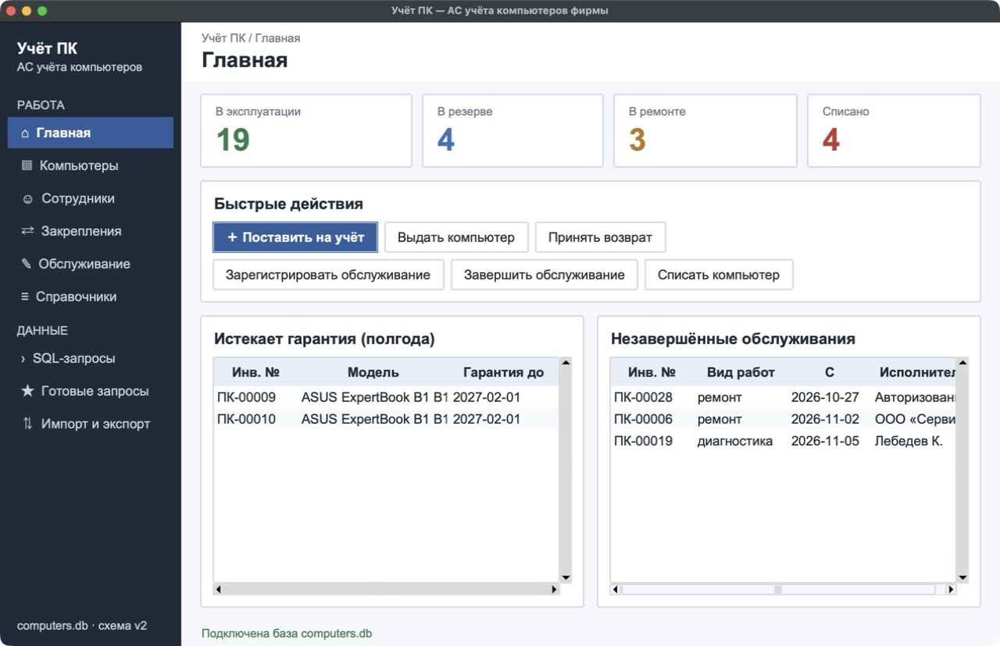
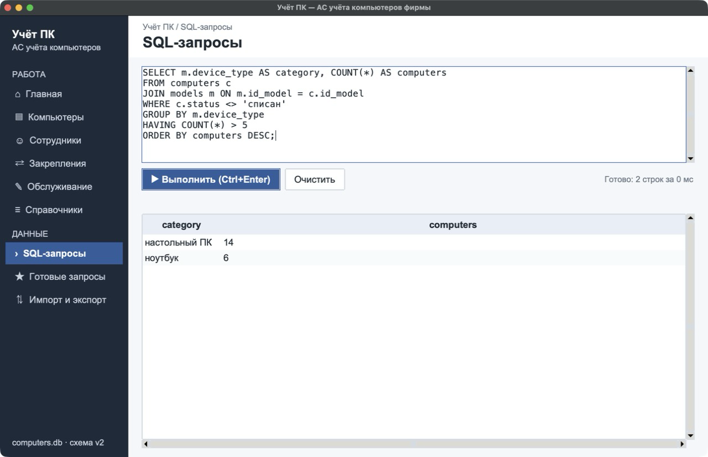
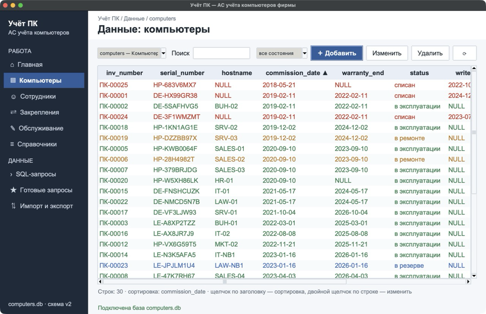
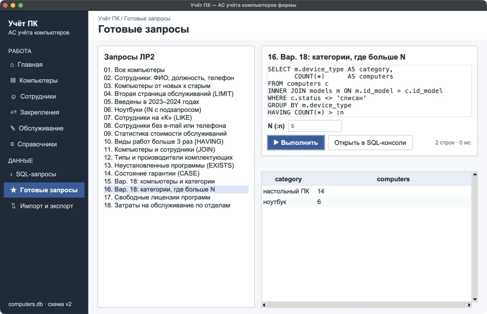
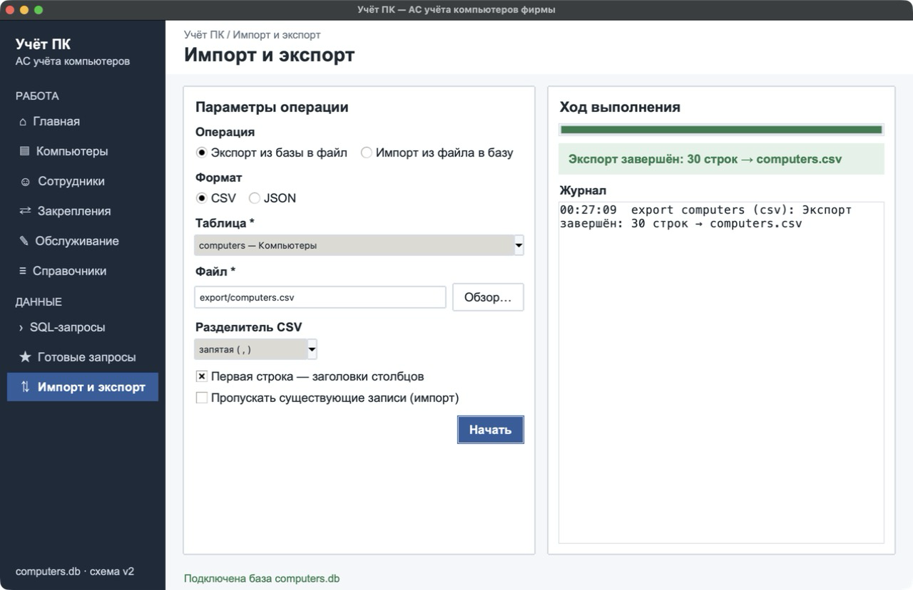
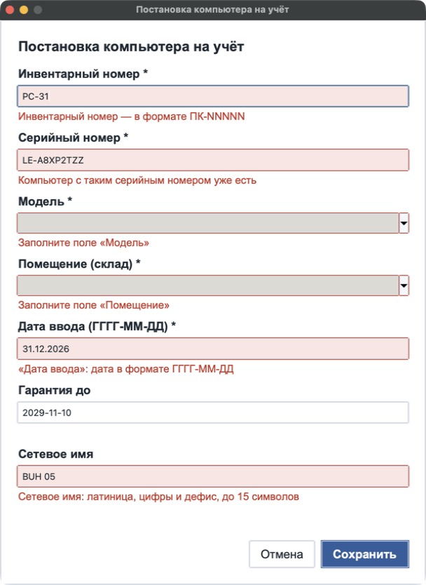
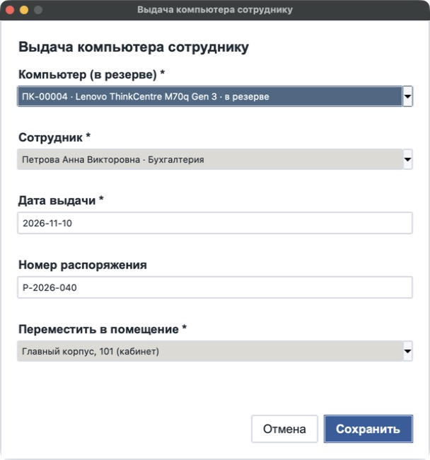

# Лабораторная работа № 3 (часть 2)

## «Создание приложения для работы с базой данных»

**Дисциплина:** Модели данных
**Тема:** АС учёта компьютеров, используемых фирмой

---

## 1. Цель работы

Разработать настольное приложение на Python с графическим интерфейсом Tkinter для работы с базой данных SQLite учёта компьютеров. Приложение должно:

- подключаться к базе;
- выполнять произвольные и готовые SQL-запросы;
- показывать данные таблиц в Treeview;
- позволять вводить, изменять и удалять данные;
- выполнять импорт и экспорт CSV и JSON;
- реализовывать функции предметной области с проверкой ввода в оформлении из ЛР3 (часть 1).

## 2. Запуск и окружение

```bash
cd lab3/part2
python3 app/main.py
```

Без аргумента открывается `data/computers.db` — база после миграций ЛР2 (схема версии 2). Другую базу можно передать аргументом или открыть через меню «Файл → Открыть базу…». Нужен Python 3.9+ с Tk 8.6 или новее. Проверено на Python 3.12 с Tk 9.0. Сторонние библиотеки не используются.

Системный Python 3.9 в macOS поставляется с устаревшим Tk 8.5: на текущей версии macOS окно на нём зависает при первой отрисовке. Логика приложения на нём работает (тесты проходят), но для интерфейса нужен Python с Tk 8.6+ — например, установщик с python.org или `uv python install 3.12`.

## 3. Архитектура

Логика работы с базой отделена от интерфейса (задание 3.3): модули `db.py`, `services.py`, `io_ops.py`, `queries.py` не импортируют Tkinter и проверяются автотестами без окна.

| Модуль | Слой | Назначение |
| --- | --- | --- |
| `app/db.py` | доступ к данным | класс `Database`: подключение, выполнение SQL, транзакции, метаданные таблиц, вставка, изменение и удаление по первичному ключу |
| `app/services.py` | предметная область | класс `Accounting`: справочники для форм и операции учёта с проверкой бизнес-правил |
| `app/io_ops.py` | предметная область | импорт и экспорт таблиц в CSV и JSON в транзакции |
| `app/queries.py` | предметная область | каталог готовых запросов: файлы ЛР2 и дополнительные запросы с параметрами |
| `app/theme.py` | интерфейс | палитра и шрифты из дизайн-системы ЛР3 (часть 1), стили ttk |
| `app/widgets.py` | интерфейс | таблица на Treeview с сортировкой и поиском, выпадающий список «ключ — подпись», плашка сообщения |
| `app/dialogs.py` | интерфейс | формы операций, универсальная карточка записи, подтверждение удаления |
| `app/views.py` | интерфейс | экраны: Главная, Просмотр данных, SQL-запросы, Готовые запросы, Импорт и экспорт |
| `app/main.py` | интерфейс | главное окно, меню, боковая навигация, подключение к базе, выход |
| `tests/test_logic.py` | тесты | 19 автотестов логики на временной копии базы |
| `tests/smoke_ui.py` | тесты | смоук-тест интерфейса: все экраны, формы и операции |

## 4. Главное окно и меню

Окно повторяет макет из ЛР3 (часть 1): слева тёмная боковая панель навигации, сверху путь и название экрана, ниже рабочая область, внизу строка состояния.



*Рисунок 1 — Главное окно приложения*

Строка меню:

| Меню | Пункты |
| --- | --- |
| Файл | Открыть базу…, Закрыть базу, Резервная копия…, Выход |
| Данные | Компьютеры, Сотрудники, Закрепления, Обслуживание, Комплектующие, Программы, Справочники; Добавить, Изменить, Удалить запись |
| Операции | Поставить компьютер на учёт, Выдать компьютер, Принять возврат, Зарегистрировать обслуживание, Завершить обслуживание, Установить программу, Списать компьютер |
| Запросы | SQL-консоль, Готовые запросы |
| Импорт/экспорт | Экспорт данных…, Импорт данных… |
| Справка | О программе |

Боковая панель дублирует основные разделы, текущий раздел подсвечен. Главный экран показывает число компьютеров по состояниям, быстрые действия, компьютеры с истекающей гарантией и незавершённые обслуживания.

## 5. Подключение к базе данных

```python
def open(self, path):
    path = Path(path)
    if not path.exists():
        raise DatabaseError(f"Файл базы данных не найден: {path}")
    try:
        con = sqlite3.connect(path)
        con.execute("PRAGMA foreign_keys = ON")
        con.execute("SELECT COUNT(*) FROM sqlite_master").fetchone()
    except sqlite3.Error as e:
        raise DatabaseError(f"Не удалось открыть базу данных {path.name}: {e}") from e
    self.close()
    self.con, self.path = con, path
```

- **Нет файла.** `sqlite3.connect` молча создал бы пустую базу, поэтому наличие файла проверяется заранее.
- **Файл не является базой.** Пробный запрос к `sqlite_master` вызывает ошибку «file is not a database».
- В обоих случаях пользователь видит сообщение, приложение остаётся открытым, и можно выбрать другой файл.
- Для каждого соединения включается `PRAGMA foreign_keys = ON`: без этого SQLite не проверяет внешние ключи из ЛР1.
- **Закрытие соединения.** Через меню «Файл → Закрыть базу», при открытии другой базы и при выходе. Обработчик закрытия окна (`WM_DELETE_WINDOW`) сначала закрывает соединение, затем окно.

## 6. Модуль выполнения SQL-запросов

`Database.run` выполняет любой запрос и возвращает результат: столбцы, строки, число изменённых строк и время.

- Для SELECT возвращаются данные.
- Для INSERT, UPDATE и DELETE изменения фиксируются (`commit`).
- При ошибке транзакция откатывается, а текст ошибки SQLite передаётся интерфейсу как `DatabaseError`.
- Если введено несколько инструкций через `;`, они выполняются как скрипт.

```python
def run(self, sql, params=()):
    con = self._require()
    start = time.perf_counter()
    try:
        cur = con.execute(sql, params)
        if cur.description:
            cols = [d[0] for d in cur.description]
            rows = cur.fetchall()
            return Result(cols, rows, len(rows), (time.perf_counter() - start) * 1000)
        con.commit()
        return Result([], [], cur.rowcount, (time.perf_counter() - start) * 1000)
    except (sqlite3.ProgrammingError, sqlite3.Warning) as e:
        ...
    except sqlite3.Error as e:
        if con.in_transaction:
            con.rollback()
        raise DatabaseError(str(e)) from e
```

Экран «SQL-запросы» (рисунок 2):

- редактор с моноширинным шрифтом;
- выполнение кнопкой или Ctrl+Enter / Cmd+Enter; если в редакторе выделен фрагмент, выполняется только он;
- кнопка «Очистить»;
- строка состояния: число строк и время;
- таблица результата;
- при ошибке — красная плашка с текстом SQLite, а предыдущий результат не стирается.

После изменяющих запросов обновляются остальные экраны.



*Рисунок 2 — Экран SQL-запросов*

## 7. Просмотр данных в Treeview

Экран «Просмотр данных» (рисунок 3) показывает любую таблицу базы. Таблица выбирается из списка или пунктом меню. Компонент `DataTable` (`widgets.py`) построен на `ttk.Treeview` с вертикальной и горизонтальной прокруткой:

- **сортировка** — щелчок по заголовку столбца, повторный щелчок меняет направление (▲ / ▼); числа сортируются как числа, NULL — в конце;
- **поиск** — по подстроке во всех столбцах, без учёта регистра (в том числе для кириллицы), по мере ввода;
- **фильтр по состоянию** — для таблицы компьютеров, выполняется SQL-запросом с параметром;
- **оформление** — чередование фона строк, цвет строки по состоянию компьютера (цвета дизайн-системы), выделение выбранной строки;
- **ввод, изменение и удаление** — кнопки «＋ Добавить», «Изменить» (или двойной щелчок по строке), «Удалить»; строка состояния показывает «Показано N из M» и текущую сортировку.

Данные перечитываются из базы после каждой операции, выполненного запроса или импорта (задание 4.3).



*Рисунок 3 — Просмотр таблицы компьютеров*

**Карточка записи** (`RecordDialog`) строится по структуре таблицы (`PRAGMA table_info`, `PRAGMA foreign_key_list`):

- для обычного столбца — поле ввода с типом в подписи;
- для внешнего ключа — выпадающий список записей родительской таблицы;
- обязательные поля (NOT NULL без DEFAULT) отмечены «*»;
- числовые значения проверяются перед сохранением;
- ошибки ограничений (CHECK, UNIQUE, FOREIGN KEY) показываются в форме текстом SQLite.

**Удаление** спрашивает подтверждение и перечисляет последствия по внешним ключам. Например, для компьютера: «связанные записи в software_installs: 6 — будут удалены (CASCADE)». Удаление, запрещённое RESTRICT (отдел с сотрудниками), отклоняется с сообщением СУБД.

## 8. Готовые запросы

Экран «Готовые запросы» (рисунок 4) загружает все 16 запросов ЛР2 прямо из файлов `lab2/part1/queries/*.sql` и добавляет два собственных запроса с параметрами: «Свободные лицензии» и «Затраты по отделам за период». Выбранный запрос показывается с текстом SQL. Для параметризованных запросов выводятся поля параметров: N в варианте 18, даты «с» и «по» для затрат. Параметры передаются через именованные плейсхолдеры (`:n`, `:date_from`), а не подстановкой в строку. Кнопка «Открыть в SQL-консоли» переносит запрос в редактор.

После миграции из ЛР2 (часть 2) название здания хранится в таблице `buildings`. Поэтому запрос 11 при загрузке автоматически адаптируется к схеме версии 2: добавляется соединение с `buildings`. Это выявил автотест `test_catalog_runs`, который выполняет каждый запрос каталога.



*Рисунок 4 — Экран готовых запросов (вариант 18)*

## 9. Импорт и экспорт

Экран «Импорт и экспорт» (рисунок 5) сделан по макету: операция, формат (CSV или JSON), таблица, файл с кнопкой «Обзор…» (стандартные диалоги открытия и сохранения), разделитель, флажки «Первая строка — заголовки» и «Пропускать существующие записи». Справа — индикатор выполнения, плашка результата и журнал операций.

Логика (`io_ops.py`) повторяет скрипты ЛР2 (часть 2):

- экспорт выгружает всю таблицу;
- импорт сверяет столбцы файла с таблицей и вставляет все строки одной транзакцией;
- при нарушении ограничения импорт целиком откатывается, а на экране показывается причина.



*Рисунок 5 — Экран импорта и экспорта*

## 10. Интеграция дизайна из Figma

Цвета, шрифты и компоненты взяты из дизайн-системы ЛР3 (часть 1). В `theme.py` они переведены в стили ttk; используется тема `clam`, так как она разрешает менять цвета виджетов.

| Элемент дизайн-системы | Реализация в Tkinter |
| --- | --- |
| палитра (primary #2F5D9E, bg #F5F7FA, sidebar #1F2A3A, цвета состояний) | словарь `theme.C`, стили `ttk.Style.configure` |
| основная, вторичная и опасная кнопки | стили `Primary.TButton`, `TButton`, `Danger.TButton` |
| боковое меню и активный пункт | `Sidebar.TFrame`, `Nav.TButton`, `NavActive.TButton` |
| поле с ошибкой | `Bad.TEntry`, `Bad.TCombobox` и красная подпись под полем |
| заголовок таблицы, чередование и выделение строк | `Treeview.Heading`, теги `odd`, `success` / `info` / `warning` / `danger` |
| карточки и панели | `Card.TFrame` с рамкой |
| плашки сообщений | `Msgsuccess.TLabel`, `Msgdanger.TLabel` и т.д. |
| шрифты: заголовок 20–22, панель 15–16, текст 13, подписи 11, SQL — моноширинный 12 | `theme.fonts()` подбирает доступное семейство (Arial → Helvetica → Segoe UI) |

Структура экранов совпадает с макетами: боковое меню из 9 пунктов в двух группах, верхняя панель с путём, рабочая область с панелями.

## 11. Функции предметной области

Операции реализованы в `services.Accounting`, формы к ним — в `dialogs.OperationDialog`. Каждая форма открывается из меню «Операции» или кнопкой на главном экране. Выпадающие списки содержат только допустимые варианты: например, «Выдать» предлагает лишь компьютеры в резерве и неуволенных сотрудников. Перед сохранением проверяется каждое поле. Ошибки показываются красным текстом под полем, а поле подсвечивается. Изменения выполняются одной транзакцией: либо все, либо ни одного. Результат выводится в окне сообщения и строке состояния, данные на экранах обновляются.

| Операция (сценарий ЛР1) | Проверки | Изменения в базе |
| --- | --- | --- |
| Постановка на учёт (С1) | формат «ПК-NNNNN» и уникальность инв. номера; уникальность серийного номера и сетевого имени; формат имени; помещение — склад; даты в формате ГГГГ-ММ-ДД, не в будущем; гарантия не раньше ввода | INSERT computers, состояние «в резерве» |
| Выдача сотруднику (С2) | компьютер в резерве и без действующего закрепления (БО1, БО3); сотрудник не уволен (БО2); дата выдачи не раньше ввода; помещение — кабинет или серверная | INSERT assignments; состояние «в эксплуатации», новое помещение |
| Возврат на склад (С2) | закрепление действующее; компьютер не в ремонте; дата возврата не раньше выдачи; помещение — склад | дата возврата; состояние «в резерве», склад |
| Регистрация обслуживания (С3) | компьютер в эксплуатации или резерве, без открытого обслуживания (БО4); ровно один исполнитель — сотрудник ИТ или организация (БО7); дата начала не раньше ввода | INSERT services; состояние «в ремонте» |
| Завершение обслуживания (С3) | обслуживание незавершённое; дата окончания не раньше начала; работы указаны; стоимость — число ≥ 0 | дата, работы, стоимость; состояние «в эксплуатации» или «в резерве» по БО3 |
| Установка программы (С4) | компьютер не списан; программа ещё не установлена; для платной программы есть свободная лицензия (БО8) | INSERT software_installs |
| Списание (С5) | компьютер не списан и не в ремонте; дата не раньше ввода и последней выдачи | закрытие закрепления (БО5); комплектующие на склад (по флажку); удаление установок ПО; состояние «списан» |



*Рисунок 6 — Форма постановки на учёт с ошибками проверки*



*Рисунок 7 — Форма выдачи компьютера сотруднику*

Проверки в приложении дополняют ограничения базы. Межтабличные правила БО2, БО3, БО6 и БО8, которые не выражаются через CHECK (ЛР1, часть 2), контролируются здесь. Ограничения базы остаются последней линией защиты: если запрос обойдёт форму (например, через SQL-консоль), СУБД всё равно отклонит недопустимые данные.

## 12. Тестирование

**Автотесты логики** (`python3 -m unittest discover -s tests`) выполняются на временной копии базы, рабочая база не меняется. Результат — 19 тестов, OK.

| Группа | Что проверено |
| --- | --- |
| Подключение | несуществующий файл; файл, не являющийся базой |
| SQL-модуль | SELECT, ошибка «no such column», UPDATE с числом строк, скрипт из нескольких инструкций, откат при нарушении CHECK, подсчёт зависимых записей, запрет удаления RESTRICT |
| Операции | успешные постановка, выдача и возврат, цикл обслуживания, списание, установка программы; отклонение неверного формата, дубликатов, уволенного сотрудника, двух исполнителей, отрицательной стоимости, превышения лицензий |
| Импорт/экспорт | обратная загрузка CSV и JSON, пропуск дубликатов, откат при конфликте, неизвестный столбец |
| Готовые запросы | все 18 запросов каталога выполняются, параметр N в варианте 18 меняет результат (N = 5 → 2 категории, N = 2 → 4) |

**Смоук-тест интерфейса** (`tests/smoke_ui.py`) открывает окно на копии базы и проходит все экраны, формы и операции. Скриншоты в отчёте сняты с работающего приложения. По ним дополнительно поправлена вёрстка: панель инструментов таблиц, ширина столбцов на главном экране, цвета списка в тёмной теме macOS.

```
главная: ['19', '4', '3', '4']
фильтр «в резерве»: 4 строк
форма register: пустая отправка → ошибки в полях ['serial_number', 'id_model', 'id_room']
форма assign: пустая отправка → ошибки в полях ['inv_number', 'tab_number', 'id_room']
форма return: пустая отправка → ошибки в полях ['id_assignment', 'id_room']
форма service_open: пустая отправка → ошибки в полях ['inv_number', 'work_type', 'executor_tab_number']
форма service_close: пустая отправка → ошибки в полях ['id_service', 'works_done']
форма writeoff: пустая отправка → ошибки в полях ['inv_number']
форма install: пустая отправка → ошибки в полях ['inv_number', 'id_program']
карточки записей всех 11 таблиц: ok
SQL: Готово: 2 строк за 0 мс
SQL с ошибкой: Ошибка: no such column: nope
готовый запрос: 16. Вар. 18: категории, где больше N → 2 строк · 0 мс
экспорт: Экспорт завершён: 30 строк → computers.csv
повторный импорт без пропуска: Ошибка, импорт отменён, изменения откатаны: UNIQUE constraint failed: ...
```

Тесты нашли и помогли исправить две ошибки:

1. Запрос 11 из ЛР2 обращался к удалённому миграцией столбцу `rooms.building`.
2. В Python 3.9 несколько инструкций вызывают `sqlite3.Warning`, а не `ProgrammingError`, поэтому скрипты из SQL-консоли не выполнялись.

## 13. Выводы

1. Разработано настольное приложение на Python и Tkinter для базы SQLite учёта компьютеров. В нём есть главное окно с меню и боковой навигацией, подключение к базе с обработкой ошибок и корректным закрытием, SQL-консоль, просмотр таблиц в Treeview с сортировкой, поиском и фильтром, ввод, изменение и удаление записей, готовые запросы ЛР2 с параметрами, импорт и экспорт CSV и JSON.
2. Логика работы с базой отделена от интерфейса и покрыта 19 автотестами. Интерфейс проверен смоук-тестом.
3. Оформление соответствует дизайн-системе и макетам ЛР3 (часть 1): палитра, шрифты, компоненты и структура экранов.
4. Реализованы 7 операций предметной области (постановка на учёт, выдача, возврат, открытие и завершение обслуживания, установка программы, списание) с проверкой ввода и бизнес-правил. Изменения выполняются транзакциями, результат показывается пользователю.

---

## Приложение. Ответы на контрольные вопросы

1. **Tkinter.** Стандартная библиотека Python для графических интерфейсов: окна, кнопки, поля, списки, таблицы, меню, диалоги. Не требует установки, работает в Windows, macOS и Linux.
2. **Элементы приложения на Tkinter.** Главное окно `Tk`; виджеты (`Label`, `Entry`, `Button`, `ttk.Combobox`, `ttk.Treeview`, `Text`, `Menu`); контейнеры (`Frame`, `Toplevel` для диалогов); менеджеры размещения (`pack`, `grid`, `place`); переменные (`StringVar`); обработчики событий; цикл событий `mainloop()`.
3. **Подключение к SQLite.** Модуль `sqlite3`: `con = sqlite3.connect("файл.db")`, затем `con.execute(...)`, `con.commit()` и `con.close()`. Внешние ключи включаются `PRAGMA foreign_keys = ON` (раздел 5).
4. **Курсор.** Объект, через который выполняется запрос и читается результат: `cur = con.execute(sql)`, затем `cur.fetchall()` и `cur.fetchone()`. Атрибуты `cur.description` (имена столбцов) и `cur.rowcount` (число изменённых строк).
5. **Типы SQL-запросов в приложении.** SELECT — просмотр, отчёты, справочники для форм. INSERT, UPDATE, DELETE — ввод, изменение, удаление и операции учёта. Служебные PRAGMA — структура таблиц и внешние ключи. Произвольные запросы и скрипты — через SQL-консоль.
6. **Табличное отображение.** `ttk.Treeview` с `show="headings"`: столбцы задаются через `tree["columns"]` и `heading()`, строки добавляются `insert("", "end", values=...)`, прокрутка — через `Scrollbar` (раздел 7).
7. **Treeview.** Виджет для табличных и иерархических данных. Здесь используется как таблица: заголовки с обработчиком сортировки, теги для оформления строк, выделение строки, двойной щелчок для открытия карточки.
8. **Обработка событий.** Программа реагирует на действия пользователя: щелчки, нажатия клавиш, выбор в списке, закрытие окна. Реакция задаётся параметром `command=` у кнопок и меню, методом `bind("<Событие>", обработчик)` и `protocol("WM_DELETE_WINDOW", ...)`. Цикл `mainloop()` получает события и вызывает обработчики.
9. **Зачем валидация ввода.** Чтобы не допустить в базу ошибочные данные, дать пользователю понятное сообщение рядом с полем вместо ошибки СУБД и проверить правила, которые база выразить не может (межтабличные бизнес-правила).
10. **Импорт и экспорт.** Экспорт: `SELECT` и запись строк в файл (`csv.writer`, `json.dump`). Импорт: чтение файла (`csv.DictReader`, `json.load`), сверка столбцов и вставка `executemany` в одной транзакции с откатом при ошибке. Файл выбирается стандартными диалогами `filedialog` (раздел 9).
